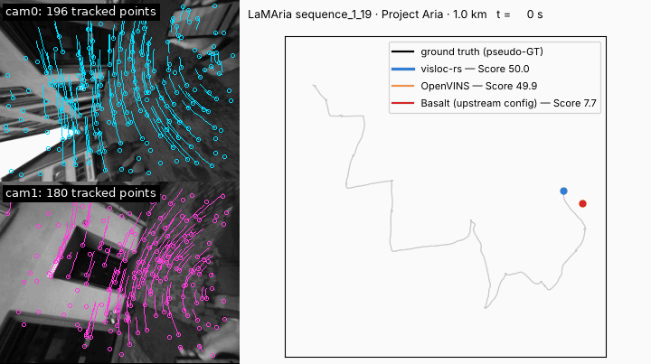
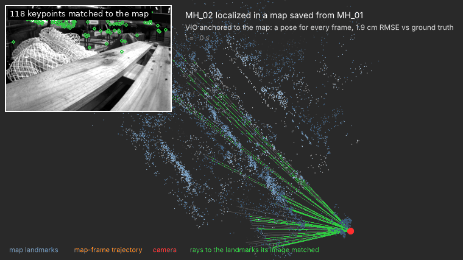
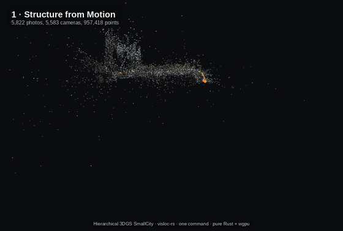
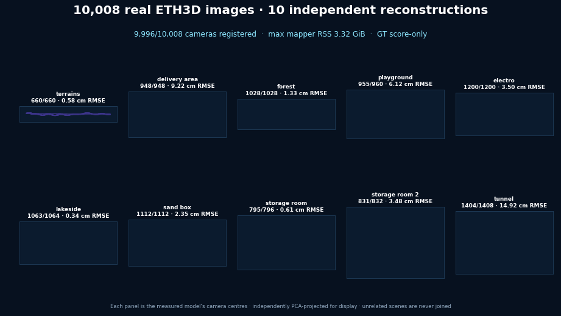
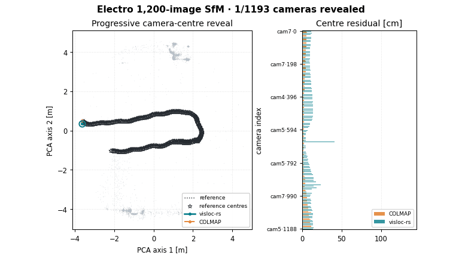
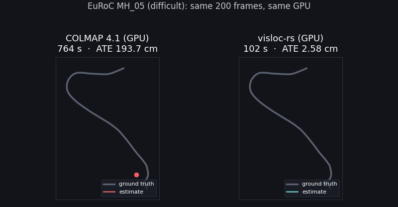
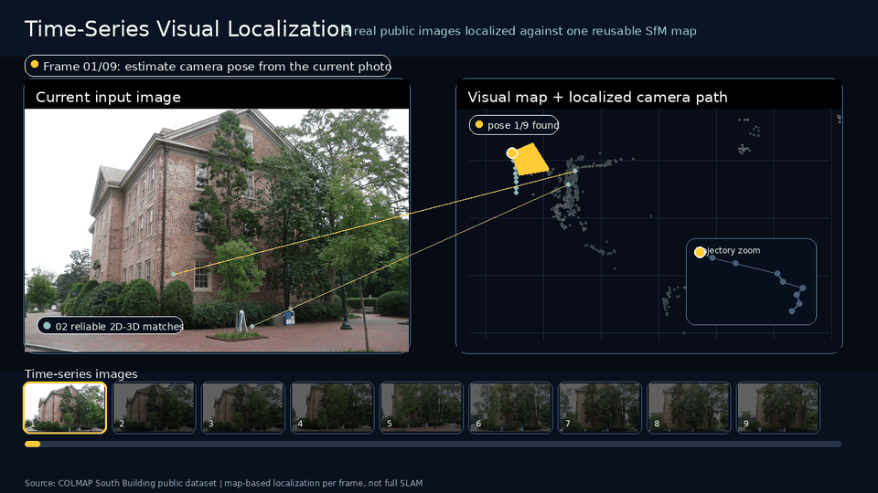

<h1 align="center">visloc-rs</h1>

<p align="center">
  <strong>Structure from Motion, visual-inertial SLAM, 3D Gaussian Splatting and map-based localization &mdash; in pure Rust.</strong>
</p>

<p align="center">
  <a href="https://github.com/rsasaki0109/visloc-rs/actions/workflows/ci.yml"></a>
  
  
  
</p>

<p align="center">
  <br>
  <sub>Visual-inertial odometry on <a href="https://lamaria.ethz.ch">LaMAria</a> sequence_1_19: Project Aria glasses, 1.0 km city walk, 15 min, both SLAM cameras + IMU, no loop closure. LaMAria Score (official evaluator, higher is better): <b>visloc-rs 50.0</b>, OpenVINS 49.9 (estimate shipped with the LaMAria demo), Basalt with its upstream configuration 7.7 (run through this repository's parity-verified Basalt port). Trajectories are Sim(3)-aligned to the pseudo ground truth as the evaluator does. <a href="docs/lamaria_multicam.md">Details and the other training sequences</a>.</sub>
</p>

<p align="center">
  <br>
  <sub>Map-based localization: EuRoC MH_02 in a map that the stereo-inertial SLAM saved from MH_01, a different flight. The map fixes correct the VIO into the map frame, so every frame gets a map pose (orange): <b>3,039 of the 3,040 frames, at 1.9 cm RMSE</b> against ground truth. Green: the keypoints that matched the map, searched around where the corrected VIO predicts each landmark (98% of the images match; 81% when each image is matched alone), and rays to those landmarks. The same runs in real time as ROS 2 nodes. <a href="docs/basalt_map_localization.md">Details and the other EuRoC queries</a>.</sub>
</p>

<p align="center">
  <br>
  <sub>5,822 photos of a city block &rarr; 5,583 camera poses &rarr; 4.7M-gaussian splat &rarr; 5.9M-triangle mesh in 2.5 h, one <code>gsplat_photos</code> command, no COLMAP or Python, orbited from high above where no input photo was taken. <a href="#photos-to-splat-and-mesh-3d-gaussian-splatting">Details</a>.</sub>
</p>

## In a nutshell

visloc-rs turns camera images (optionally with an IMU) into camera poses, 3D
maps and photorealistic scenes, and localizes new images against those maps.
Everything is Rust: no C++, OpenCV or CUDA toolchain to build. GPU work runs
on any GPU through wgpu. Models are read and written in COLMAP format, so
results plug into existing tools.

| What | Headline result (measured, real data) | vs |
| --- | --- | --- |
| **Photo SfM** (unordered images) | ETH3D Electro 1,200 images: **3.46× faster**, **25% lower** camera-centre error; 9,996 / 10,008 cameras registered across all ten ETH3D many-view scenes | COLMAP 3.9 CPU |
| **GPU SfM** (video frames) | EuRoC: **faster on 8/8** sequences (1.4–7.5×), **more accurate on 4/8**, equal on 1; COLMAP breaks on MH_05 (194 cm vs 2.6 cm) | COLMAP 4.1 CUDA |
| **Stereo-inertial VI-SLAM** (Basalt port + online mapper) | **Real time on 11/11** EuRoC sequences on the dev machine (1.06–1.68×, thin margin on the slowest); **beats ORB-SLAM3 on 9/11** | ORB-SLAM3, Basalt |
| **Egocentric VI-SLAM** (Project Aria, both SLAM cameras + IMU) | LaMAria, all 5 tracks: mean Score **64.3**, above GroundedSLAM (62.3); ahead on Short, Medium and Long, level on Low light, behind on Moving; causal and real time on 4 CPU cores (training sequences; the leaderboard's are test) | GroundedSLAM, Aria's SLAM |
| **Metric objects** (mono camera + IMU + a 2D detector) | KITTI raw, against the 3D boxes: car heights **11 %** off with mono + IMU (110 cars), **6 %** with stereo + IMU; pedestrians **7 cm** | KITTI tracklets |
| **Photos → 3D Gaussian Splatting + mesh** | **Faster than brush on 5/5** benchmark scenes, PSNR within 0.05 dB on 4 | brush 0.3 |
| **Localization against a prebuilt map** | OpenLORIS robot rig: **98.96%** of 1,250 held-out frames localized, median 2.9 mm; simulated house: 38 ms / frame | — |
| **Stereo / RGB-D VO** | KITTI 00 **1.23 m** and 09 **2.07 m** (ORB-SLAM2: 1.3 m / 3.2 m); TUM fr1_xyz 1.4 cm | ORB-SLAM2 |

**Where it still loses**, measured the same way: COLMAP CUDA is more
accurate on 3 of the 8 EuRoC sequences and registers more of the blurred
frames; ORB-SLAM3 wins 2 of 11 EuRoC sequences (MH_04, MH_05); on LaMAria,
Aria's own closed-source SLAM stays well ahead (75.9) and GroundedSLAM
leads the Moving-platform track; OpenLORIS
10k rig SfM is not yet at
COLMAP's RMSE. Every number above links to a benchmark doc with the
commands to reproduce it.

### Contents

- [Sensor support](#sensor-support)
- [Try it](#try-it)
- [Structure from Motion](#structure-from-motion) — ETH3D, EuRoC GPU SfM vs COLMAP CUDA
- [Photos to splat and mesh](#photos-to-splat-and-mesh-3d-gaussian-splatting)
- [Visual-inertial SLAM](#visual-inertial-slam-basalt-rust-port)
- [Localize against a map](#localize-against-a-map)
- [Use from Python and ROS 2](#use-from-python-and-ros-2)
- [More results](#more-results) — KITTI, TUM RGB-D, sequential SfM
- [Documentation](#documentation)

## Sensor support

What each sensor setup can do today. **Benchmarked** means a measured
real-data result is in the repo. **Experimental** means the code runs but
the docs record open gaps.

| Sensor setup | Tasks | Status | Headline result | Entry point |
| --- | --- | --- | --- | --- |
| Monocular, unordered photos | SfM, 3DGS, mesh | **Benchmarked** | ETH3D Electro 1,200: 3.46× faster than COLMAP CPU, 3.50 vs 4.68 cm | `unordered_sfm_demo`, `gsplat_photos` |
| Monocular video | SfM | **Benchmarked** | EuRoC: faster than COLMAP 4.1 CUDA on 8/8 sequences, more accurate on 4/8 | `gsplat_euroc` |
| Posed photos (a COLMAP sparse model) | Dense MVS | Experimental | ETH3D high-res training, 13 scenes at 3200 px on one L4: F1 83.7% at 2 cm in 74 min (ACMMP 83.42%), 4× faster than ACMMP's code on the same GPU; 81.5% end to end from the photos | `visloc-mvs` example `mvs` ([notes](docs/mvs.md)) |
| Monocular video | VO (DPVO port) | Experimental | MH_01 prefix 0.16 m, about 2× DPVO's published error; CPU only | `euroc_dpvo_vo_demo` |
| Monocular + IMU | VIO (Basalt port) | Experimental | TUM-VI room1–6: metric scale within 3.4% (median 1.3%), ATE 0.02–0.19 m, at most 0.014 m above stereo + IMU; no EuRoC result yet | `basalt_euroc_vio_demo --mono` ([notes](docs/mono_inertial_vio.md)) |
| Monocular + IMU, plus a 2D detector | Object height, distance and speed in metres | Experimental | KITTI raw, 5 drives: car heights 11 % off (median, 110 cars), distances 19 %; moving cars' speeds 2–3 m/s off | `objects_metric_offline` ([notes](docs/object_tracking.md)) |
| Stereo | VO / SLAM | **Benchmarked** | KITTI seq00 1.23 m and seq09 2.07 m, vs 1.3 m and 3.2 m for ORB-SLAM2 | `deep_stereo_slam`, `online_slam_stereo_vo_kitti_demo` |
| Stereo + IMU | VIO + mapping (Basalt port) | **Benchmarked** | Beats ORB-SLAM3 on 9/11 EuRoC sequences; native-Basalt parity within 0.1%; real time (RTF 1.06–1.68) on all 11/11 EuRoC sequences on the dev machine, thin margin on the slowest | `basalt_euroc_online_slam_demo` |
| RGB-D (as virtual stereo) | VO | **Benchmarked** | TUM fr1_xyz 0.014 m, fr1_desk 0.026 m (about 1.3–1.6× ORB-SLAM2 RGB-D) | [TUM RGB-D](docs/tum_rgbd_benchmark.md) |
| Multi-camera rig | SfM | Experimental | OpenLORIS 10k: 9,998/10,000 registered; RMSE parity with COLMAP still open | `generalized_rig_sfm` |
| Robot rig cameras vs. a prebuilt map | Relocalization | **Benchmarked** | OpenLORIS (robot-mounted rig): 98.96% of 1,250 held-out frames localized against a map built from other frames, median 2.9 mm | `localize_openloris_map` |
| Wheeled robot: stereo + IMU (RealSense T265), wheel odometry | Localization in a saved SLAM map, odometry corrected into its frame | **Benchmarked** | OpenLORIS-Scene office, other sessions up to 2.8 days later with furniture moved: VIO + map gives 94–99.8% of frames a map pose at 2.8–7.6 cm, and 1.1–2.4 cm with the stereo baseline corrected from the wheel odometry; wheel odometry + map 3.5–5.1 cm with its reference point and level calibrated from the VIO, and the same through the ROS 2 nodes from a rosbag2; across the day/night lighting change only with local contrast equalization (daylight session: 33% of frames at 2.6 cm; dawn session: none) | `scripts/openloris_to_euroc.py`, `basalt_euroc_localize_demo --vio` or `--odometry` ([notes](docs/openloris_map_localization.md)) |
| Robot camera sequence vs. a prebuilt map | Sequential map-matching localization | **Benchmarked** (simulation) | RNE house (drjohnson): 387/400 frames at 5.6 cm ATE, 38 ms per frame (median) with `--gpu --motion-model`. RNE checker corridor: 203/400 at 1.57 m, limited by repetitive texture | `localize_rne_map_sequence` |
| Camera + GNSS prior | Tracking | Example only | Synthetic smoke test; no tight GNSS fusion | `track_sequence_with_gnss_prior` |
| VO + GNSS positions | Joint pose-graph fusion | Experimental (synthetic) | ~1 km synthetic loop: ATE 5.25 m (VO only) → 0.90 m fused; multipath jumps rejected, 15 s dropout bridged. Loosely coupled (receiver ENU positions; no raw pseudoranges, no IMU) | `gnss_vo_fusion_demo` ([notes](docs/gnss_fusion.md)) |

LiDAR is not supported. Wheel odometry is supported only as the odometry
that map fixes correct into a map's frame (above); it is not fused into the
VIO.

## Try it

Requires Rust 1.88+ only. Datasets are external inputs and are not bundled.

```bash
# Photos -> camera poses, Gaussian splat and mesh (GPU via wgpu)
cargo run --release -p visloc-gsplat-train --features gpu,euroc --example gsplat_photos --   --images /path/to/my_photos --out runs/my-scene

# Stereo-inertial VI-SLAM on a EuRoC sequence
cargo run --release --example basalt_euroc_online_slam_demo --features basalt-lm-workspace-reuse --   --euroc-dir /path/to/MH_01_easy   --calibration configs/basalt/variants/official_euroc_ds/euroc_ds_calib.json   --config configs/basalt/variants/official_euroc_ds/euroc_config.json   --out-dir target/basalt_mh01_online

# Smallest end-to-end check: localize a synthetic query, no data needed
cargo run --example localize_dummy
```

Full options for each are in the sections below; `scripts/check.sh` runs the
complete local quality gate (`fmt`, `clippy`, `test`, `doc`).

**Prebuilt binaries:** each [release](https://github.com/rsasaki0109/visloc-rs/releases)
attaches `gsplat_photos`, `visloc_mvs`, `colmap_incremental_mapper` and
`visloc_web` for Linux x86_64, Windows x86_64 and macOS (Apple silicon), so
the photo pipeline runs without a Rust toolchain.

## Structure from Motion

visloc-rs registers **9,996/10,008 cameras (99.88%)** across every ETH3D
low-resolution many-view scene with no mapper run above 3.32 GiB, reconstructs
the 1,200-image Electro set **3.46× faster than COLMAP** with **25.2% lower**
camera-centre RMSE, and beats official COLMAP on the 38-image courtyard control
(**0.5379 cm vs 1.6166 cm**).

<p align="center">
  
</p>

| Real scene (ETH3D low-res many-view) | Registered / supplied | Centre RMSE | RMSE / extent | Mapper peak RSS |
| --- | ---: | ---: | ---: | ---: |
| terrains | **660/660** | 0.58 cm | 0.12% | 1.56 GiB |
| delivery area | **948/948** | 9.22 cm | 0.99% | 2.31 GiB |
| forest | **1028/1028** | 1.33 cm | 0.19% | 2.65 GiB |
| playground | **955/960** | 6.12 cm | 2.52% | 2.44 GiB |
| electro | **1200/1200** | 3.50 cm | 0.55% | 1.39 GiB |
| lakeside | **1063/1064** | 0.34 cm | 0.08% | 3.19 GiB |
| sand box | **1112/1112** | 2.35 cm | 0.45% | **3.32 GiB** |
| storage room | **795/796** | 0.61 cm | 0.42% | 1.71 GiB |
| storage room 2 | **831/832** | 3.48 cm | 2.57% | 1.00 GiB |
| tunnel | **1404/1408** | 14.92 cm | 1.61% | 3.25 GiB |

<p align="center"><sub>tunnel includes one 5.32 m outlier (median 2.47 cm, p95 9.41 cm); playground excludes five hash-audited source outliers. The connected 10k corridor stress run, the 300-image reliability gate, the OpenLORIS comparison, and all reproduction commands are in the <a href="docs/sfm_benchmarks.md">SfM benchmark details</a>.</sub></p>

<p align="center">
  
</p>

<p align="center"><sub>Same-input CPU8 Electro 1,200: visloc-rs <b>3.46× faster</b> and <b>25.2% lower</b> camera-centre RMSE than COLMAP. Unordered SfM, sequential SfM vs COLMAP, and EuRoC reconstruction evidence are in the <a href="docs/unordered_sfm_benchmark.md">SfM benchmark docs</a>.</sub></p>

### Against COLMAP 4.2 and GLOMAP on the same inputs

On the 13 ETH3D DSLR training scenes, the visloc-rs mapper is on par with
COLMAP 4.2's incremental mapper and its global mapper (GLOMAP), and maps
about 7× faster. All three get the same COLMAP SIFT features and exhaustive
matches, the GLOMAP paper's setup, and the scoring follows that paper:

| Mapper (pycolmap 4.2.1, 4 threads) | Mean AUC@1° / 3° / 5° | Registered | Mapper time |
| --- | ---: | ---: | ---: |
| visloc-rs | 50.9 / 75.5 / 82.1 | 445 / 454 | **28.4 s** |
| COLMAP incremental | 50.4 / 75.2 / 81.7 | 445 / 454 | 200.7 s |
| COLMAP global (GLOMAP) | 51.6 / 75.5 / 81.7 | 454 / 454 | 184.4 s |

On visloc-rs's own matches (GPU SIFT, the default) it leads both at every
threshold: 53.1 / 78.9 / 85.7. On the 5,822 SmallCity photos, visloc-rs maps
in 21.7 min; COLMAP's global mapper had not finished after 94 min. Per-scene
tables, timings and caveats: [ETH3D AUC benchmark](docs/eth3d_auc_benchmark.md).

### Large connected collections

On the connected OpenLORIS 10k stress set, streamed VLAD + LSH cuts candidate
generation from 49:49 to **8:51 (5.63×)**; **RMSE parity with COLMAP is still
open** (0.3890 m vs 0.3843 m). Full tables and caveats:
[SfM benchmark details](docs/sfm_benchmarks.md).

### GPU SfM vs COLMAP (CUDA) on EuRoC

Same 200 undistorted frames per sequence, same fixed intrinsics, same
GPU, run back to back. visloc-rs uses GPU SIFT, batched GPU
matching and the COLMAP incremental-mapper port. COLMAP 4.1 uses GPU
extraction, GPU sequential matching and its default mapper. ATE is the
Sim(3) camera-centre RMSE against ground truth.

| Sequence | Time (visloc-rs / COLMAP) | ATE (visloc-rs / COLMAP) | Registered (visloc-rs / COLMAP) |
| --- | ---: | ---: | ---: |
| MH_01_easy | **96 s** / 634 s | 0.35 / 0.35 cm | 182 / **200** |
| MH_03_medium | **113 s** / 340 s | **1.32** / 2.61 cm | 166 / **200** |
| MH_05_difficult | **102 s** / 764 s | **2.58** / 193.66 cm | 194 / **200** |
| V1_01_easy | **104 s** / 219 s | **2.40** / 2.75 cm | 199 / **200** |
| V1_02_medium | **55 s** / 101 s | **1.76** / 1.83 cm | 198 / **200** |
| V2_01_easy | **81 s** / 172 s | 3.30 / **1.00** cm | 199 / **200** |
| V1_03_difficult | **45 s** / 93 s | 2.17 / **1.98** cm | 67 / **80** |
| V2_03_difficult | **42 s** / 60 s | 3.37 / **2.85** cm | 118 / **180** |

visloc-rs is faster on all 8 sequences (1.4–7.5×). It is more accurate
on 4 and equal on MH_01. COLMAP is more accurate on V2_01, V1_03 and V2_03,
and it registers more frames, most visibly on the blurred V1_03 and V2_03.

COLMAP's results vary between runs: an earlier run gave V2_01 34.9 cm, and
MH_05 failed in both runs. visloc-rs is deterministic.

<p align="center">
  
</p>
<p align="center"><sub>EuRoC MH_05, same 200 frames, same GPU. COLMAP breaks (ATE 193.7 cm, 764 s), visloc-rs stays at <b>2.58 cm</b> in <b>102 s</b>. The visloc-rs poses then train a 3D Gaussian Splatting scene: raw frames to splat in pure Rust + wgpu, no COLMAP. <a href="scripts/make_euroc_vs_colmap_gif.py">Script</a>.</sub></p>

Configuration, caveats, the ablation and the command that reproduces the
table: [EuRoC GPU SfM vs COLMAP](docs/euroc_gpu_sfm_vs_colmap.md).

### Run the SfM demo

Reconstruct an unordered photo set in one command — SIFT features estimated
in-process, COLMAP text model (`cameras.txt`, `images.txt`, `points3D.txt`)
written to `--out-colmap`:

```bash
cargo run --release --example unordered_sfm_demo --features image-io -- \
  --feature-extractor sift \
  --images-dir /path/to/my_photos \
  --width 1920 --height 1080 --fx 1400 --fy 1400 --cx 960 --cy 540 \
  --sift-max-keypoints 4096 \
  --retrieval-topk 12 --min-matches 30 --match-ratio 0.8 \
  --verification-mode full --mapper incremental \
  --next-image-policy auto --post-refinement-registration \
  --final-iterative-refinement \
  --out-colmap /path/to/runs/my-photos-sfm
```

Pass a validated per-image calibration with `--input-colmap-calibration` instead
of the scalar intrinsics. The complete option set, the courtyard control
commands, and the connected-component export mode are in the
[SfM benchmark details](docs/sfm_benchmarks.md#run-the-sfm-demo).

## Photos to splat and mesh (3D Gaussian Splatting)

A folder of photos becomes a trained 3D Gaussian Splatting scene and a
coloured mesh in one command, in Rust + wgpu with no COLMAP or Python:

```bash
cargo run --release -p visloc-gsplat-train --features gpu,euroc --example gsplat_photos -- \
  --images /path/to/my_photos --out /path/to/runs/my-scene
```

<p align="center">
  
</p>

<p align="center"><sub>COLMAP's south-building, 128 raw JPGs: each photo next to the trained splat and the mesh rendered from its recovered pose. Every image registered, held-out PSNR 22.77, 37 min end to end.</sub></p>

The pipeline runs SfM (EXIF focal, GPU SIFT and matching, the COLMAP-port
mapper, intrinsics refined by the final bundle adjustment; a COLMAP model is
written to `sparse/0`), trains with brush's refine strategy on hand-written
wgpu passes (faster than brush 0.3 on 5/5 benchmark scenes), and fuses a
mesh from median depths. `--equirect` takes 360° panoramas, and `visloc_web`
runs the same pipeline from a browser. Stages, the hero runs, 360° cameras,
the web UI and the reproduction commands:
[photos to splat and mesh](docs/photos_to_splat.md).

## Visual-Inertial SLAM (Basalt Rust port)

A faithful Rust port of upstream
[Basalt](https://github.com/VladyslavUsenko/basalt) commit `0f3b2b52` — a
tightly-coupled stereo-inertial VIO estimator plus a keyframe/loop-closure
mapper — in [`pipelines/basalt`](pipelines/basalt). On upstream Basalt's own
inputs it matches native Basalt's ATE to **within 0.1%** on all 11 EuRoC
sequences. With EuRoC's official calibration, the mapper runs **online**
beside the VIO, beats measured ORB-SLAM3 (full-trajectory SE(3) ATE) on
**9 of 11** EuRoC sequences, and runs in **real time on all 11** on the
development machine (RTF 1.06–1.68; the slowest have little headroom).

<p align="center">
  <br>
  <sub>Six of the eight winning EuRoC sequences: visloc-rs online VI-SLAM (blue) vs measured ORB-SLAM3 (red), both SE(3)-aligned to ground truth (black).</sub>
</p>

| Sequence | visloc-rs (online VI-SLAM) | ORB-SLAM3 stereo-inertial | Winner |
| --- | ---: | ---: | :---: |
| MH_01_easy | 0.016 | 0.036 | visloc-rs |
| MH_02_easy | 0.025 | 0.033 | visloc-rs |
| MH_03_medium | 0.026 | 0.028 | visloc-rs |
| MH_04_difficult | 0.070 | 0.043 | ORB-SLAM3 |
| MH_05_difficult | 0.063 | 0.055 | ORB-SLAM3 |
| V1_01_easy | 0.036 | 0.038 | visloc-rs |
| V1_02_medium | 0.014 | 0.017 | visloc-rs |
| V1_03_difficult | 0.021 | 0.029 | visloc-rs |
| V2_01_easy | 0.017 | 0.039 | visloc-rs |
| V2_02_medium | 0.012 | 0.014 | visloc-rs |
| V2_03_difficult | 0.045 | 0.056 | visloc-rs |

<p align="center">
  
</p>

<p align="center"><sub>9/11 wins; full-trajectory ATE translation RMSE in metres, lower is better. MH_04 and MH_05 remain the two losses (VIO tracking robustness on fast, blurred motion). Per-sequence RTF, lag and memory, the speed changes and the parity evidence: <a href="docs/vi_slam_benchmarks.md">VI-SLAM benchmark details</a>.</sub></p>

### Project Aria glasses (LaMAria)

On [LaMAria](https://lamaria.ethz.ch) (Project Aria glasses on city walks:
Short, Medium, Long, Low light and Moving-platform tracks), the Basalt port's
VIO runs on both SLAM cameras and the IMU, and a visual-inertial bundle
adjustment ([`scripts/lamaria_batch_ba.py`](scripts/lamaria_batch_ba.py))
runs behind it: SIFT keyframes at 2 Hz, matches guided by the VIO, revisits,
and the last 240 s solved again every 30 s, with the gyro bias free to move
in the first minutes while the device warms up (by day). Cameras and IMU
only: no GPS, no magnetometer. The chain is causal and keeps up with the
recording on 4 CPU cores (about 4 CPU seconds per second of recording); one
batch pass after the recording, its gyro bias free to drift slowly, adds the
revisits over the whole sequence. Score per track
(official evaluator, higher is better):

| Method | Sequences | Short | Medium | Long | Low light | Moving | Mean |
| --- | --- | ---: | ---: | ---: | ---: | ---: | ---: |
| Aria's SLAM (closed source) | test | 90.7 | 78.5 | 70.9 | 84.2 | 55.0 | 75.9 |
| GroundedSLAM | test | 80.2 | 61.6 | 59.9 | 67.7 | 41.9 | 62.3 |
| **visloc-rs**, online + one pass after the recording¹ | training | 83.8 | 69.8 | 67.4 | 67.6 | 33.1 | 64.3 |
| **visloc-rs**, online (causal, real time) | training | 79.7 | 67.2 | 63.3 | 67.6 | 32.1 | 62.0 |
| OpenVINS + Maplab | test | 27.7 | 23.4 | 12.8 | 19.8 | 13.9 | 19.5 |

<sub>Leaderboard rows as shown on 2026-10-17 (test set). The visloc-rs rows
are the ten training sequences, two per track, scored locally with the
official evaluator: not a submission, so the comparison is indicative.
¹ Low light keeps the online result, and runs without the warm-up, which
lowers it there. Above GroundedSLAM on the mean: ahead on Short, Medium and
Long, level on Low light, behind on Moving (sequence_5_12's tram ride, which
the solve halves: 7.4). Per sequence:
[the real-time chain](docs/lamaria_batch_ba.md#the-first-minutes-online);
the leaderboard and the steps that led here: [LaMAria plan](docs/lamaria_plan.md).</sub>

### Objects in metres (mono + IMU)

A 2D detector (YOLOX through ONNX Runtime) and a ByteTrack-style tracker
give each object a track of boxes. The mono-inertial VIO gives metric camera
poses and gravity. An object on the ground is placed where the bottom of its
box meets the ground, found from the triangulated points under the camera's
path. That gives its height, its distance and, from the foot's path, its
speed. On KITTI raw, against the tracklets (median errors):

| Poses | Cars: height | Cars: distance | Pedestrians: height |
| --- | --- | --- | --- |
| Mono + IMU (110 cars, 5 drives) | 0.16 m, 11 % | 19 % | – ¹ |
| Stereo + IMU (111 cars, 18 pedestrians) | 0.09 m, 6 % | 12 % | 0.07 m, 4 % |

<sub>¹ The pedestrians are on 0091, which starts moving; the mono-inertial VIO
must start at rest.</sub>

`scripts/run_kitti_objects_eval.sh` runs a drive end to end, and
`scripts/render_objects_gif.py` draws a GIF of a drive. The method,
results on LaMAria and TUM-VI, and what still fails:
[object tracking](docs/object_tracking.md).

### Run the VI-SLAM demo

Replay a EuRoC sequence through the online VIO + mapper (the calibration and
config are in the repo; `--euroc-dir` is an external dataset):

```bash
RUSTFLAGS="-C target-feature=+avx2,+fma" \
  cargo run --profile release-rt --example basalt_euroc_online_slam_demo \
  --features basalt-lm-workspace-reuse,mimalloc-global -- \
  --euroc-dir /path/to/MH_01_easy \
  --calibration configs/basalt/variants/official_euroc_ds/euroc_ds_calib.json \
  --config configs/basalt/variants/official_euroc_ds/euroc_config.json \
  --out-dir target/basalt_mh01_online
```

It writes `trajectory_online.tum` (what the table above scores),
`trajectory_online_kf.tum` and `timing_breakdown_online.json`. The
`release-rt` profile and `mimalloc` give the real-time numbers; a plain
`--release` build is correct, just slower. The offline VIO + batch-mapper
commands and `--pipeline` / `--threads` are in the
[VI-SLAM benchmark details](docs/vi_slam_benchmarks.md#run-it).

## Localize against a map

Load a real COLMAP model and localize a query photo against it. Fetch COLMAP's
south-building dataset once (about 100 MB):

```bash
mkdir -p ~/datasets/south-building && cd ~/datasets/south-building && \
  curl -L -o south-building.zip \
    https://github.com/colmap/colmap/releases/download/3.11.1/south-building.zip && \
  unzip south-building.zip
```

Then, from the repository root:

```bash
cargo run --release --features image-io --example deep_localization_demo -- \
  --root ~/datasets/south-building/south-building \
  --map-image P1180141.JPG --query-image P1180155.JPG
```

<p align="center">
  <br>
  <sub>Public-data localization: real query photos localized frame by frame against the same reusable sparse visual map (COLMAP South Building). Details: <a href="docs/public_data_demo.md">public COLMAP map-reuse demo</a>.</sub>
</p>

| First run | Command | What it shows |
| --- | --- | --- |
| Synthetic localization | `cargo run --example localize_dummy` | Smallest end-to-end: one query, one landmark, PnP RANSAC estimate |
| Map-reuse localization | `cargo run --release --features image-io --example deep_localization_demo -- --root <south-building> --map-image P1180141.JPG --query-image P1180155.JPG` | A real query photo localized against a COLMAP model, classical vs deep frontend |
| Sequence tracking | `cargo run --features image-io --example track_image_sequence_from_common_images` | Moving-camera tracking smoke with per-frame pose continuity |
| KITTI revisit scanner | `python scripts/run_kitti_deep_vo_revisit_smoke.py` | Public KITTI 00 revisit smoke (downloads start/revisit slices) |
| Full local quality gate | `scripts/check.sh` | `fmt` + `clippy` + `test` + `doc` in one command |

### Save a VI-SLAM map and localize against it

The stereo-inertial SLAM demo can save its final map, and a second sequence of
the same place can then be localized against it, image by image, without
running SLAM again:

```bash
# 1. Map MH_01 and save the map (COLMAP text model + ORB descriptors)
cargo run --release --example basalt_euroc_online_slam_demo -- \
  --euroc-dir /path/to/MH_01_easy \
  --calibration configs/basalt/variants/official_euroc_ds/euroc_ds_calib.json \
  --config configs/basalt/variants/official_euroc_ds/euroc_config.json \
  --out-dir target/mh01_slam --save-map target/mh01_map

# 2. Localize MH_02's cam0 images against it
cargo run --release --example basalt_euroc_localize_demo -- \
  --map target/mh01_map --euroc-dir /path/to/MH_02_easy --out-dir target/mh02_on_mh01
```

`target/mh01_map/sparse` is an ordinary COLMAP model (the Double Sphere
cameras are saved as fitted `OPENCV_FISHEYE`). `localization.tum` holds IMU
poses in the map's frame, the convention of the SLAM demo's trajectories.
Against an MH_01 map, MH_02 (a different flight) localizes 81.2% of its
images at 1.8 cm RMSE against ground truth. Over eight cross-session EuRoC
queries no accepted pose is more than 25 cm off; how many images localize
depends on how much of the flight the map covers. Add `--vio --calibration
FILE --config FILE` to run the stereo-inertial VIO alongside and correct it
into the map frame: every frame then gets a map pose (MH_02: 99.8% at 2.0 cm RMSE,
localizing every 5th image). Each image is then matched around where the
corrected VIO predicts the landmarks, so 98% of MH_02's images match the map
instead of 81%, in half the time. On a real wheeled
robot (OpenLORIS-Scene, a RealSense T265), sessions days apart in a
rearranged office localize the same way, and `--odometry FILE` corrects the
robot's wheel odometry instead of the VIO; see
[the OpenLORIS results](docs/openloris_map_localization.md). Maps of several flights of a place merge into
one with `basalt_map_merge --base A --add B --out AB`: against MH_01 merged
with MH_05's map, MH_04 localizes 55.8% of its images instead of 4.6%. See
the [EuRoC map-localization results](docs/basalt_map_localization.md).

More runnable demos and the full index are in the
[demo strategy](docs/demo_strategy.md) and the
[archived README details](docs/readme_details.md#demos).

## Use from Python and ROS 2

### Python

[`bindings/python`](bindings/python/README.md) builds a `visloc` Python package
with pyo3 + maturin: cameras (COLMAP models), SE(3) poses, COLMAP text/binary
read/write as NumPy arrays, PnP + RANSAC localization, and ATE / RPE
trajectory evaluation.

```bash
cd bindings/python && pip install maturin numpy && maturin develop --release
python -c "import visloc; print(visloc.Camera('PINHOLE', 640, 480, [500, 500, 320, 240]))"
```

### ROS 2

[`ros2/visloc-ros2`](ros2/visloc-ros2/README.md) has three ROS 2 nodes built on
the pure-Rust `ros2-client` (RustDDS), so building them needs no ROS install:

- `visloc_vio_node` runs the Basalt stereo-inertial VIO on two
  `sensor_msgs/Image` topics plus `sensor_msgs/Imu`, and publishes
  `nav_msgs/Odometry`, `geometry_msgs/PoseStamped`, `nav_msgs/Path` and `/tf`.
- `visloc_localize_node` localizes `sensor_msgs/Image` frames against a COLMAP
  map and publishes `PoseWithCovarianceStamped`, an inlier count and
  diagnostics.
- `visloc_map_localize_node` localizes a robot in a map saved by the
  stereo-inertial SLAM (`--save-map`): next to `visloc_vio_node` it publishes
  `/tf` `map -> odom` and the body pose in the map. EuRoC MH_02 replayed over
  DDS against an MH_01 map: a map pose for 99.8% of frames at 2.2 cm RMSE.

```bash
cd ros2/visloc-ros2 && cargo build --release
./target/release/visloc_vio_node --calibration <basalt_calib.json> --config <basalt_config.json> \
  --remap left/image_raw=/cam0/image_raw --remap right/image_raw=/cam1/image_raw --remap imu=/imu0
```

The nodes are tested over DDS (RustDDS to RustDDS) but not yet against a ROS 2
install; see the crate README for topics, parameters, QoS notes and limits.

## More results

Local public-data development measurements, not official leaderboard submissions.
The headline snapshot is registry-backed by
[`benchmarks/registry/readme_claims_v1.json`](benchmarks/registry/readme_claims_v1.json);
see the [registered run evidence](docs/generated/registered_runs.md) and
[scoped claim matrix](docs/generated/benchmark_claim_matrix.md).

- **KITTI multi-sequence** — one config over 00/02/05/06/07/09: seq00 **1.23 m** and seq09 **2.07 m**, against ORB-SLAM2's published 1.3 m and 3.2 m ([details](docs/kitti_multiseq_benchmark.md)).
- **EuRoC MH_03 / MH_05 stereo loop closure + BA** — **0.057 m / 0.072 m** ATE; behind ORB-SLAM3 (~2.4× / ~1.4×), near OV2SLAM.
- **TUM RGB-D fr1_xyz / fr1_desk** via virtual stereo — **0.014 m / 0.026 m** ATE ([details](docs/tum_rgbd_benchmark.md)).
- **Sequential SfM vs COLMAP** on a 2,700-frame EuRoC flight — stereo VO + loop SfM **6 min, 0.13 m, metric** against COLMAP mono incremental **11.7 h, 2.18 m, scale-free** ([details](docs/sfm_vs_colmap_benchmark.md)).
- **Unordered SfM (real photo collections)** — orderless photos -> VLAD view graph -> incremental reconstruction, vs **COLMAP's own model**: South Building **128/128, 1.09 cm**; Gerrard Hall **98/100, 0.68 cm** (both 0.1% of extent).

## Documentation

The [detailed README material](docs/readme_details.md) preserves the project
boundaries, feature overview, full demos table, minimal Rust example, repository
layout, roadmap, further-reading index, and complete benchmark snapshot that
previously lived here.

- **Choose and run a demo:** [demo index](docs/demo_strategy.md), [public COLMAP map-reuse demo](docs/public_data_demo.md), [GNSS-prior tracking](docs/gnss_demo.md), and [interactive KITTI trajectory viewer](https://rsasaki0109.github.io/visloc-rs/kitti3d/).
- **Understand supported configurations:** [feature matrix](docs/feature_matrix.md), [API stability](docs/api_stability.md), [COLMAP compatibility](docs/colmap_compatibility.md), and [migration notes](docs/migration.md).
- **Inspect VO and loop-closure evidence:** [KITTI multi-sequence](docs/kitti_multiseq_benchmark.md), [KITTI loop closure](docs/kitti_loop_closure_benchmark.md), [EuRoC loop closure](docs/euroc_loop_closure_benchmark.md), [TUM RGB-D](docs/tum_rgbd_benchmark.md), and [tracking persistence](docs/tracking_persistence_benchmark.md).
- **Inspect VI-SLAM (Basalt Rust port) evidence:** [VI-SLAM benchmark details](docs/vi_slam_benchmarks.md), [localizing against a saved map](docs/basalt_map_localization.md), [faithful-port final closure report](work/m11_basalt_faithful_port_final_closure_20260914.md), and [upstream oracle / provenance](benchmarks/basalt/README.md).
- **Where VI-SLAM goes next:** [global-consistency plan](docs/vi_slam_global_consistency_plan.md) — same-protocol ORB-SLAM3 measurements, the 9/11 official-calibration + mapper result (now online and real time on 11/11, §1.5-1.6) and its scale-bias root cause, the paused persistent-map prototype, and the staged plan targeting VIO tracking robustness on the two remaining losses (MH_04, MH_05).
- **Inspect SfM evidence:** [SfM benchmark details](docs/sfm_benchmarks.md), [EuRoC reconstruction](docs/euroc_sfm_benchmark.md), [sequential SfM vs COLMAP](docs/sfm_vs_colmap_benchmark.md), [unordered SfM](docs/unordered_sfm_benchmark.md), and [registry evidence for the head-to-head](docs/generated/sfm_vs_colmap_headtohead.md).
- **Inspect learned frontend evidence:** [SuperPoint ONNX/CUDA](docs/superpoint_onnx_cuda_benchmark.md), [LightGlue ONNX](docs/lightglue_onnx_benchmark.md), and [single-binary deep stereo SLAM](docs/inprocess_slam_benchmark.md).
- **Inspect mapping and optimization evidence:** [learned retrieval for relocalization](docs/learned_retrieval_relocalization.md), [multi-session lifelong mapping](docs/multi_session_lifelong_benchmark.md), and [pose-graph / BA internals with GTSAM parity](docs/pgo_internals.md).
- **Follow the project:** [roadmap](docs/roadmap.md), [contributing](CONTRIBUTING.md), [security](SECURITY.md), and [changelog](CHANGELOG.md).

## License

Licensed under either of [Apache License, Version 2.0](LICENSE-APACHE) or
[MIT license](LICENSE-MIT), at your option.
