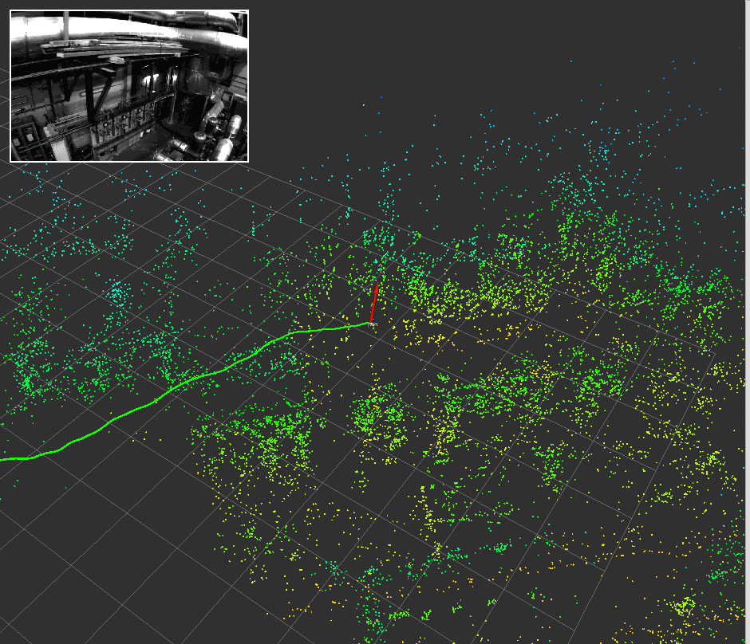

# Localizing against a saved VI-SLAM map (EuRoC)

`basalt_euroc_online_slam_demo --save-map` saves the stereo-inertial SLAM's
final map; `basalt_euroc_localize_demo` then localizes each cam0 image of a
sequence against it (mapper ORB frontend, Hamming matching, P3P RANSAC, a pose
accepted with at least `--min-inliers` inliers, default 30). This page
measures that path on all of EuRoC: one map per environment (MH_01, V1_01,
V2_01), queried with the other eight sequences of the same environment.

**Headline.** With the default threshold of 30 inliers, no accepted pose in
any of the eight query sequences is more than 25 cm off; across all of them
0.3% are more than 10 cm off. MH_02 against the MH_01 map localizes **81.2%**
of its images at **1.8 cm** RMSE against ground truth. How many images
localize is set mostly by how much of the query flight the map covers: from
81% (MH_02) down to under 10% for flights through parts of the room the map
never saw. MH_01 against its own map localizes 98.4% and agrees with the SLAM
trajectory to 2.4 mm (median).

**With VIO** (`--vio`, [below](#anchoring-the-vio-to-the-map)), every
frame gets a map pose once two fixes agree: MH_02 99.8% of frames at 2.0 cm
RMSE (5.7 cm worst) localizing only every 5th image, at 0.83× real time on 4
cores. Between rare fixes the VIO drifts; each pose comes with the time and
distance since its last fix, and the poses within 2 m and 5 s of one are never
more than 13 cm off on any sequence. Matching each image around the
landmarks' projections from the anchored VIO's prediction
(`--projection-radius-px 20`, [below](#matching-around-the-predicted-projections))
makes the fixes far more frequent: 98% of MH_02's images match the map
instead of 81%, and the longest stretch without a match falls from 7.3 s to
1.2 s.

## Setup

- **Data.** EuRoC ASL format. ETH's Research Collection rate-limited this
  machine, so the sequences were read from the Hugging Face copy
  `GlowBond/EuRoC_MAV_Dataset`; only the nested sequence zips were fetched
  (HTTP range requests) and `unzip -t` passed on every one.
  - Machine Hall: the copy's `machine_hall.zip` has the official archive's
    SHA-256 `5ed7d079…de0f6f` (see
    [nonregression_20260830.md](nonregression_20260830.md)).
  - Vicon rooms: no official hash is on record. The nested `V1_01_easy.zip`
    inflated from the copy's `vicon_room1.zip` has the same SHA-256
    (`a920fe5b…ba45fa`) as the separately uploaded
    `pepijn223/euroc-mirror`.
- **Code.** `main` at `1d655cd`, release build. Maps: README configuration
  (`configs/basalt/variants/official_euroc_ds/`), default online-mapper
  settings.
- **Machine.** 4-core Intel Xeon @ 2.10 GHz, 15 GB RAM.
- **Scoring.** Every pose is an IMU pose; translation is compared with ground
  truth. The map→ground-truth transform is fitted once, on the map's own SLAM
  trajectory against its ground truth, and applied unchanged to the
  localizations (`--mode fixed`): nothing is fitted to the scored poses.
  Rotation against ground truth is not used: the SLAM trajectories
  themselves differ from the ground-truth orientation by a median 0.9°
  (MH_01) and 5.5° (V1_01) after alignment, so it measures the reference,
  not the localizer.

## Maps

| Map | Keyframes / images | Landmarks | On disk | SLAM ATE (RMSE) | SLAM time |
|---|---|---|---|---|---|
| MH_01 | 566 / 1,132 | 15,483 | 20 MB | 1.51 cm | 310 s (0.84× real time) |
| V1_01 | 416 / 832 | 14,053 | 15 MB | 3.54 cm | 169 s (1.07×) |
| V2_01 | 343 / 686 | 8,242 | 9.3 MB | 1.54 cm | 124 s (1.07×) |

The cameras are saved as COLMAP `OPENCV_FISHEYE` fitted to the Double Sphere
calibration, at most 0.0003 px off over the 57° half field of view.

## Results (default `--min-inliers 30`)

| Query → map | Localized | RMSE / median / max | Query flight within 0.5 m of a map viewpoint | Latency (median) |
|---|---|---|---|---|
| MH_01 → MH_01 (same flight) | 98.4% of 3,682 | 1.56 / 1.21 / 7.2 cm | — | 77 ms |
| MH_02 → MH_01 | **81.2%** of 3,040 | 1.83 / 1.19 / 16.8 cm | 66% | 75 ms |
| MH_03 → MH_01 | 47.4% of 2,700 | 1.98 / 1.23 / 10.3 cm | 33% | 73 ms |
| MH_04 → MH_01 | 4.6% of 2,033 | 4.51 / 3.12 / 11.9 cm | 0.1% | 69 ms |
| MH_05 → MH_01 | 7.8% of 2,273 | 5.12 / 4.78 / 17.1 cm | 0.1% | 67 ms |
| V1_02 → V1_01 | 28.5% of 1,710 | 2.84 / 2.47 / 6.9 cm | 48% | 62 ms |
| V1_03 → V1_01 | 10.9% of 2,149 | 4.02 / 2.30 / 21.4 cm | 39% | 62 ms |
| V2_02 → V2_01 | 20.3% of 2,348 | 2.14 / 1.57 / 9.0 cm | 36% | 48 ms |
| V2_03 → V2_01 | 0.4% of 1,922 | 3.96 / 2.55 / 7.5 cm | 30% | 43 ms |

MH_01 against its own map agrees with the SLAM trajectory to 0.58 cm RMSE
(2.4 mm median) without any alignment; its 1.56 cm against ground truth is
the map's own accuracy. Latency includes ORB extraction and global matching
against every landmark of the map, so it scales with the map size.

**Coverage.** "Within 0.5 m of a map viewpoint" is the share of the query's
ground-truth poses that have a map-flight pose within 0.5 m looking the same
way (camera axes within 30°). MH_04 and MH_05 fly through parts of the hall
MH_01 never saw (median 7 m from any MH_01 viewpoint), and their few
localized images are the ones near it. Coverage does not explain the
"difficult" Vicon flights: V1_03 and V2_03 come near map viewpoints for
30–39% of the flight but localize 11% and 0.4%; their fast motion and blur
are the likely cause (not isolated here).

## Choosing the inlier threshold

Each query was run once at `--min-inliers 12`. Without `--prior-radius-m`
every image is localized independently with a fixed RANSAC seed, so that run
contains the result of every higher threshold: a pose accepted at N is one
whose logged inlier count is at least N. (On MH_02, filtering the 12-inlier
run at 20 reproduces a separate 20-inlier run exactly: the same 2,656 poses.)

All eight cross-session queries, by threshold:

| `--min-inliers` | 12 | 20 | 25 | **30** | 40 |
|---|---|---|---|---|---|
| Localized | 40.6% | 34.0% | 31.1% | **28.7%** | 23.8% |
| Poses > 10 cm off | 243 | 103 | 38 | **15** | 8 |
| Poses > 25 cm off | 53 | 12 | 2 | **0** | 0 |

And by the accepted pose's inlier count:

| Inliers | Poses | > 10 cm off | > 25 cm off |
|---|---|---|---|
| 12–19 | 1,196 | 11.7% | 3.4% |
| 20–29 | 950 | 9.3% | 1.3% |
| 30–49 | 1,586 | 0.9% | 0 |
| ≥ 50 | 3,471 | 0.03% | 0 |

Wrong poses are those supported by few inliers. Below 30 they reach metres:
at the previous default of 20, MH_03 accepted a pose 1.6 m off and V2_02 one
3.6 m off (RMSE 6.6 cm and 15.0 cm, against 2.0 cm and 2.1 cm at 30). The
default is therefore 30. It localizes fewer images (MH_02: 81.2% instead of
87.4%), but a localizer that returns no pose is safer than one that
confidently returns the wrong place.

An earlier version of this page, measured on MH_02 alone, preferred
`--min-inliers 12` (94.1% of MH_02 at 2.2 cm). The other sequences reverse
that: at 12, MH_03 accepts 29 poses more than 25 cm off (up to 2.1 m) and
V2_02 20 (up to 4.7 m).

### `--prior-radius-m` (MH_02, previous thresholds)

Matching only the landmarks within 5 m of the previous pose was measured on
MH_02 at 20 and 12 inliers:

| Options | Localized | RMSE / max | > 10 cm | > 25 cm | Latency median |
|---|---|---|---|---|---|
| `--min-inliers 20` | 87.4% | 2.01 / 30 cm | 3 | 1 | 74 ms |
| `--min-inliers 20 --prior-radius-m 5` | 88.0% | 2.14 / 30 cm | 6 | 1 | 72 ms |
| `--min-inliers 12 --prior-radius-m 5` | 94.7% | 3.92 / 84 cm | 37 | 10 | 46 ms |

It barely raises the localized rate. Combined with a low inlier threshold it
accepts wrong poses, since with fewer candidates the nearest /
second-nearest ratio test also passes wrong matches.

### Duplicate landmarks and the ratio test

The ratio test rejects a keypoint whose two nearest landmark descriptors are
about equally close. A map can hold several landmarks for one physical
point: the SLAM's tracks break and restart, and a map
[merged from several flights](#merging-maps-of-several-flights) holds each
session's landmarks. Those duplicates have nearly the same descriptor, so
the ratio test rejects keypoints of exactly the points the map knows twice.
With `--duplicate-radius-m R` (`duplicate_radius` in
`visloc_map_localize_node`), landmarks within R of the best one count as
the same point. The ratio test then compares the best landmark with the
best one farther away (`BinaryLandmarkIndex::with_duplicate_radius`):

| Query → map | off | 5 cm | 10 cm | 20 cm |
|---|---|---|---|---|
| MH_02 → MH_01 | 81.2% (max 16.8 cm) | 82.3% (8.1 cm) | 83.1% (7.6 cm) | 83.7% (8.7 cm) |
| V2_02 → V2_01 | 20.3% | | 21.0% | |
| V2_02 → V2_01 + V2_03 (merged) | 18.4% | 19.0% | 19.3% | 19.6% |

The RMSE stays within 0.1 cm (1.75-1.83 cm on MH_02, 2.1-2.2 cm on V2_02),
and no pose is more than 10 cm off. The gain is small and it is off by
default, which keeps the tables on this page reproducible; 10 cm matches the
fusion radius of `basalt_map_merge`. The demo now matches map-wide through
`BinaryLandmarkIndex`, which gives the same matches as before (MH_02's
`localization.tum` is byte-identical) at a median 67 ms per image instead
of 86 ms.

## Anchoring the VIO to the map

Image localization gives a pose only for the images that match the map. With
`--vio --calibration FILE --config FILE`, the Basalt stereo-inertial VIO runs
on every frame of the query sequence and every `--localize-every`-th image is
localized. `visloc_localization::MapAnchor` turns the accepted localizations
(fixes) into the transform from the VIO frame to the map frame:

- Both frames are gravity-aligned, so the transform is a yaw and a
  translation, averaged over the fixes of the last 5 s.
- It starts once two consecutive fixes agree (within 10 cm and 3°).
- A fix is accepted only within 15 cm and 3° of where the current transform
  puts the VIO pose, widened by 5 cm and 1° per metre the VIO travelled since
  the last accepted fix; three agreeing rejected fixes in a row replace the
  transform (a VIO jump).

Every frame after the start gets a map pose in `trajectory_map.tum`;
`trajectory_map.csv` adds `seconds_since_fix` and `metres_since_fix`, how
long and how far the VIO has carried the pose since the transform's newest
fix.

### Results (`--localize-every 5`)

Same maps, queries and scoring as above (fixed map→ground-truth alignment).
"Fresh" poses are those within 2 m and 5 s of their last fix.

| Query → map | Localization alone | VIO + map: frames with a pose | RMSE / max | Fresh poses: frames | RMSE / max | Speed |
|---|---|---|---|---|---|---|
| MH_02 → MH_01 | 81.2% | 99.8% | 2.0 / 5.7 cm | 95.6% | 1.9 / 5.3 cm | 0.83× real time |
| MH_03 → MH_01 | 47.4% | 99.8% | 5.0 / 10.9 cm | 52.7% | 3.7 / 9.2 cm | 0.80× |
| MH_04 → MH_01 | 4.6% | 73.1% | 23.0 / 47.1 cm | 7.1% | 5.1 / 6.7 cm | 0.88× |
| MH_05 → MH_01 | 7.8% | 77.1% | 14.4 / 27.6 cm | 10.5% | 5.6 / 9.6 cm | 0.88× |
| V1_02 → V1_01 | 28.5% | 93.9% | 3.5 / 6.4 cm | 59.3% | 3.1 / 6.4 cm | 1.03× |
| V1_03 → V1_01 | 10.9% | 99.8% | 6.7 / 13.5 cm | 32.1% | 2.9 / 6.9 cm | 1.21× |
| V2_02 → V2_01 | 20.3% | 99.8% | 4.2 / 12.6 cm | 49.0% | 3.6 / 12.6 cm | 1.20× |
| V2_03 → V2_01 | 0.4% | never anchored | — | — | — | 1.41× |

"Localization alone" localizes every image (previous section); the VIO runs
localize every 5th. Localizing every image instead gives the same accuracy
(MH_02: 2.0 / 5.9 cm) at half the speed; it does anchor V2_03 (77.7% of
frames, 24.2 / 68.6 cm, its 4 fixes too few to hold the VIO, which alone
drifts 24 cm), where every 5th image yields too few fixes for two to agree.
Speed is the whole pipeline (image decoding, VIO, ORB extraction,
localization) on the 4-core machine; matching against the larger MH_01 map
is the slower part.

**Error grows with the distance since the last fix.** Pooled over all seven
anchored queries:

| VIO travel since the last fix | Share of poses | RMSE | 95th percentile | > 25 cm off |
|---|---|---|---|---|
| 0–0.5 m | 39.9% | 2.7 cm | 5.4 cm | 0 |
| 0.5–2 m | 21.2% | 5.1 cm | 8.9 cm | 0 |
| 2–5 m | 18.5% | 8.0 cm | 15.8 cm | 0.6% |
| 5–10 m | 13.0% | 11.8 cm | 22.9 cm | 1.5% |
| > 10 m | 7.4% | 27.0 cm | 44.7 cm | 37% |

Where the map covers the flight (MH_02, MH_03, V1_02, V1_03, V2_02) fixes
keep coming and every pose stays within 13.5 cm. Where it barely does
(MH_04, MH_05, V2_03) the VIO carries the pose for tens of metres and errors
reach decimetres. Keeping only fresh poses (within 2 m and 5 s of a fix)
removes them: no fresh pose is more than 12.6 cm off on any sequence, at
either cadence. The time limit matters for V2_03, whose VIO drifts quickly
even over short distances.

**The anchor is not what limits these numbers.** The recorded VIO
trajectories and fixes (every 5th image) were replayed through other ways
of combining them. A Python port of `MapAnchor` reproduces every RMSE above
to 0.01 cm. A Kalman filter on the four offset parameters lets the offset
drift by a random walk per metre of VIO travel (tried at 1-5 cm and
0.2-1° per metre). It changes the RMSE by -0.6 to +0.8 cm. Averaging fixes
over 2 or 10 s instead of 5 s changes it by -0.4 to +0.7 cm. Feeding the
same ground-truth fix positions (with the real fixes' rotations, the same
timing and the same averaging) into the anchor bounds what any such
combination of these fixes can reach:

| | MH_02 | MH_03 | MH_04 | MH_05 | V1_02 | V1_03 | V2_02 |
|---|---|---|---|---|---|---|---|
| `MapAnchor` | 2.05 | 4.97 | 23.0 | 14.4 | 3.47 | 6.66 | 4.24 |
| with ground-truth fix positions | 1.30 | 4.80 | 23.7 | 15.4 | 2.76 | 6.36 | 3.85 |

(RMSE, cm.) Even perfect fixes take off at most 1.4 cm, except on MH_02,
where the fixes' own noise (1.9 cm) is most of its error. The rest is the
VIO drifting where no image localizes. Neither a better filter nor feeding
the fixes into the VIO estimator would remove that drift. More map
coverage would ([merged maps](#merging-maps-of-several-flights)), and so
would more fixes where the map does cover the flight
([below](#matching-around-the-predicted-projections)).

### Matching around the predicted projections

Once the anchor is set, it and the VIO predict each image's pose. With
`--projection-radius-px PX`, every landmark the predicted camera sees is
matched only against the keypoints within `PX` pixels of its predicted
projection (`BinaryLandmarkIndex::match_projected`), with the map-wide
search as the fallback. `visloc_map_localize_node` has always done this
(`projection_radius`, 20 px). The ratio test then compares a landmark with
the few keypoints near its projection instead of the whole image, so many
more correct matches pass it. With 20 px:

| Query → map, localizing | Images that localize | Longest stretch without one | Median inliers | VIO + map RMSE / max | Fixes > 10 cm off | Localization per image |
|---|---|---|---|---|---|---|
| MH_02 → MH_01, every image | 81.2% → **98.2%** | 7.3 s → **1.2 s** | 78 → 148 | 2.03 / 5.9 → **1.94 / 5.0 cm** | 1 → 2 | 77 → 31 ms |
| MH_02 → MH_01, every 5th | 81.6% → 98.4% | 7.5 s → 1.8 s | 77 → 150 | 2.05 / 5.7 → 2.00 / 5.6 cm | 1 → 0 | 81 → 31 ms |
| V2_02 → V2_01, every image | 20.3% → **60.4%** | 14.5 s → 9.4 s | 47 → 57 | 4.13 / 12.2 → **3.33 / 12.3 cm** | 0 → 22 | 45 → 30 ms |
| V2_02 → V2_01, every 5th | 21.1% → 60.6% | 14.8 s → 11.3 s | 47 → 56 | 4.24 / 12.6 → 3.44 / 12.0 cm | 0 → 5 | 47 → 30 ms |

"Images that localize" is the share of the images tried; the share of
frames with a map pose does not change (99.8–99.97%). Per-image times are
medians (ORB extraction, matching, PnP).

On V2_02 the extra fixes are less accurate than the map-wide ones: 22 of
1,419 are 10–19 cm off (none of 477 without projection), mostly fixes with
40–60 inliers. The anchor averages the fixes of the last 5 s, so the VIO +
map poses still improve and their worst error does not grow. The other six
queries were not rerun with projection matching, so the option stays off by
default.

### On a robot (ROS 2)

`ros2/visloc-ros2`'s `visloc_map_localize_node` runs the same localization
and `MapAnchor` next to `visloc_vio_node` and publishes `/tf` `map -> odom`
(REP-105) and `map_pose`, with a position covariance of 3 cm + 2.5 cm per
metre travelled since the last fix (the growth measured above). Once
anchored, it matches each landmark only against the keypoints near the
landmark's projection from the predicted pose, so localization costs about 4
ms per image after ORB extraction. MH_02 was replayed over DDS against the
MH_01 map, localizing every 5th image, with all processes on 4 cores. At
real time, 99.6% of frames got a map pose, at 2.05 / 5.2 cm (RMSE / max)
and a median latency of 49 ms; the VIO dropped the rest in its busiest
stretch. At half speed, 99.8% of frames got a pose, at 2.06 / 5.2 cm.
Played from a rosbag2 at real time, all eight queries above come within 1.2
points of the offline `--vio --localize-every 5` share of frames with a map
pose. On a ground robot, the VIO can publish `base_link` and the map node
can take the camera's position from `/tf_static`, so wheel odometry can be
anchored too. `ros2/visloc-ros2/launch/map_localization.launch.py` starts
both nodes, `robot_state_publisher` with the rig's URDF, and RViz, where the
map node's latched `map_cloud` shows the map's landmarks. Details in
[the node's README](../ros2/visloc-ros2/README.md#visloc_map_localize_node).



## Merging maps of several flights

How many images localize is set mostly by how much of the query flight the
map covers (see the results above). `basalt_map_merge`
adds maps of other flights of the same room to a map, in the first map's
frame:

```bash
target/release/examples/basalt_map_merge \
  --base runs/mh01_map --add runs/mh04_map --out runs/mh01_mh04_map
```

Each added map is registered to the merged map so far
(`visloc_localization::register_map`). Every keyframe of the added map is
localized in it like a camera image, using its landmark observations as the
keypoints and their descriptors. A keyframe counts with at least 15
inliers: a keyframe has only the keypoints that became landmarks, fewer than
an image. The transform (yaw and translation, as both maps are
gravity-aligned) is the one most localized keyframes agree with, within
25 cm and 2°, refitted to them; fewer than 3 agreeing keyframes fail the
merge. `merge_maps` then moves the added map into the base frame and
renumbers it, and fuses each added landmark that lies within 10 cm of a
base landmark with a descriptor within 50 bits into that landmark. The
merged map is an ordinary saved map: `basalt_euroc_localize_demo` and
`visloc_map_localize_node` load it unchanged, and since it keeps the base
map's frame, the base map's alignment to ground truth still scores it.
`map.json` lists the sessions with their transforms and registration
statistics, and `images.csv` gains a `session` column.

Each pair below merges the room's map with the SLAM map of one more flight
and is queried with the room's remaining flight, which is in neither map
(maps built and scored as above). "Coverage" is the share of the query's
poses within 0.5 m of a map flight's pose looking the same way:

| Query → map | Coverage | Localized (alone) | VIO + map: frames with a pose | RMSE / median / max | > 25 cm |
|---|---|---|---|---|---|
| MH_04 → MH_01 | 0.1% | 4.6% | 73.1% | 23.0 / 14.8 / 47.1 cm | 418 |
| MH_04 → **MH_01 + MH_05** | 58.5% | **55.8%** | **99.7%** | **9.5 / 7.3 / 22.0 cm** | **0** |
| MH_05 → MH_01 | 0.1% | 7.8% | 77.1% | 14.4 / 12.0 / 27.6 cm | 33 |
| MH_05 → **MH_01 + MH_04** | 53.9% | **43.7%** | **99.8%** | 16.6 / **6.7** / 49.6 cm | 343 |
| V1_02 → V1_01 | 48.4% | 28.5% | 93.9% | 3.5 / 3.3 / 6.4 cm | 0 |
| V1_02 → V1_01 + V1_03 | 70.1% | 28.5% | 93.9% | 3.2 / 3.0 / 6.1 cm | 0 |
| V1_03 → V1_01 | 39.3% | 10.9% | 99.8% | 6.7 / 4.4 / 13.5 cm | 0 |
| V1_03 → V1_01 + V1_02 | 67.1% | 13.1% | 99.8% | 6.3 / 4.4 / 12.2 cm | 0 |
| V2_02 → V2_01 | 35.5% | 20.3% | 99.8% | 4.2 / 2.2 / 12.6 cm | 0 |
| V2_02 → V2_01 + V2_03 | 59.3% | 18.4% | 99.8% | 4.3 / 2.3 / 12.6 cm | 0 |
| V2_03 → V2_01 | 29.7% | 0.4% | never anchored | — | — |
| V2_03 → V2_01 + V2_02 | 49.4% | 0.3% | never anchored | — | — |
| MH_02 → MH_01 | 65.8% | 81.2% | 99.8% | 2.05 / 1.56 / 5.7 cm | 0 |
| MH_02 → MH_01 + MH_04 | 65.8% | 80.1% | 99.8% | 2.09 / 1.67 / 5.7 cm | 0 |

How each added map registered, against the transform implied by fitting
each flight's SLAM trajectory to ground truth (that reference is only as
good as the two fits, i.e. the maps' own errors):

| Added map → base | Its SLAM error (RMSE / max) | Keyframes localized, agreeing | Off the reference over the added flight (mean / max) |
|---|---|---|---|
| MH_04 → MH_01 | 7.1 / 18.0 cm | 28 of 706, all | 10.4 / 24.7 cm |
| MH_05 → MH_01 | 6.3 / 14.6 cm | 60 of 764, all | 5.3 / 11.4 cm |
| V1_02 → V1_01 | 1.3 / 2.6 cm | 245 of 730, all | 2.3 / 2.5 cm |
| V1_03 → V1_01 | 2.0 / 4.6 cm | 74 of 1,000, all | 2.9 / 4.3 cm |
| V2_02 → V2_01 | 1.2 / 3.2 cm | 323 of 978, 322 | 1.5 / 1.9 cm |
| V2_03 → V2_01 | 4.4 / 22.2 cm | 7 of 940, all | 2.9 / 4.1 cm |

Every merge registered, and no keyframe agreed with a wrong transform.
What a merge buys depends on the added map:

- **Where the map lacked coverage and the added flight is good, merging
  works.** MH_04 and MH_05 fly through parts of the hall MH_01 never saw.
  With the other difficult flight merged in, 6 to 12 times as many images
  localize. The VIO anchors within 0.25 s instead of after 26-27 s, so
  99.7-99.8% of frames get a map pose. MH_04's error falls from 23.0 to
  9.5 cm RMSE, with no pose 25 cm off (418 before).
- **An added map is only as accurate as itself and its registration.**
  MH_04's own map is 7.1 cm RMSE from ground truth (MH_01's: 1.5 cm). It
  was registered on the small part of the hall it shares with MH_01, and
  away from there it sits up to 25 cm off. MH_05's median error halved
  (12.0 to 6.7 cm). But from 70 to 80 s, where only MH_04's part of the
  map covers the flight (MH_01's localizes none of those images), the
  fixes are 25 cm off. The anchor followed them after a stretch the VIO
  had carried alone, and two later fixes were rejected before it
  re-anchored; the worst pose is 49.6 cm off. A rigid transform cannot undo
  an added map's own distortion, and deforming it did not help either (see
  below).
- **Coverage is not the limit for the fast Vicon flights.** V1_02 and V2_02
  gain 20-24 points of coverage from V1_03 and V2_03, but no images: the
  difficult flights' maps barely localize them (V1_02 against the V1_03
  map alone: 26 of 1,710 images). V2_03, conversely, does not localize
  against any map, even with V2_02's in the merge.
- **Added landmarks cost a few percent where they add nothing.** The
  matching's nearest/second-nearest ratio test also sees the added
  landmarks. Where an added map brings little, 1-9% of the images that
  localized against the base map stop doing so (MH_02 with MH_04:
  2,468 to 2,435; V2_02 with V2_03: 477 to 433). Fusing more aggressively
  (30 cm, 70 bits) recovered 9 of those 44 images on V2_02, not fusing
  lost 2 more, and `--duplicate-radius-m 0.1` recovers 20
  ([above](#duplicate-landmarks-and-the-ratio-test)).
  Merge flights that cover new ground with a good map.

**Deforming the added map was tried and dropped.** The added parts' own
error was measured directly: their keyframes' positions in the merged map,
put in the ground-truth frame with the base map's alignment, against the
added flight's ground truth. With the rigid merge, MH_04's part is 15.2 cm
RMSE (33.3 cm worst) and MH_05's 9.3 cm; the Vicon rooms' parts are
1.9-5.1 cm. To deform them:

1. With the registration as the prior, every keyframe of the added map was
   localized in the base map by projection-guided matching. That localized
   2-9 times as many keyframes as the map-wide search (MH_04: 90 instead of
   28; V1_03: 278 instead of 74).
2. A pose graph (`visloc_slam::PoseGraph`) held the keyframes to their
   relative poses in the added map, between keyframes sharing at least 20
   landmarks and between consecutive ones, and pulled the localized ones
   toward those localizations under a Huber kernel. The landmarks moved
   with their keyframes.

It changed the added parts' error by -1.1 to +0.6 cm (MH_05 9.3 to 8.2;
MH_04 15.2 to 15.8). Making the graph more flexible (fewer or looser
relative edges) made MH_04 worse, 20-23 cm. The reason is in the
localizations themselves. Each comes from only the keyframe's landmark
keypoints, at least 15 inliers, so it is less accurate than the rigid
placement at the same keyframes: 3.7-9.2 cm RMSE with outliers up to 30 cm,
against 1.9-4.2 cm. Where the maps overlap, the rigid placement is already
better than the constraints a deformation would use. Where they do not
(MH_04's far end), there is nothing to fit.

## Reproduce

```bash
D=/path/to/euroc     # MH_01_easy/, MH_02_easy/, ... each with mav0/
cargo build --release --features basalt-lm-workspace-reuse \
  --example basalt_euroc_online_slam_demo --example basalt_euroc_localize_demo

# Map (once per environment: MH_01_easy, V1_01_easy, V2_01_easy)
target/release/examples/basalt_euroc_online_slam_demo \
  --euroc-dir $D/MH_01_easy \
  --calibration configs/basalt/variants/official_euroc_ds/euroc_ds_calib.json \
  --config configs/basalt/variants/official_euroc_ds/euroc_config.json \
  --out-dir runs/mh01_slam --save-map runs/mh01_map

# Query, once at a low threshold
target/release/examples/basalt_euroc_localize_demo \
  --map runs/mh01_map --euroc-dir $D/MH_02_easy --out-dir runs/mh02_on_mh01 \
  --min-inliers 12

# Score at any threshold >= 12
python3 scripts/evaluate_map_localization.py --mode fixed \
  --estimate runs/mh02_on_mh01/localization.tum \
  --per-frame runs/mh02_on_mh01/per_frame.csv --min-inliers 30 \
  --reference $D/MH_02_easy/mav0/state_groundtruth_estimate0/data.csv \
  --align-estimate runs/mh01_slam/trajectory_online.tum \
  --align-ground-truth $D/MH_01_easy/mav0/state_groundtruth_estimate0/data.csv \
  --queries 3040
```

`--mode direct --reference runs/mh01_slam/trajectory_online.tum` compares a
localization with the SLAM trajectory in the map frame, without alignment.

VIO anchored to the map, scored the same way:

```bash
target/release/examples/basalt_euroc_localize_demo \
  --map runs/mh01_map --euroc-dir $D/MH_02_easy --out-dir runs/mh02_vio \
  --vio --calibration configs/basalt/variants/official_euroc_ds/euroc_ds_calib.json \
  --config configs/basalt/variants/official_euroc_ds/euroc_config.json \
  --localize-every 5

python3 scripts/evaluate_map_localization.py --mode fixed \
  --estimate runs/mh02_vio/trajectory_map.tum \
  --reference $D/MH_02_easy/mav0/state_groundtruth_estimate0/data.csv \
  --align-estimate runs/mh01_slam/trajectory_online.tum \
  --align-ground-truth $D/MH_01_easy/mav0/state_groundtruth_estimate0/data.csv \
  --queries 3040
```

The README's animation, from the VIO run with every image localized,
matching by projection, and its inliers dumped (needs matplotlib and
Pillow):

```bash
target/release/examples/basalt_euroc_localize_demo \
  --map runs/mh01_map --euroc-dir $D/MH_02_easy --out-dir runs/mh02_vio_projection \
  --vio --calibration configs/basalt/variants/official_euroc_ds/euroc_ds_calib.json \
  --config configs/basalt/variants/official_euroc_ds/euroc_config.json \
  --localize-every 1 --projection-radius-px 20 --dump-inliers runs/mh02_vio_inliers.csv
python3 scripts/render_map_localization_gif.py --map runs/mh01_map \
  --images $D/MH_02_easy --localization runs/mh02_vio_projection/localization.tum \
  --trajectory runs/mh02_vio_projection/trajectory_map.tum \
  --inliers runs/mh02_vio_inliers.csv --out docs/assets/hero_map_localization.gif \
  --start 0.5 --frames 140 --fps 10 --duration 150 --elev 60 --azim -80 --zoom 1.15 \
  --width 760 --inset 270 --title "MH_02 localized in a map saved from MH_01" \
  --subtitle "VIO anchored to the map: a pose for every frame, 1.9 cm RMSE vs ground truth"
```

Without `--trajectory`, the script draws the localizations alone (the run
without `--vio` above), and the camera disappears from the frames whose
image did not localize.

A merged map (`cargo build ... --example basalt_map_merge`), queried with
the flight left out of it and scored with the base map's alignment:

```bash
target/release/examples/basalt_euroc_online_slam_demo --euroc-dir $D/MH_04_difficult \
  --calibration ... --config ... --out-dir runs/mh04_slam --save-map runs/mh04_map
target/release/examples/basalt_map_merge \
  --base runs/mh01_map --add runs/mh04_map --out runs/mh01_mh04_map
target/release/examples/basalt_euroc_localize_demo \
  --map runs/mh01_mh04_map --euroc-dir $D/MH_05_difficult --out-dir runs/mh05_on_merged
python3 scripts/evaluate_map_localization.py --mode fixed \
  --estimate runs/mh05_on_merged/localization.tum \
  --reference $D/MH_05_difficult/mav0/state_groundtruth_estimate0/data.csv \
  --align-estimate runs/mh01_slam/trajectory_online.tum \
  --align-ground-truth $D/MH_01_easy/mav0/state_groundtruth_estimate0/data.csv \
  --queries 2273
```

## Limits

- One map per environment, built from its "easy" flight, except in
  [Merging maps of several flights](#merging-maps-of-several-flights). Merged
  maps are registered rigidly, so an added flight's own map error stays in
  the merged map.
- cam0 only. Without `--vio` each image is localized independently; with it
  the anchor is a yaw + translation offset averaged over 5 s, not a joint
  optimization of VIO and map, so its error grows between fixes as measured
  above.
- The online mapper's background optimization depends on thread timing, so
  a rerun may build a slightly different map.
