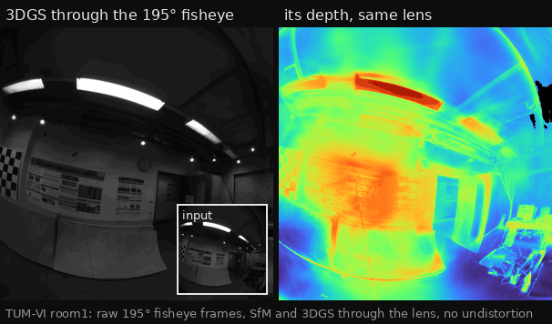

# Fisheye and distorted cameras

The goal is to run SfM and 3DGS on fisheye images directly, without
resampling them to pinhole views first. This page covers what is done and
what is still open.

<p align="center">
  
</p>

The splat of TUM-VI room1 (below), trained on the raw 195° frames, and its
expected depth, both drawn through the fisheye. The camera follows the
recorded path: every other view is a key, with three more frames between
two keys (rotation interpolated spherically, centre linearly). The nearest
input frame is inset. `gsplat_lens_frames_cuda` renders the frames and
`scripts/make_fisheye_gif.py` lays them out:

```bash
gsplat_lens_frames_cuda --ply <run>/scene.ply --data <run> --out frames \
  --every 2 --interp 4
python scripts/make_fisheye_gif.py --frames frames --out fisheye_tumvi.gif \
  --first 120 --count 100 --panel-width 300 --greys 40 --fps 12 --caption "..."
```

## 3DGS: drawing through the lens

A camera's intrinsics carry a lens (`visloc_gsplat_core::lens::Lens`):

- **Projection.** Either the pinhole's `(x, y) / z` or the equidistant
  `θ (x, y) / r`, where `r = |(x, y)|` and `θ = atan2(r, z)`. The equidistant
  form is the Kannala-Brandt / OpenCV fisheye base, and it images rays past
  90° as well.
- **Distortion.** COLMAP's distortion of the projected coordinates
  `(u, v)`, with `ρ² = u² + v²`:
  `u' = u + u (k1 ρ² + k2 ρ⁴ + k3 ρ⁶ + k4 ρ⁸) + 2 p1 u v + p2 (ρ² + 2 u²) + sx1 ρ²`,
  and `v'` likewise, with `p1`/`p2` and `sx1`/`sy1` swapped.

COLMAP's `SIMPLE_RADIAL`, `RADIAL`, `OPENCV` and `FULL_OPENCV` without its
rational denominator are pinhole lenses of this form. `SIMPLE_RADIAL_FISHEYE`,
`RADIAL_FISHEYE`, `OPENCV_FISHEYE` and `THIN_PRISM_FISHEYE` are equidistant
ones (`colmap_scene::lens_of`). A COLMAP dataset with any of these models
now trains on its images as they are. Before, `SIMPLE_RADIAL`, `RADIAL` and
`OPENCV` loaded with their distortion dropped, and the fisheye models did
not load at all.

The EWA splatting linearises the lens at each gaussian's centre. The 2×3
Jacobian `J` of the lens replaces the pinhole one in `Σ' = J W Σ Wᵀ Jᵀ`:

- **CPU reference** (`cpu_render`) and **f64 gradient oracle**
  (`backward`). The lens math is written once, generic over the scalar
  (`lens::LensScalar`). On the oracle's dual numbers, the Jacobian's own
  derivatives, which the backward pass needs, come out exactly.
- **CUDA** (`native/gsplat_cuda/lens.cuh`, ABI 11) and **wgpu**
  (`common.wgsl`). The same math, run in the backward pass on 3-component
  dual numbers in the camera-space point. The undistorted pinhole keeps its
  original code path in all four.
- **Culling and depth.** A fisheye draws what lies 0.1 from its centre
  within the wider of `max_theta` (below) and 90°, even behind the image
  plane, and sorts by distance. Its depth channels hold the distance from
  the camera centre. A distorted pinhole draws what lies 0.1 in front of
  it, as the undistorted one does.
- **Past the image.** A lens is trusted out to `max_theta`, fitted to the
  image: along 64 directions, the angle where a ray leaves the image grown
  by 10%, but never past an angle where the distortion folds back. Past it
  the polynomial is not calibrated and can blow up. A gaussian centred
  there is drawn through the lens's first-order extension at the cone
  instead (`lens::extended_lens_coords`). Its centre is turned onto the
  cone at the same distance and azimuth, giving `q`. It then projects to
  `m(q) + J(q) (p − q)`, and its footprint uses `J(q)`. This is the lens
  counterpart of a pinhole's 1.3× frustum clamp: a gaussian off the
  frustum still reaches into the image.
- **Near the axis.** The equidistant scale `θ / r` and its derivative cancel
  catastrophically in f32. Below `(r / z)² = 0.01` they come from their
  series.
- **Meshes.** The CPU TSDF (`mesh::Tsdf`) fuses each view through its lens.
  A voxel projects through the lens, and its depth compares with the
  frame's in the renderers' terms: `z`, or a fisheye's distance. A pixel
  back-projects along the lens's ray (`lens::unproject`, which inverts the
  distortion by Newton's method). The frustum test becomes a `max_theta`
  cone. `gsplat_mesh`, `gsplat_photos` and `gsplat_mesh_cuda` (whose median
  and expected depths go through the CPU TSDF) mesh fisheye splats. A
  distorted pinhole is now meshed with its distortion, where it was meshed
  without it.
- **Planar depth and the depth-normal loss.** Both follow each pixel's ray
  through the lens and give the lens's depth: `z`, or a fisheye's distance.
  The planar median depth is where that ray meets the splat's plane. The
  depth-normal loss builds its surface points along the rays. The CUDA
  library makes a camera's rays on the device (`lens_pixel_ray`, Newton's
  method in f32) and keeps them while the camera stays. The wgpu trainer
  makes them on the host (`lens::unproject`) once per camera and keeps one
  buffer per camera of a rig. An undistorted pinhole computes its rays in
  the kernels as before.
- **The device TSDF.** `gsplat_mesh_cuda --gpu-tsdf` fuses through the
  lens as well. A voxel projects by the CPU TSDF's arithmetic, in f32 on
  the device (`lens_project`). A pixel back-projects along
  `lens_pixel_ray`, and the frustum test is the `max_theta` cone. Every
  geometry path of the splat now goes through the lens.

### Verified so far

These checks run on the CPU (`cargo test -p visloc-gsplat-core`):

- The lens Jacobian against central differences, on pinhole, distorted,
  equidistant and thin-prism lenses, including points within 1e-4 of the
  axis.
- The series and closed forms agree at the switch.
- ETH3D's thin-prism lens against `visloc-core`'s `ThinPrismFisheye`, which
  is COLMAP's formula.
- The f64 oracle against the f32 CPU renderer, and its parameter gradients
  against finite differences, on seven views of one scene:
  - a pinhole
  - a distorted pinhole
  - a fisheye seeing the scene ~50° off its axis
  - ETH3D's thin-prism lens
  - a fisheye seeing it past 90°, behind its image plane
  - a narrow fisheye with every gaussian centred past its `max_theta`
  - a narrow distorted pinhole with every gaussian centred past its
    `max_theta`
- The extension meets the lens at `max_theta` and keeps moving points
  outwards, on ETH3D's narrowest rig lens, whose polynomial blows up past
  the image.
- Every wgpu kernel validates with naga (`shaders::every_kernel_validates`),
  and the uniforms match the WGSL layout.

On a GPU, the CUDA `lens_*` tests (`crates/gsplat-cuda/tests/oracle.rs`) and
the wgpu `gpu_lens_*` tests compare the forward pass, the screen gradients
and the parameter gradients against the oracle. They use six lens views of
a 64-gaussian scene:

- a distorted pinhole
- a fisheye ~35° off its axis
- ETH3D's thin-prism lens
- a fisheye past 90°
- a narrow fisheye with much of the scene past its `max_theta`
- a narrow distorted pinhole with much of the scene past its `max_theta`

CUDA agrees with the oracle within 1e-6 in the forward pass and within
1.2e-5 of each gradient's largest value. wgpu, run on lavapipe, agrees
within 2e-5 and 2.1e-4.

The geometry channels have tests of their own:

- CUDA's planar depth meets a tilted disc where each pixel's ray does,
  within 1e-3, behind a distorted pinhole and a fisheye
  (`lens_planar_depth_follows_the_pixel_rays`).
- CUDA's depth-normal loss and its gradients match an f64 CPU loss built
  on `lens::unproject`'s rays, on the six lens views, within 2.5e-6 of the
  largest gradient (`lens_depth_normal_loss_matches_cpu`).
- wgpu's gradients do too, through a pinhole, a distorted pinhole and a
  fisheye, within 5.1e-6 (`gpu_normal_loss_follows_the_lens`).
- Trained through a fisheye, the depth-normal loss falls as it does
  through a pinhole: 0.265 to 0.094 in 300 steps, against 0.286 to 0.099
  (`depth_normal_loss_falls_in_training`).
- The device TSDF meshes one view through a distorted pinhole and a
  distorted fisheye as the CPU TSDF does, from the median and the planar
  depth (`lens_views_match_the_cpu_tsdf`). Through the pinhole every
  vertex is the CPU's within 1e-3 voxels. Through the fisheye 99.97% are,
  and the rest lie within 0.31 voxels: a voxel within rounding of a pixel
  border can read its neighbour's depth.

### ETH3D rig: delivery_area

The scene has 948 images from four rig cameras, of which 829 train and every
8th of the sorted names (119) is held out. Each variant trains for 30k steps
with the CUDA trainer:

| Variant | Images | Camera | PSNR | SSIM |
|---|---|---|---|---|
| `dist_lens` | distorted | `THIN_PRISM_FISHEYE`, as calibrated | 26.17 | 0.916 |
| `dist_pinhole` | distorted | `PINHOLE`, distortion dropped | 22.10 | 0.822 |
| `undist` | ETH3D's undistorted, resized to 752×480 | `PINHOLE` | 33.29 | 0.964 |

On the same images, modelling the lens gains 4.1 dB. `undist` is not
comparable: its images are resampled, and so smoother.

ETH3D's undistortion and this lens model agree. Warping a distorted image
onto its undistorted camera with `visloc-core`'s `ThinPrismFisheye` gives
59 dB against ETH3D's own undistorted image, on all four cameras.

Scoring one splat on the other dataset's views (`gsplat_eval`) is a harsher
test:

- The `dist_lens` splat scores 15.4 dB on the undistorted views.
- The `undist` splat scores 18.7 dB through the lens.

Both renders line up with the ground truth, but differ in brightness. The
gap comes from the few huge gaussians that cover the background. In the
`dist_lens` splat, 0.8% of the gaussians have a scale of 2 m or more. Without
them, the lens and pinhole renders of one frame agree within about 1 dB. EWA
linearises a gaussian at its centre, so a gaussian metres wide gets a
footprint that depends on the projection, and the two sort keys (distance
vs `z`) order it differently against the walls in front. A fix would be a
scale cap in training, or projecting with an unscented transform as 3DGUT
does.

An earlier version culled every gaussian centred past `max_theta`. On these
images it scored 9.6 dB on the undistorted views of the two narrow cameras.
Training had left big dark gaussians just outside their fields of view,
where the lens never drew them.

### Meshes through the lens

`gsplat_mesh_cuda` meshed the same three delivery_area splats: CUDA median
depth, fused by the CPU TSDF, scored against the rig's laser scan with
ETH3D's evaluator. Mesh F1 at 2 / 5 / 10 cm:

| Splat | Mesh F1 |
|---|---|
| distorted images, through the lens | 6.1 / 16.1 / 27.2 % |
| distorted images, distortion dropped | 3.9 / 11.1 / 20.3 % |
| ETH3D's undistorted images | 7.2 / 17.9 / 29.3 % |

The lens splat meshes about as well as the undistorted one, and better
than the one that drops the distortion. All three score low: they are
splats of 752×480 grey images.

Fusing through a lens costs more per voxel than through a pinhole:

- The fisheye's 948 views took 99 s to integrate, against 41 s for the
  undistorted ones.
- TUM-VI room1's 195° splat (283 views, 1.1 cm voxels) took 252 s and gave
  1.6M triangles.

Occlusion culling uses the cone that a block's bounding sphere subtends:
eight points of its rim through the lens, their box grown by 10% and a
pixel. It leaves the mesh unchanged (`Tsdf::cull_occluded` compares with
it off) but saves only about 10%. Most of the time is the lens projection.

### Planar depth and the depth-normal loss through the lens

The same scene, with the planar median depth (`gsplat_mesh_cuda
--planar-depth`). It also has splats trained with the depth-normal loss
(`gsplat_train_cuda --normal-weight 0.005`, from step 7000). Mesh F1 at
2 / 5 / 10 cm:

| Splat | Median depth | Planar depth |
|---|---|---|
| distorted images, through the lens | 6.1 / 16.1 / 27.2 % | 7.1 / 18.5 / 29.9 % |
| the same, with the depth-normal loss | 6.1 / 16.1 / 26.9 % | 6.8 / 17.8 / 29.1 % |
| ETH3D's undistorted images | 7.2 / 17.9 / 29.3 % | 7.5 / 18.8 / 29.6 % |
| the same, with the depth-normal loss | 6.2 / 15.8 / 26.1 % | 6.8 / 16.9 / 27.4 % |

Planar depth through the lens closes most of the gap to the undistorted
images: 18.5% at 5 cm, against 18.8%. The depth-normal loss runs through
the lens, but on these images it lowers F1 with either camera, as it gave
no gain on ETH3D's DSLR scenes. Held-out PSNR moves from 26.17 to 26.13 dB
through the lens, and from 33.29 to 32.64 dB on the undistorted images.

### The device TSDF through the lens

The same splats, fused on the device (`gsplat_mesh_cuda --gpu-tsdf`).
Mesh F1 at 2 / 5 / 10 cm, and the time to fuse the 948 views (CPU: render
and integrate; GPU: render, fuse and extract):

| Splat | Depth | CPU TSDF | GPU TSDF |
|---|---|---|---|
| distorted images, through the lens | median | 6.1 / 16.1 / 27.2 %, 115 s | 6.1 / 16.1 / 27.2 %, 8.8 s |
| | planar | 7.1 / 18.5 / 29.9 %, 191 s | 7.1 / 18.4 / 29.9 %, 14.9 s |
| ETH3D's undistorted images | median | 7.2 / 17.9 / 29.3 %, 54 s | 7.2 / 17.9 / 29.3 %, 14.5 s |
| | planar | 7.5 / 18.8 / 29.6 %, 73 s | 7.5 / 18.7 / 29.6 %, 20.4 s |

The device gives the CPU's F1 to 0.1 points, through the lens as through
the pinhole. The lens costs the device almost nothing: 0.054 s per
thousand blocks through it, against 0.049 s for the pinhole. On the CPU
integrating through the lens took 4.4 times as long per block, so the
device is 13 times faster there, against 3.6 to 3.7 times for the pinhole.

## SfM: mapping through the lens

`visloc-core` has the camera models: `OpenCvFisheye`, `SimpleRadialFisheye`,
`RadialFisheye`, `Fov`, `DoubleSphere` and COLMAP's `ThinPrismFisheye`. Each
has projection, unprojection to a unit ray, and the point Jacobian. The
COLMAP-port mapper uses those for registration, triangulation and its
filters, and now for bundle adjustment too:

- **Bundle adjustment.** The native solver (`rig_ba_solver`) projects a
  camera with distortion or a fisheye projection through its `Lens`. The
  lens gives the normalized coordinates `m = (pixel − c) / f` and their
  Jacobian, from `Camera::project_with_point_jacobian`. The solve's
  intrinsics then place them at `(fx m.x + cx, fy m.y + cy)`. Undistorted
  pinholes keep the direct path. Before, the solver took any camera with a
  focal length for an undistorted pinhole, without a warning. On a synthetic
  Kannala-Brandt sequence the frame centres came out 3.7 cm off; through the
  lens they are within 1 mm.
- **Intrinsics refinement.** Focal length and principal point refinement
  (`ba_refine_focal_length`, `ba_refine_principal_point`) works in front of
  a lens, with the distortion fixed. `Camera::set_intrinsics` writes the
  refined values back and keeps the distortion coefficients.
- **Rig manifest.** A sensor row can carry any COLMAP model, with its
  parameters after the pose, for example
  `S 0 1 752 480 541.9 541.6 413.8 216.0 1 0 0 0 0 0 0 THIN_PRISM_FISHEYE 541.9 …`.
  `run_colmap_port` writes such a row for a lens camera.
- **`gsplat_photos`, `gsplat_photos_cuda`.** `--camera "MODEL W H PARAMS..."`
  takes the photos' calibrated camera, as a `cameras.txt` row without its
  id. It is scaled to the working images and held fixed. SfM and training
  then follow its lens on the images as they are. `sparse/0/cameras.txt`
  keeps the model.
- **Two-view verification.** It fits E on normalized coordinates
  (`normalize_pixel`) and F and H on raw pixels, as COLMAP does. With strong
  distortion, E wins and the pair is classified as calibrated.

Still open:

- Refining the distortion itself (COLMAP's `ba_refine_extra_params`).
- A rig of differently calibrated cameras in `gsplat_photos`, such as
  ETH3D's four.
- Rays past 90° in a rig: the generalized (multi-camera) initialization and
  PnP still take the normalized plane, and the unit-ray initialization
  takes single-camera frames only.

### Lenses wider than 180°

A lens wider than 180° images rays at and behind its image plane, which
`normalize_pixel` cannot represent. `Camera::sees_behind` tells such a camera
apart:

- a panorama
- a Double Sphere camera
- an equidistant fisheye whose image corners lie past the radius its
  polynomial reaches at 90° (one that folds back before 90° ends there)

Such a camera takes the mapper's unit-ray paths, which so far only
panoramas took:

- two-view verification on rays (`verify_spherical_pair`)
- the unit-ray initialization
- P3P bearings
- triangulation rows and angular errors
- in-front tests along the observed ray (`Camera::sees_in_front`)

Bundle adjustment already projected through the lens at any angle. Lenses
narrower than 180° keep the normalized-plane paths, unchanged.

The Kannala-Brandt models (`OPENCV_FISHEYE` and its reduced forms) had
unprojected rays past 90° to their mirror image: `(tan θ · x̂, 1)` points
ahead of the camera there. It is `(sin θ · x̂, cos θ)` now.

A synthetic 640 px Kannala-Brandt lens at f = 150 px spans ±122° across its
sides. It sees points up to 100° off its axis, about a fifth of them behind
its image plane. The mapper reconstructs its trajectory exactly and
triangulates the points behind too; on the normalized plane it built no
model at all.

TUM-VI room1 is the real check: cam0, 512 px Kannala-Brandt at f = 191 px,
195° across the diagonal. Every 10th frame gives 283 images.
`gsplat_photos_cuda --camera OPENCV_FISHEYE ...` registers all of them,
and their centres come within 0.44 cm RMSE of the motion-capture ground
truth. Without the calibration, the self-calibrated pinhole prior is
63 cm off. The normalized-plane path does just as well on this lens,
though: only 1.6% of its SIFT keypoints lie past 90°, in the vignetted
corners. Training the splat through the lens on that run's poses gives
25.86 dB held out.

### ETH3D rig: SfM on one camera

`gsplat_photos_cuda` ran on one rig camera's images at a time: 237 images
for delivery_area, 165 for terrains, 752×480 grey. The run's camera
centres are aligned to the ground truth by a similarity transform and
scored by RMSE. Centres only: on these near-straight paths, a centre
alignment leaves the roll about the path open, so rotation errors are not
comparable. Two runs per camera:

- **lens**: the distorted images with `--camera` and their
  `THIN_PRISM_FISHEYE` calibration.
- **undistorted**: ETH3D's undistorted images with their `PINHOLE`
  calibration. This baseline the old pipeline could already run.

| Scene | Camera | lens | undistorted |
|---|---|---|---|
| delivery_area | cam4 | 1.38 cm | 1.74 cm |
| delivery_area | cam5 | 1.03 cm | 1.77 cm |
| delivery_area | cam6 | 2.65 cm | 2.05 cm |
| delivery_area | cam7 | 1.65 cm | 1.78 cm |
| terrains | cam4 | 0.40 cm | 0.39 cm |
| terrains | cam5 | 0.33 cm | 0.36 cm |
| terrains | cam6 | 1.26 cm | 1.51 cm |
| terrains | cam7 | 0.78 cm | 0.93 cm |

Every run registers every image. The lens runs median 1.15 cm and the
undistorted ones 1.6 cm: the distorted images through their lens map at
least as well as the undistorted ones. On delivery_area cam4's distorted
images, two other runs fail:

- the calibration with its distortion dropped: 119.5 cm
- no calibration, the self-calibrated pinhole prior: 103.7 cm

The table is with the registration threshold scaled to the image size
(`abs_pose_max_error`, 5.6 px on these images). With COLMAP's fixed 12 px,
two of the sixteen runs ended about a metre off, with every camera turned
around: delivery_area cam5 undistorted and cam6 through the lens.
delivery_area cam4 through the lens came out at 11.65 cm. Replaying three
of these mappings over eight RANSAC seeds shows the cause: 12 px on
752×480 images lets P3P keep poses that the correspondences barely pin
down, and the seed then picks the solution.

| Threshold | Centre RMSE over 8 seeds × 3 runs |
|---|---|
| 12 px (COLMAP's) | 1–119 cm, with 7 runs past 50 cm |
| 8 px | 1–14 cm |
| 6 px | 1.2–4.4 cm |
| 4 px | 1.0–3.4 cm |

Two other changes to the PnP did not help:

- refining with Levenberg-Marquardt instead of Gauss-Newton
- accepting the refined pose by its MSAC score instead of its inlier count

### End to end: distorted photos to a splat

`gsplat_photos_cuda --camera` writes a COLMAP dataset with the lens, which
`gsplat_train_cuda` trains through. It runs on the distorted images as they
are, with no undistortion anywhere. Each run trains for 30k steps with
every 8th image held out. The same images and lens with ETH3D's
ground-truth poses are the reference:

| Scene | Camera | SfM poses | ground-truth poses |
|---|---|---|---|
| delivery_area | cam7 | 27.64 dB | 27.76 dB |
| terrains | cam4 | 25.39 dB | 25.48 dB |

The splats on SfM poses come within 0.1 dB of those on the true poses.

## Validation data

ETH3D's low-res many-view training scenes (`<scene>_rig.7z`) ship the
distorted images of four `THIN_PRISM_FISHEYE` cameras, 752×480 grey, with
their calibration and poses, beside the undistorted images and the laser
scans. They serve both halves:

- 3DGS on the distorted images against 3DGS on the undistorted ones
  (above).
- SfM poses against the ground truth (to do).
