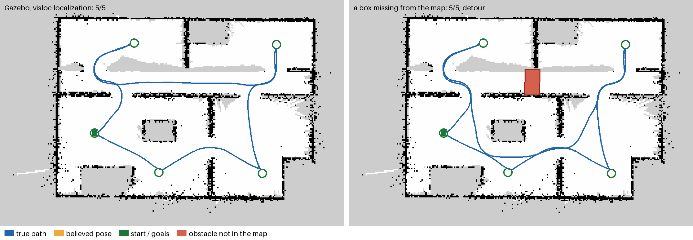

# Robot navigation with Nav2

visloc-rs localizes a robot in a visual map. A navigation stack plans and
drives on a 2D occupancy grid. visloc-rs does not implement the navigation
stack itself: it gives [Nav2](https://docs.nav2.org) the two things Nav2
cannot get elsewhere for a camera robot.

1. **A map to plan on.** `visual_map_to_occupancy` turns a visual map (a map
   saved by the stereo-inertial SLAM, or any gravity-aligned COLMAP model)
   into the occupancy grid that Nav2's `map_server` loads (PGM + YAML).
2. **Localization in that map.** visloc publishes `map -> odom` (REP-105) from
   map-based localization, which takes the place of AMCL. The real-robot
   node is `visloc_map_localize_node`
   ([ros2/visloc-ros2](../ros2/visloc-ros2/README.md)).

The navigation results below were measured in simulation, at two levels:

- **A lightweight simulation** (`visloc_navigation::sim`): no rendering;
  the camera detects 3D texture points. It runs in real time and is
  deterministic, which makes it useful for comparing localization sources.
- **Gazebo**: rendered stereo images, an IMU and a lidar. The robot is
  driven by visloc-rs's real robot nodes (`visloc_vio_node`,
  `visloc_map_localize_node`) on a map made by visloc's own stereo-inertial
  SLAM ([below](#in-gazebo-rendered-cameras-and-the-real-nodes)).

No real robot has been driven by Nav2 on visloc localization yet. The
occupancy conversion is also shown on a real robot's map (TUM RGB-D
fr2/pioneer_360).

## Result: Nav2 on visloc localization, in simulation

<p align="center">
  
</p>

Nav2 Jazzy (planner NavFn, controller Regulated Pure Pursuit) drives the
simulated robot to five goals in turn, one in each room, then back to the
start. It runs in real time over ROS 2. The robot's `map -> odom` comes from
one of three sources:

| `map -> odom` from | goals reached | collisions | believed-pose error, RMSE / max | drive time |
| --- | ---: | ---: | --- | ---: |
| ground truth (upper bound) | **5/5** | 0 | 0 | 90 s |
| **visloc** (map-based localization + wheel odometry) | **5/5** | 0 | **3.8 cm** / 25 cm | 89 s |
| wheel odometry alone (start pose given) | 0/5 | 0 | 1.65 m / 3.07 m | 434 s |
| visloc, with a box missing from the map blocking the hallway | **5/5** | 0 | 3.5 cm / 23 cm | 99 s |

A goal counts as reached only if Nav2 reports success *and* the robot's true
pose ends within 0.3 m of it. With odometry alone, Nav2 reported two goals as
reached while the robot was 0.36 m and 0.77 m away from them, and the
other three failed or timed out. With visloc, the robot localizes 0.2 s after
start without being given an initial pose. Its believed pose stays at
centimetre level, except along the textureless hallway wall, where no fix
comes for a few seconds (the 25 cm maximum). In the last run the unmapped
box blocks the hallway between the two bedrooms. Nav2's obstacle layer sees
it on the depth scan and replans through the living room and the kitchen
(right panel), at the cost of 9 s.

What is simulated (`visloc_navigation::sim`, deterministic):

- **World.** A 10 m x 7 m apartment: five rooms joined by 1 m doorways,
  furniture, wall texture as 3D points with descriptors (15% of them
  deliberately alike, as repetitive texture), and one hallway wall left bare.
- **Robot.** Differential drive, 0.2 m radius, 0.5 m/s, with actuation noise.
- **Wheel odometry.** Wheel radii ±0.25% off and track width 2% off, plus
  noise: realistic drift.
- **Camera.** Forward, 640 x 480 pinhole, about 90 degrees across, 0.5 m up,
  5 Hz. It detects the texture points in view and not occluded, with
  0.7 px noise, noisy descriptors, 20% missed detections and 40 clutter
  keypoints per image. There is no image rendering, so feature extraction
  is not tested; matching, PnP and everything after it are.
- **Depth scan.** The horizontal slice of a depth camera, 87 degrees, 4 m,
  for Nav2's obstacle layers.
- **Map.** Built by a mapping run through every room (`nav_sim_build_map`).
  Landmarks get 2 cm of error and keyframes 1 cm, standing in for SLAM
  error. The occupancy grid is built from that map alone, not from the true
  walls.

Localization is visloc's own pipeline (`visloc_localization`): brute-force
descriptor matching with a ratio test, P3P-RANSAC and Gauss-Newton
refinement against the map's landmarks. From the second fix onward,
matching is limited to the landmarks within 8 m of the predicted camera.
Fixes go into `OdomCorrection`, the same class `visloc_map_localize_node`
uses on real robots, which gates them against the wheel odometry and keeps
`map -> odom`. A localization takes 1.2 ms. Until the first `map -> odom`,
the robot turns in place to find the map.

Note on the solver: the pipeline's default minimal solver (DLT) is degenerate
when every landmark in view is on one wall, which is common indoors, so the
simulation uses P3P as `basalt_euroc_localize_demo` does. With DLT the same
drive got stuck against a wall.

### Without ROS

`nav_sim_drive` runs the same robot, map and localization without ROS. A
waypoint follower steers on the believed pose around a patrol of every room,
twice:

```bash
cargo run --release --example nav_sim_drive -- --laps 2
```

| `map -> odom` from | waypoints reached | collisions | error RMSE / max |
| --- | ---: | ---: | --- |
| ground truth | 34/34 | 0 | 0 |
| visloc | **34/34** | 0 | **2.3 cm** / 11 cm |
| wheel odometry alone | 7/34, then stuck against a wall | yes | 0.25 m when it stopped |

`pipelines/navigation/tests/sim_robot.rs` checks part of this drive in
`cargo test`.

## Reproduce

Build the map, then convert it to the Nav2 map. `nav_sim_build_map` already
writes `occupancy.yaml`. The second command shows the conversion a real map
goes through, and gives a byte-identical grid:

```bash
cargo run --release --example nav_sim_build_map -- --out runs/nav_sim/map
```

```bash
cargo run --release --example visual_map_to_occupancy -- \
  --map-dir runs/nav_sim/map --camera-height 0.5 --out runs/nav_sim/map/occupancy
```

With ROS 2 Jazzy and Nav2 installed (`ros-jazzy-navigation2`,
`ros-jazzy-nav2-bringup`), build the node and launch everything. The node
uses pure-Rust DDS, so it needs no ROS build tooling:

```bash
cargo build --release --manifest-path ros2/visloc-ros2/Cargo.toml --bin visloc_nav_sim_node
```

```bash
ros2 launch ros2/visloc-ros2/launch/nav_sim.launch.py \
  map_dir:=runs/nav_sim/map \
  node:=ros2/visloc-ros2/target/release/visloc_nav_sim_node \
  mode:=visloc record:=runs/nav_sim/visloc.csv
```

In another shell, send the goals and score the drive:

```bash
python3 ros2/visloc-ros2/tools/nav_sim_goals.py --out runs/nav_sim/visloc.json
```

`mode:=odometry` and `mode:=ground_truth` give the other rows. For the
unmapped box, add `extra_box:=4.6,4.0,5.2,5.0,0.8`. To draw the figure:

```bash
python3 scripts/plot_nav_sim.py --map runs/nav_sim/map/occupancy.yaml \
  --run "visloc=runs/nav_sim/visloc.csv" --out runs/nav_sim/nav.png
```

RViz shows the run with the `map` fixed frame: `/map`, `/plan`,
`/local_costmap/costmap`, `/scan` and `/map_pose`.

## In Gazebo: rendered cameras and the real nodes

<p align="center">
  
</p>

The same apartment in [Gazebo](https://gazebosim.org) Harmonic, with nothing
of the lightweight simulation left but the floor plan. Gazebo renders the
cameras, so the whole camera pipeline runs: feature extraction, stereo VIO,
SLAM and map-based localization.

- **World** (`ros2/visloc-ros2/gz/make_world.py`): the apartment's walls and
  furniture with procedurally generated textures, one hallway wall bare.
- **Robot**: a differential drive, 0.2 m radius, with on `imu_link`, 0.5 m
  up, a stereo pair (640 x 480 grey, 90 degrees, 12 cm baseline, 20 Hz)
  and an IMU (200 Hz, with noise and bias), and a 2D lidar for Nav2's
  obstacle layers. There is no wheel odometry.
- **Map**: the robot is driven once around every room (`drive_route.py`)
  while `record_euroc.py` records the stereo images and the IMU.
  `basalt_euroc_online_slam_demo --save-map` builds the map from that
  recording (0.9 cm trajectory error online; 4,355 frames, 22,536
  landmarks), and `visual_map_to_occupancy` converts it (right panel).
- **Navigation** (`nav.launch.py`): `visloc_vio_node` on the stereo pair and
  the IMU gives `odom -> imu_link`. `visloc_map_localize_node` on the left
  camera, against the saved map, gives `map -> odom`. Nav2 plans on the
  converted map. This is the stack a real robot would run, except for the
  base driver.

The map is in the SLAM's own frame, which starts where mapping started. The
goals are the same five rooms, written in the world and converted to the
map with a planar transform fitted between the SLAM trajectory and Gazebo's
ground truth (`align_map.py`, 0.9 cm residual). Only the goal script and the
scoring use that transform; navigation never sees it.

<p align="center">
  
</p>

| run | goals reached | contacts | `/map_pose` error, RMSE / median / max | drive time (sim) |
| --- | ---: | ---: | --- | ---: |
| visloc VIO + map localization | **5/5** | 0 | **1.6 cm** / 1.1 cm / 4.3 cm | 116 s |
| same, with a textured box missing from the map in the hallway | **5/5** | 0 | 1.8 cm / 1.4 cm / 4.4 cm | 130 s |
| same, with a plain (textureless) box | **5/5** | 0 | 2.0 cm / 1.5 cm / 4.4 cm | 130 s |

Each goal counts as reached by the same rule as above, with the true pose
from Gazebo. The robot localizes in the map from its first image (about 400
PnP inliers), without an initial pose. The first run was repeated three
times, each with 5/5 goals and 1.6 cm RMSE. With the box, Nav2's
obstacle layer marks it from the lidar and the planner goes round through
the living room and the kitchen (right panel), about 14 s longer. Map
localization finds nothing on the box, which is not in the map, and keeps
working on the walls around it.

**Pitfall: the map frame is not on the floor.** The SLAM map's frame and the
VIO's `odom` start at the IMU, here 0.5 m above the floor, so `base_link` and
the lidar's points are at z ≈ -0.5 m in both. Nav2's obstacle layer drops
points below `min_obstacle_height`, which is set both per source and per
layer (the layer's own defaults to 0.0). With the defaults, Nav2 marked no
obstacle at all: the run without the box still passed, because the map has
every wall, and with the box the robot drove into it. `gz/nav2_params.yaml`
sets both limits to -1.5 m. A real robot with this stack needs the same, or
a floor-level `map` frame.

**Not covered: VIO that has lost tracking.** When the robot drove into the
box (before that fix), the camera ended up about 10 cm from its face, too
close for stereo. The VIO had nothing to track, integrated the IMU alone,
and its pose ran off 7 m while the robot stood still. Map localization had
no features either, so nothing corrected it. The stack has no detector for
that (too few tracked features for too long) and no stop until it
relocalizes. Wheel odometry would bridge such gaps; this robot has none.

Gazebo renders on the CPU here (no GPU), which makes the simulation run at
about a tenth of real time. Every node runs on simulation time, so Nav2 and
the visloc nodes see a normal-speed robot; a 2-minute drive takes about
20 minutes.

### Reproduce in Gazebo

Needs ROS 2 Jazzy, Nav2 and `ros-jazzy-ros-gz` (Gazebo Harmonic). Build the
nodes and the SLAM:

```bash
cargo build --release --manifest-path ros2/visloc-ros2/Cargo.toml \
  --bin visloc_vio_node --bin visloc_map_localize_node
```

```bash
cargo build --release --example basalt_euroc_online_slam_demo --example visual_map_to_occupancy
```

Make the world, then map. In one shell, start Gazebo and the bridge; in a
second, record; in a third, drive the route, then stop the recorder with
Ctrl-C:

```bash
python3 ros2/visloc-ros2/gz/make_world.py --out runs/gz_nav/world
```

```bash
(cd runs/gz_nav/world && gz sim -s -r --headless-rendering apartment.sdf) &
ros2 run ros_gz_bridge parameter_bridge --ros-args \
  -p config_file:=ros2/visloc-ros2/gz/bridge.yaml -p use_sim_time:=true
```

```bash
python3 ros2/visloc-ros2/gz/record_euroc.py --out runs/gz_nav/mapping
```

```bash
python3 ros2/visloc-ros2/gz/drive_route.py
```

Build the map, its occupancy grid, and the world-from-map transform for the
goals:

```bash
target/release/examples/basalt_euroc_online_slam_demo \
  --euroc-dir runs/gz_nav/mapping \
  --calibration runs/gz_nav/world/calibration.json \
  --config configs/basalt/variants/official_euroc_ds/euroc_config.json \
  --out-dir runs/gz_nav/slam --save-map runs/gz_nav/map
```

```bash
target/release/examples/visual_map_to_occupancy \
  --map-dir runs/gz_nav/map --camera-height 0.5 --out runs/gz_nav/map/occupancy
```

```bash
python3 ros2/visloc-ros2/gz/align_map.py --trajectory runs/gz_nav/slam/trajectory_online.tum \
  --ground-truth runs/gz_nav/mapping/mav0/state_groundtruth_estimate0/data.csv \
  --out runs/gz_nav/map/world_from_map.json
```

Navigate: launch Gazebo, the visloc nodes and Nav2, then send the goals from
a second shell:

```bash
ros2 launch ros2/visloc-ros2/gz/nav.launch.py world:=runs/gz_nav/world/apartment.sdf \
  map:=runs/gz_nav/map nodes:=ros2/visloc-ros2/target/release
```

```bash
python3 ros2/visloc-ros2/gz/nav_goals.py --world-from-map runs/gz_nav/map/world_from_map.json \
  --out runs/gz_nav/nav.json --record runs/gz_nav/nav.csv
```

For the unmapped box, make a second world with
`--extra-box 4.6,4.0,5.2,5.0,0.8` (add `--extra-box-plain` for the
textureless one), launch on it, and pass the same `--extra-box` to
`nav_goals.py`, which needs it to count contacts. To draw a run on the map:

```bash
python3 scripts/plot_nav_sim.py --map runs/gz_nav/map/occupancy.yaml \
  --world-from-map runs/gz_nav/map/world_from_map.json \
  --run "visloc=runs/gz_nav/nav.csv" --out runs/gz_nav/nav.png
```

## The occupancy grid of a visual map

A sparse visual map says where there is something (a landmark). Along every
ray from a camera to a landmark it observed, it also says where there is
nothing. `visloc_navigation::OccupancyMapper` accumulates both as log-odds
in a 2.5D grid: per 5 cm cell, and per 25 cm slice of the robot's height
band (0.1–1.5 m above the floor by default). It then projects them to 2D:

- **Occupied**: some slice holds at least two landmark hits and positive
  evidence.
- **Free**: the lowest slice was seen through and nothing is occupied, or the
  mapping robot drove there. Because obstacles stand on the floor, a column
  seen free only higher up (the inside of a sofa, seen over its back) stays
  unknown.
- **Unknown**: everything else, including textureless walls. A visual map
  cannot see a bare wall, so set Nav2's planner `allow_unknown: false` and
  give it a depth sensor. The parameters in
  `ros2/visloc-ros2/launch/nav_sim_nav2_params.yaml` do both.

Walls come out as dotted lines, with a cell for every textured point.
Inflation by the robot radius closes the gaps for planning.

### On real data: TUM RGB-D fr2/pioneer_360

<p align="center">
  
</p>

The real-data check uses [TUM RGB-D](https://cvg.cit.tum.de/data/datasets/rgbd-dataset)
fr2/pioneer_360: a Pioneer robot with a Kinect drives loops in a large
hall. The map is built with `tum_rgbd_save_map` from the sequence's
motion-capture trajectory, so this tests the conversion on real landmarks
(Kinect depth, ORB corners) but not SLAM. It has 3,593 landmarks and 262
keyframes. The floor is a clear peak of landmarks 0.52 m below the camera,
which gives `--camera-height 0.52`. The grid shows the hall's walls as
straight edges about 12.6 m apart, and the objects in it. The loop's inside
stays unknown: the forward camera never looked at it. Free space is sparse,
along the rays to the landmarks, which is the limit of a sparse visual map.
A depth sensor's obstacle layer in Nav2, or a denser map, fills it in.

```bash
cargo run --release --features image-io --example tum_rgbd_save_map -- \
  --seq-dir rgbd_dataset_freiburg2_pioneer_360 \
  --trajectory rgbd_dataset_freiburg2_pioneer_360/groundtruth.txt --out runs/pioneer_map \
  --fx 520.9 --fy 521.0 --cx 325.1 --cy 249.7 \
  --k1 0.2312 --k2 -0.7849 --p1 -0.0033 --p2 -0.0001 --k3 0.9172 \
  --match-radius-px 12 --max-depth 6 --keyframe-m 0.05 --keyframe-deg 4 --max-hamming 70
```

```bash
cargo run --release --example visual_map_to_occupancy -- \
  --map-dir runs/pioneer_map --camera-height 0.52 --out runs/pioneer_map/occupancy
```

For a map from `basalt_euroc_online_slam_demo --save-map`:

```bash
cargo run --release --example visual_map_to_occupancy -- \
  --map-dir runs/office_map --camera-height 0.55 --out runs/office_map/occupancy
```

`--camera-height` is the camera's height above the floor on the robot: the
floor is the median camera height minus it. You can give `--floor-z`
instead. The map must be gravity-aligned with `z` up, which the
stereo-inertial SLAM's maps are. Photo SfM models are not, unless you align
them first. Other options: `--resolution`, `--min-height` / `--max-height`
(the obstacle band), `--max-range`, `--min-hits`, `--free-radius` (the disc
cleared around each camera position).

## On a real robot

Replace `visloc_nav_sim_node` with the real nodes: the robot's base driver
(`odom -> base_link`), `visloc_vio_node` and `visloc_map_localize_node`
(`map -> odom`), and a depth camera or a laser for the obstacle layers.
Then run Nav2's `navigation_launch.py` with `map_server` on the converted
map, and no AMCL. `ros2/visloc-ros2/gz/nav.launch.py` is that setup in
Gazebo, without wheel odometry; on a robot, add the base driver's odometry
and keep the VIO for `odom -> base_link` or the other way round. This has
not been tried on a robot yet. The OpenLORIS
results in [openloris_map_localization.md](openloris_map_localization.md)
are the localization half of it, with no navigation.
