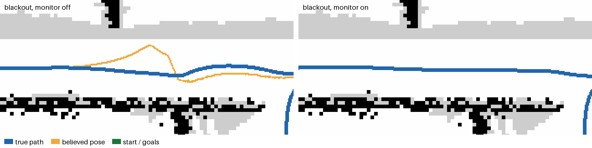
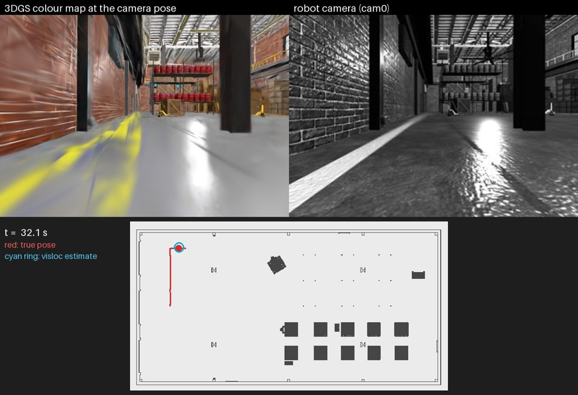
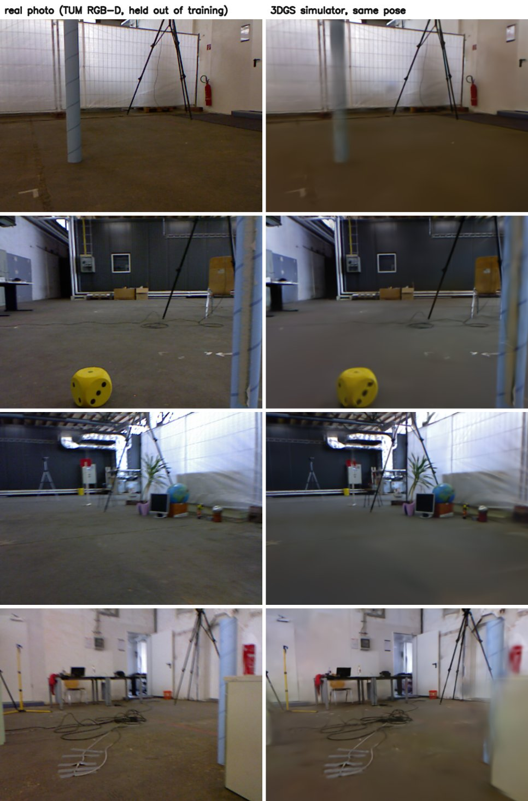

# Robot navigation with Nav2

<p align="center">
  
</p>

visloc-rs localizes a robot in a visual map. A navigation stack plans and
drives on a 2D occupancy grid. visloc-rs does not implement the navigation
stack itself: it gives [Nav2](https://docs.nav2.org) the two things Nav2
cannot get elsewhere for a camera robot.

1. **A map to plan on.** `visual_map_to_occupancy` turns a visual map (a map
   saved by the stereo-inertial SLAM, or any gravity-aligned COLMAP model)
   into the occupancy grid that Nav2's `map_server` loads (PGM + YAML).
2. **Localization in that map.** visloc publishes `map -> odom` (REP-105) from
   map-based localization, which takes the place of AMCL. The real-robot
   node is `visloc_map_localize_node`
   ([ros2/visloc-ros2](../ros2/visloc-ros2/README.md)).

The navigation results below were measured in simulation, at two levels:

- **A lightweight simulation** (`visloc_navigation::sim`): no rendering;
  the camera detects 3D texture points. It runs in real time and is
  deterministic, which makes it useful for comparing localization sources.
- **Gazebo**: rendered stereo images, an IMU and a lidar. The robot is
  driven by visloc-rs's real robot nodes (`visloc_vio_node`,
  `visloc_map_localize_node`) on a map made by visloc's own stereo-inertial
  SLAM ([below](#in-gazebo-rendered-cameras-and-the-real-nodes)).

No real robot has been driven by Nav2 on visloc localization yet. The
occupancy conversion is also shown on a real robot's map (TUM RGB-D
fr2/pioneer_360).

## Result: Nav2 on visloc localization, in simulation

<p align="center">
  
</p>

Nav2 Jazzy (planner NavFn, controller Regulated Pure Pursuit) drives the
simulated robot to five goals in turn, one in each room, then back to the
start. It runs in real time over ROS 2. The robot's `map -> odom` comes from
one of three sources:

| `map -> odom` from | goals reached | collisions | believed-pose error, RMSE / max | drive time |
| --- | ---: | ---: | --- | ---: |
| ground truth (upper bound) | **5/5** | 0 | 0 | 90 s |
| **visloc** (map-based localization + wheel odometry) | **5/5** | 0 | **3.8 cm** / 25 cm | 89 s |
| wheel odometry alone (start pose given) | 0/5 | 0 | 1.65 m / 3.07 m | 434 s |
| visloc, with a box missing from the map blocking the hallway | **5/5** | 0 | 3.5 cm / 23 cm | 99 s |

A goal counts as reached only if Nav2 reports success *and* the robot's true
pose ends within 0.3 m of it. With odometry alone, Nav2 reported two goals as
reached while the robot was 0.36 m and 0.77 m away from them, and the
other three failed or timed out. With visloc, the robot localizes 0.2 s after
start without being given an initial pose. Its believed pose stays at
centimetre level, except along the textureless hallway wall, where no fix
comes for a few seconds (the 25 cm maximum). In the last run the unmapped
box blocks the hallway between the two bedrooms. Nav2's obstacle layer sees
it on the depth scan and replans through the living room and the kitchen
(right panel), at the cost of 9 s.

What is simulated (`visloc_navigation::sim`, deterministic):

- **World.** A 10 m x 7 m apartment: five rooms joined by 1 m doorways,
  furniture, wall texture as 3D points with descriptors (15% of them
  deliberately alike, as repetitive texture), and one hallway wall left bare.
- **Robot.** Differential drive, 0.2 m radius, 0.5 m/s, with actuation noise.
- **Wheel odometry.** Wheel radii ±0.25% off and track width 2% off, plus
  noise: realistic drift.
- **Camera.** Forward, 640 x 480 pinhole, about 90 degrees across, 0.5 m up,
  5 Hz. It detects the texture points in view and not occluded, with
  0.7 px noise, noisy descriptors, 20% missed detections and 40 clutter
  keypoints per image. There is no image rendering, so feature extraction
  is not tested; matching, PnP and everything after it are.
- **Depth scan.** The horizontal slice of a depth camera, 87 degrees, 4 m,
  for Nav2's obstacle layers.
- **Map.** Built by a mapping run through every room (`nav_sim_build_map`).
  Landmarks get 2 cm of error and keyframes 1 cm, standing in for SLAM
  error. The occupancy grid is built from that map alone, not from the true
  walls.

Localization is visloc's own pipeline (`visloc_localization`): brute-force
descriptor matching with a ratio test, P3P-RANSAC and Gauss-Newton
refinement against the map's landmarks. From the second fix onward,
matching is limited to the landmarks within 8 m of the predicted camera.
Fixes go into `OdomCorrection`, the same class `visloc_map_localize_node`
uses on real robots, which gates them against the wheel odometry and keeps
`map -> odom`. A localization takes 1.2 ms. Until the first `map -> odom`,
the robot turns in place to find the map.

Note on the solver: the pipeline's default minimal solver (DLT) is degenerate
when every landmark in view is on one wall, which is common indoors, so the
simulation uses P3P as `basalt_euroc_localize_demo` does. With DLT the same
drive got stuck against a wall.

### Without ROS

`nav_sim_drive` runs the same robot, map and localization without ROS. A
waypoint follower steers on the believed pose around a patrol of every room,
twice:

```bash
cargo run --release --example nav_sim_drive -- --laps 2
```

| `map -> odom` from | waypoints reached | collisions | error RMSE / max |
| --- | ---: | ---: | --- |
| ground truth | 34/34 | 0 | 0 |
| visloc | **34/34** | 0 | **2.3 cm** / 11 cm |
| wheel odometry alone | 7/34, then stuck against a wall | yes | 0.25 m when it stopped |

`pipelines/navigation/tests/sim_robot.rs` checks part of this drive in
`cargo test`.

## Reproduce

Build the map, then convert it to the Nav2 map. `nav_sim_build_map` already
writes `occupancy.yaml`. The second command shows the conversion a real map
goes through, and gives a byte-identical grid:

```bash
cargo run --release --example nav_sim_build_map -- --out runs/nav_sim/map
```

```bash
cargo run --release --example visual_map_to_occupancy -- \
  --map-dir runs/nav_sim/map --camera-height 0.5 --out runs/nav_sim/map/occupancy
```

With ROS 2 Jazzy and Nav2 installed (`ros-jazzy-navigation2`,
`ros-jazzy-nav2-bringup`), build the node and launch everything. The node
uses pure-Rust DDS, so it needs no ROS build tooling:

```bash
cargo build --release --manifest-path ros2/visloc-ros2/Cargo.toml --bin visloc_nav_sim_node
```

```bash
ros2 launch ros2/visloc-ros2/launch/nav_sim.launch.py \
  map_dir:=runs/nav_sim/map \
  node:=ros2/visloc-ros2/target/release/visloc_nav_sim_node \
  mode:=visloc record:=runs/nav_sim/visloc.csv
```

In another shell, send the goals and score the drive:

```bash
python3 ros2/visloc-ros2/tools/nav_sim_goals.py --out runs/nav_sim/visloc.json
```

`mode:=odometry` and `mode:=ground_truth` give the other rows. For the
unmapped box, add `extra_box:=4.6,4.0,5.2,5.0,0.8`. To draw the figure:

```bash
python3 scripts/plot_nav_sim.py --map runs/nav_sim/map/occupancy.yaml \
  --run "visloc=runs/nav_sim/visloc.csv" --out runs/nav_sim/nav.png
```

RViz shows the run with the `map` fixed frame: `/map`, `/plan`,
`/local_costmap/costmap`, `/scan` and `/map_pose`.

## In Gazebo: rendered cameras and the real nodes

<p align="center">
  
</p>

The same apartment in [Gazebo](https://gazebosim.org) Harmonic, with nothing
of the lightweight simulation left but the floor plan. Gazebo renders the
cameras, so the whole camera pipeline runs: feature extraction, stereo VIO,
SLAM and map-based localization.

- **World** (`ros2/visloc-ros2/gz/make_world.py`): the apartment's walls and
  furniture with procedurally generated textures, one hallway wall bare.
- **Robot**: a differential drive, 0.2 m radius, with on `imu_link`, 0.5 m
  up, a stereo pair (640 x 480 grey, 90 degrees, 12 cm baseline, 20 Hz)
  and an IMU (200 Hz, with noise and bias), and a 2D lidar for Nav2's
  obstacle layers. There is no wheel odometry.
- **Map**: the robot is driven once around every room (`drive_route.py`)
  while `record_euroc.py` records the stereo images and the IMU.
  `basalt_euroc_online_slam_demo --save-map` builds the map from that
  recording (0.9 cm trajectory error online; 4,355 frames, 22,536
  landmarks), and `visual_map_to_occupancy` converts it (right panel).
- **Navigation** (`nav.launch.py`): `visloc_vio_node` on the stereo pair and
  the IMU gives `odom -> imu_link`. `visloc_map_localize_node` on the left
  camera, against the saved map, gives `map -> odom`. Nav2 plans on the
  converted map. This is the stack a real robot would run, except for the
  base driver.

The map is in the SLAM's own frame, which starts where mapping started. The
goals are the same five rooms, written in the world and converted to the
map with a planar transform fitted between the SLAM trajectory and Gazebo's
ground truth (`align_map.py`, 0.9 cm residual). Only the goal script and the
scoring use that transform; navigation never sees it.

<p align="center">
  
</p>

| run | goals reached | contacts | `/map_pose` error, RMSE / median / max | drive time (sim) |
| --- | ---: | ---: | --- | ---: |
| visloc VIO + map localization | **5/5** | 0 | **1.6 cm** / 1.1 cm / 4.3 cm | 116 s |
| same, with a textured box missing from the map in the hallway | **5/5** | 0 | 1.8 cm / 1.4 cm / 4.4 cm | 130 s |
| same, with a plain (textureless) box | **5/5** | 0 | 2.0 cm / 1.5 cm / 4.4 cm | 130 s |

Each goal counts as reached by the same rule as above, with the true pose
from Gazebo. The robot localizes in the map from its first image (about 400
PnP inliers), without an initial pose. The first run was repeated three
times, each with 5/5 goals and 1.6 cm RMSE. With the box, Nav2's
obstacle layer marks it from the lidar and the planner goes round through
the living room and the kitchen (right panel), about 14 s longer. Map
localization finds nothing on the box, which is not in the map, and keeps
working on the walls around it.

**Pitfall: the map frame is not on the floor.** The SLAM map's frame and the
VIO's `odom` start at the IMU, here 0.5 m above the floor, so `base_link` and
the lidar's points are at z ≈ -0.5 m in both. Nav2's obstacle layer drops
points below `min_obstacle_height`, which is set both per source and per
layer (the layer's own defaults to 0.0). With the defaults, Nav2 marked no
obstacle at all: the run without the box still passed, because the map has
every wall, and with the box the robot drove into it. `gz/nav2_params.yaml`
sets both limits to -1.5 m. A real robot with this stack needs the same, or
a floor-level `map` frame.

**VIO that has lost tracking.** When the robot drove into the box (before
that fix), the camera ended up about 10 cm from its face, too close for
stereo. The VIO had nothing to track, integrated the IMU alone, and its pose
ran off 7 m while the robot stood still. Map localization had no features
either, so nothing corrected it. `visloc_vio_node` now has a lost-tracking
monitor for that (off by default; `nav.launch.py lost_min_observations:=10
lost_max_speed:=1.0`). Too few tracked observations for 0.5 s, or an
implausible speed, resets the estimator. The node then publishes no odometry
and no `odom -> base_link` until tracking has held for 1 s, so Nav2 loses
the robot's pose and stops it. Each reset is announced on `odom_reset`, on
which `visloc_map_localize_node` drops its `map -> odom` and relocalizes
(before, it applied its old correction to the VIO's new `odom` frame after
every reset, including the resets that already followed estimator errors).

To test it, `gz/camera_blackout.py` blanks both cameras for 5 simulated
seconds as the robot drives down the hallway (from world (4.5, 4.5), on the
way to the second goal); `nav_goals.py --retries 3` sends a goal Nav2 gave
up on again once the robot has been localized for 2 s, as a supervisor
would. Two pairs of runs, the second with a chase camera rendered for the
video below (more CPU load, so the VIO dropped a few frames):

| 5 s camera blackout in the hallway | goals reached | contacts | `/map_pose` error, RMSE / max | robot during the blackout |
| --- | ---: | ---: | --- | --- |
| monitor off | 5/5 | 0 | 5.6 cm / **43 cm** | drives on blind for 1.5 m |
| monitor on (`lost_min_observations 20`, `lost_max_speed 1.0`) | 5/5 (goal 2 on the 2nd try) | 0 | 1.5 cm / 4.4 cm | stops within 7 cm |
| monitor off, with the chase camera | 5/5 | 0 | 1.9 cm / **13 cm** | drives on blind |
| monitor on (`lost_min_observations 10`), with the chase camera | 5/5 (goal 2 on the 2nd try) | 0 | 1.4 cm / 4.1 cm | stops |

<p align="center">
  
</p>

Without the monitor, the VIO carried on on the IMU alone. The robot drove
on, steering on a pose that drifted up to 43 cm off, 35 cm of it across a
hallway 0.9 m wide. It snapped back when the cameras returned. Here
the hallway was straight and empty, so the robot got through; it was luck.
With the monitor, tracking counted as lost 0.5 s into the blackout and Nav2
aborted the goal; the robot stopped about 7 cm on. The estimator was reset
every 0.5 s while the images stayed blank (9 resets). 1 s after the
cameras came back, the VIO published again, map localization had its new
`map -> odom` at once, and the second try reached the goal. The error
column counts only the poses that were published. How far the blind
robot's pose drifts differs from run to run (43 cm, then 13 cm): it is
the IMU alone, integrated for 5 s.

**A false alarm, and getting out of it.** With `lost_min_observations 20`
and the chase camera's extra load, the monitor fired before the blackout:
the VIO dropped frames and tracked 19 observations for 0.5 s at the second
goal's start. The robot stopped facing a nearly bare wall, where map
localization found 11 inliers (it needs more), so it never relocalized and
the goal timed out. Two changes: the threshold went down to 10, and
`nav_goals.py --spin-after 5` turns the robot 90 degrees with Nav2's Spin
behavior (on odometry alone) when it has had odometry but no map pose for
5 s, until the map comes into view. With both, the second pair of runs
above had no false alarm (the 9 resets all fell in the blackout) and needed
no spin. In normal driving frames went down to 5 tracked observations,
briefly. A gap longer than a few seconds still needs someone (or a behavior
tree) to resend the goal, and the robot stays where it stopped until the
cameras see again.

**Driving on through it, on the wheels.** A wheeled robot does not have to
stop. With `wheel_odom_topic` (`nav.launch.py wheel_odom:=/wheel_odom`, the
diff drive's odometry), `visloc_vio_node` still resets the estimator when
tracking is lost. It no longer goes silent, though: it carries the
published pose on by the wheel odometry's motion since the last good VIO
pose (`visloc_ros2::odom_bridge`). Once tracking holds again, it moves the
new estimator's poses by a yaw and a translation so that they continue from
where the wheels took the robot. The `odom` frame never jumps, so it
publishes no `odom_reset`, and `map -> odom` stays as it was. The same
blackout, with the monitor at `lost_min_observations 10` and
`lost_max_speed 1.0`:

| 5 s camera blackout in the hallway | goals reached | contacts | `/map_pose` error, RMSE / max | robot during the blackout | drive time |
| --- | ---: | ---: | --- | --- | ---: |
| monitor on, outputs stop | 5/5 (goal 2 on the 2nd try) | 0 | 1.5 cm / 4.4 cm | stops | 126 s |
| monitor on, **wheel odometry through it** | **5/5, all at the first try** | 0 | 1.7 cm / 4.4 cm | **drives on, 1.62 m** | 118 s |

The estimator was reset 9 times in the blackout, as before. The outputs
followed the wheels at 0.3 m/s the whole way, with 2 cm of error against the
truth, and VIO took over again 1 s after the cameras came back. Gazebo's
wheel odometry has no slip. A real robot's drifts more, so how far it can
go blind depends on its wheels. A few metres on an indoor floor should hold
within the costmap's inflation.

`wheel_odom_topic` needs the lost-tracking monitor. The wheel odometry's
child frame (`base_link` here) is placed against the node's output frame by
/tf_static. It does not work with the online mapper, whose map frame
follows the VIO's.

The second pair of runs as seen from a camera following the robot (Gazebo,
rendered for the video only; it sees a plain floor through a visibility
mask, the robot's cameras the textured one). The cyan ring is where visloc
puts the robot; the robot's own (left) camera is in the corner:
[media/gz_nav2_blackout_3d.mp4](media/gz_nav2_blackout_3d.mp4).

### A public warehouse: the Depot

The apartment's walls and floor carry random patterns made to give the
cameras features. The same stack also runs in a realistic scene: the
Depot, a 30 m x 15.6 m warehouse with PBR materials (brick walls, steel
racks, crates, a concrete floor) published by OpenRobotics on Gazebo Fuel
under CC BY 4.0. `gz/make_depot_world.py` puts the same robot in it. The
Depot's only collision geometry is its floor, so the script projects the
meshes (3 to 60 cm above the floor) into a grid of what the robot can hit;
the mapping route, the contact count and the clearance check use that grid.
Everything else is as in the apartment, with nothing tuned for the place.

- **Map.** A 115 m mapping drive around the hall and between the racks;
  visloc's SLAM puts its trajectory within 4.0 cm RMSE (9.5 cm max) of the
  ground truth, with 25,972 landmarks.
- **Occupancy grid.** `visual_map_to_occupancy --max-range 20`. The
  default 8 m ray range is too short for a 30 m hall: it left most of the
  hall unknown and marked little more than the near walls.
- **Navigation.** Five goals across the hall, a 5 s camera blackout once the
  robot crosses x = -4 m on the way to the second
  (`camera_blackout.py --cross-x -4`), the chase camera on in both runs:

| Depot, 5 s camera blackout | goals reached | contacts | `/map_pose` error, RMSE / max | robot during the blackout |
| --- | ---: | ---: | --- | --- |
| monitor off | 5/5 | 0 | 6.0 cm / **20 cm** | drives on blind for 1.5 m |
| monitor on (`lost_min_observations 10`), reset prior, `--spin-after 5` | 5/5 (goal 2 on the 2nd try) | 0 | 6.1 cm / 14 cm | stops within about 15 cm |

<p align="center">
  
</p>

The error is larger than in the apartment (1.6 cm RMSE) because most of
what the cameras see in the hall is metres away. The blackout run with the
monitor first failed: after the reset, map localization found 3 to 11
inliers on every image and never relocalized, even after three spins. Most
of its fixes in the Depot (120 of 144 before the blackout) come from
projection matching, which needs a prior pose, and after an odometry reset
there was none; map-wide matching does poorly in a large hall of repeated
bricks and racks. `visloc_map_localize_node` now keeps the body's last map
pose over a reset and uses it, moved by the new frame's odometry, as the
projection prior (`reset_prior_s`, 30 s, and within `projection_fresh_m` of
travel): the monitor has just stopped the robot, so it is still about
there. Fixes found with it pass the same quality gate and must agree like
any others. In the run above, the three fixes that set the new correction
were projection fixes, after the third spin had turned the robot toward a
part of the hall the map covers well. One run each, so this shows that the
prior can make the difference, not how often.

The two runs from the chase camera:
[media/gz_depot_blackout_3d.mp4](media/gz_depot_blackout_3d.mp4).

The visual map has no colour. For a colour view, the same mapping drive also
recorded a colour camera at cam0's pose (`make_depot_world.py --rgb-twin`,
5 Hz; no visloc node reads it). Those 2,102 images, posed by the SLAM
trajectory (not by ground truth), went into a COLMAP model, and
`gsplat_train` turned that into a 3D Gaussian splat: 7,000 steps, 311k
Gaussians, held-out PSNR 22.1 dB, about 95 minutes on the CPU (lavapipe
Vulkan). The splat looks right from about the camera's height, where the
images were taken. From a chase camera 1.9 m up it blurs: no image saw the
place from there. So this video renders it at the robot's camera pose, through
the "monitor on" run, next to what the robot's camera saw:
[media/gz_depot_3dgs_fpv.mp4](media/gz_depot_3dgs_fpv.mp4).



Gazebo renders on the CPU here (no GPU), which makes the simulation run at
about a tenth of real time. Every node runs on simulation time, so Nav2 and
the visloc nodes see a normal-speed robot; a 2-minute drive takes about
20 minutes.

### Reproduce in Gazebo

Needs ROS 2 Jazzy, Nav2 and `ros-jazzy-ros-gz` (Gazebo Harmonic). Build the
nodes and the SLAM:

```bash
cargo build --release --manifest-path ros2/visloc-ros2/Cargo.toml \
  --bin visloc_vio_node --bin visloc_map_localize_node
```

```bash
cargo build --release --example basalt_euroc_online_slam_demo --example visual_map_to_occupancy
```

Make the world, then map. In one shell, start Gazebo and the bridge; in a
second, record; in a third, drive the route, then stop the recorder with
Ctrl-C:

```bash
python3 ros2/visloc-ros2/gz/make_world.py --out runs/gz_nav/world
```

```bash
(cd runs/gz_nav/world && gz sim -s -r --headless-rendering apartment.sdf) &
ros2 run ros_gz_bridge parameter_bridge --ros-args \
  -p config_file:=ros2/visloc-ros2/gz/bridge.yaml -p use_sim_time:=true
```

```bash
python3 ros2/visloc-ros2/gz/record_euroc.py --out runs/gz_nav/mapping
```

```bash
python3 ros2/visloc-ros2/gz/drive_route.py
```

Build the map, its occupancy grid, and the world-from-map transform for the
goals:

```bash
target/release/examples/basalt_euroc_online_slam_demo \
  --euroc-dir runs/gz_nav/mapping \
  --calibration runs/gz_nav/world/calibration.json \
  --config configs/basalt/variants/official_euroc_ds/euroc_config.json \
  --out-dir runs/gz_nav/slam --save-map runs/gz_nav/map
```

```bash
target/release/examples/visual_map_to_occupancy \
  --map-dir runs/gz_nav/map --camera-height 0.5 --out runs/gz_nav/map/occupancy
```

```bash
python3 ros2/visloc-ros2/gz/align_map.py --trajectory runs/gz_nav/slam/trajectory_online.tum \
  --ground-truth runs/gz_nav/mapping/mav0/state_groundtruth_estimate0/data.csv \
  --out runs/gz_nav/map/world_from_map.json
```

Navigate: launch Gazebo, the visloc nodes and Nav2, then send the goals from
a second shell:

```bash
ros2 launch ros2/visloc-ros2/gz/nav.launch.py world:=runs/gz_nav/world/apartment.sdf \
  map:=runs/gz_nav/map nodes:=ros2/visloc-ros2/target/release
```

```bash
python3 ros2/visloc-ros2/gz/nav_goals.py --world-from-map runs/gz_nav/map/world_from_map.json \
  --out runs/gz_nav/nav.json --record runs/gz_nav/nav.csv
```

If Nav2's bringup stalls (the launch never logs `lifecycle_manager_navigation`
"Managed nodes are active"; here about one launch in three), stop everything
and launch again.

For the camera blackout, launch with `camera_suffix:=image
lost_min_observations:=10 lost_max_speed:=1.0` (or without the last two for
the run without the monitor), run the relay in another shell, and add
`--retries 3 --spin-after 5` to `nav_goals.py`:

```bash
python3 ros2/visloc-ros2/gz/camera_blackout.py --at 4.5,4.5 --duration 5 \
  --log runs/gz_nav/blackout.json
```

The figure above is `plot_nav_sim.py` with `--crop 3.5,3.6,7.5,5.4`.

For the Depot, fetch the model, make the world (`--gt-grid` needs
`pycollada`; `--rgb-twin` adds the colour camera used for the 3DGS below),
map with `drive_route.py --scene runs/gz_depot/world/scene.json`, convert
the map with `--max-range 20`, and pass the same `--scene` to
`nav_goals.py`:

```bash
curl -L -o runs/gz_depot/depot.zip https://fuel.gazebosim.org/1.0/OpenRobotics/models/Depot.zip
unzip runs/gz_depot/depot.zip -d runs/gz_depot/depot_model
```

```bash
python3 ros2/visloc-ros2/gz/make_depot_world.py --depot runs/gz_depot/depot_model \
  --out runs/gz_depot/world --gt-grid
```

For the unmapped box, make a second world with
`--extra-box 4.6,4.0,5.2,5.0,0.8` (add `--extra-box-plain` for the
textureless one), launch on it, and pass the same `--extra-box` to
`nav_goals.py`, which needs it to count contacts. To draw a run on the map:

```bash
python3 scripts/plot_nav_sim.py --map runs/gz_nav/map/occupancy.yaml \
  --world-from-map runs/gz_nav/map/world_from_map.json \
  --run "visloc=runs/gz_nav/nav.csv" --out runs/gz_nav/nav.png
```

## Real to sim: a simulator made of a 3D Gaussian splat of real photos

Gazebo needs a world modelled by hand. Here the world is the splat that
visloc-rs's own SfM and 3DGS make from photos of a real place, and Nav2
drives a robot through it on visloc localization. Everything is from public
data and runs on a CPU.

<p align="center">
  
</p>

**The place.** TUM RGB-D fr2/pioneer_360, pioneer_slam and pioneer_slam3
(CC BY 4.0): a Pioneer robot with a Kinect drives loops in a hall, at the
height a robot's camera is. One in five frames, 1,339 in all, undistorted
with the Kinect's calibration.

**SfM.** `gsplat_photos --steps 0 --cpu` with the intrinsics held fixed:
1,334 of 1,339 images registered, 61,110 points, 9 minutes on 4 cores.
Photo SfM has no scale and no up. `gs/align_sfm_tum.py` fits the one
similarity (7 numbers) that takes the SfM camera centres onto the motion
capture (metres, z up, the floor at z = 0). The ground truth sets only those
7 numbers: every pose is the SfM's. After the fit, the SfM's own camera
centres are 3.7 cm RMSE from the motion capture over the three sequences.

**3DGS.** `gsplat_train` on the metric model, 20 px cropped off the
undistortion's border: 7,000 steps, 403k Gaussians, held-out PSNR 25.0 dB,
2.3 hours on the CPU (lavapipe Vulkan).

**The simulator** (`gs/gs_sim.py`):

- **Robot.** A differential drive on `cmd_vel`. Its wheel odometry (`odom ->
  base_link`) has a 2% distance-scale error, a 3% turn-rate error and a
  0.002 rad/s yaw bias.
- **Camera.** `gsplat_render_server` renders the splat at the camera's
  pose with the Kinect's own lens distortion, 640 x 480 at 10 Hz, about
  70 ms an image.
- **Collisions and scan.** The splat has no collision geometry, so
  `gs/make_gs_scene.py` builds a 2D grid of what the robot can hit from
  the opaque, small Gaussians 6–80 cm above the floor. Cells within 0.45 m
  of the capture path are free, since the robot drove there. Cells farther
  than 1.5 m from every training camera are a fence, because the splat is
  only trustworthy near its photos. A 360° scan is ray-cast in that grid.
- **Clock.** The simulator owns `/clock`, and each step waits for its
  image, so a slow renderer slows simulated time rather than the robot.

**Localization.** The map comes from `tum_rgbd_save_map --keep-world`
along pioneer_slam's SfM poses, and `visloc_map_localize_node` localizes the
rendered camera against it (`--extrinsics tf`). Two maps were tried, each
on the same 39 m drive along pioneer_slam's path (`gz/drive_route.py`):

| Map built from | Images localized | `/map_pose` error, RMSE / median / max |
| --- | ---: | --- |
| the real Kinect images and depth | 4 of 450 | 52 / 43 / 100 cm (wheel odometry) |
| **the splat's renders and depth** (`gs/render_tum_seq.py`) | **216 of 350** | **6.7 / 1.3 / 44 cm** |

The renders look like the photos, as the figure shows. But they are softer:
150–400 ORB corners an image, with descriptors that rarely match the real
images' within the quality gate. So a map of the real images does not
localize the simulator's camera. A map of the splat's own renders does. That
is also what a robot would build if it mapped inside the simulator. A real
robot uses real images for both the map and the queries.

**Nav2.** `gs/gs_nav.launch.py` starts the simulator, map localization on
the render map, map_server on that map's occupancy grid and Nav2 (the
Gazebo setup's `nav2_params.yaml`). `nav_goals.py --scene` sends 5 goals
spread over the hall:

| Run | Goals reached | Contacts | `/map_pose` error, RMSE / median / max | Drive |
| --- | ---: | ---: | --- | --- |
| 3DGS simulator, render map | **5/5** (goal 5 on the 2nd try) | 0 | 8.7 / 1.8 / 28 cm | 106 s simulated |

Video: [media/gs_tum_nav.mp4](media/gs_tum_nav.mp4). Where Nav2's path
leaves the capture paths, the camera sees the splat's floaters. Localization
then waits for the next good view, and the wheel odometry carries the pose
until it comes.

### Reproduce the 3DGS simulator

`scripts/make_gs_tum_dataset.sh WORK_DIR` does the first steps (download,
undistort, SfM, metric alignment, crop) in one go, writing `WORK_DIR/train`.
Step by step:

```bash
for s in 360 slam slam3; do
  curl -L https://cvg.cit.tum.de/rgbd/dataset/freiburg2/rgbd_dataset_freiburg2_pioneer_$s.tgz | tar -xz -C runs/gs_tum/data
done
# undistort every 5th frame into runs/gs_tum/images as <sequence>_<timestamp>.png (OpenCV, the Kinect's
# fr2 calibration, the same K out), then:
cargo run --release -p visloc-gsplat-train --features gpu,euroc --example gsplat_photos -- \
  --images runs/gs_tum/images --out runs/gs_tum/sfm --steps 0 --cpu \
  --camera "PINHOLE 640 480 520.9 521.0 325.1 249.7" --no-refine-intrinsics \
  --window 20 --retrieval 30 --max-keypoints 4096 --mask-black 12
python3 ros2/visloc-ros2/gs/align_sfm_tum.py --model runs/gs_tum/sfm/sparse/0 \
  --images runs/gs_tum/sfm/images --data runs/gs_tum/data --out runs/gs_tum/metric
# crop 20 px off each side of the images (PINHOLE 600 440 520.9 521 305.1 229.7) into runs/gs_tum/train, then:
cargo run --release -p visloc-gsplat-train --features gpu --example gsplat_train -- \
  --data runs/gs_tum/train --steps 7000 --max-gaussians 400000 --out runs/gs_tum/scene.ply
CAM="FULL_OPENCV 640 480 520.9 521.0 325.1 249.7 0.2312 -0.7849 -0.0033 -0.0001 0.9172 0 0 0"
python3 ros2/visloc-ros2/gs/render_tum_seq.py --splat runs/gs_tum/scene.ply \
  --trajectory runs/gs_tum/metric/slam.tum --out runs/gs_tum/render_slam --camera "$CAM"
cargo run --release --features image-io --example tum_rgbd_save_map -- \
  --seq-dir runs/gs_tum/render_slam --trajectory runs/gs_tum/metric/slam.tum --out runs/gs_tum/map \
  --fx 520.9 --fy 521.0 --cx 325.1 --cy 249.7 --k1 0.2312 --k2 -0.7849 --p1 -0.0033 --p2 -0.0001 \
  --k3 0.9172 --match-radius-px 12 --max-depth 6 --keyframe-m 0.05 --keyframe-deg 4 --max-hamming 70 --keep-world
cargo run --release --example visual_map_to_occupancy -- --map-dir runs/gs_tum/map --floor-z 0 \
  --max-range 8 --out runs/gs_tum/map/occupancy
python3 ros2/visloc-ros2/gs/make_gs_scene.py --splat runs/gs_tum/scene.ply \
  --model runs/gs_tum/metric/sparse/0 --out runs/gs_tum/sim/scene.json --camera "$CAM" \
  --camera-height 0.55 --camera-forward 0 --start=-2.33,-2.18,1.0
# add "goals": [[x, y, yaw], ...] to scene.json, then:
ros2 launch ros2/visloc-ros2/gs/gs_nav.launch.py scene:=runs/gs_tum/sim/scene.json map:=runs/gs_tum/map
python3 ros2/visloc-ros2/gz/nav_goals.py --world-from-map identity.json \
  --scene runs/gs_tum/sim/scene.json --retries 3 --spin-after 5 --out runs/gs_tum/nav.json
```

`identity.json` is `{"x": 0, "y": 0, "yaw": 0}`: the simulator's world is
the map's frame.

### A street from a 360-degree video

A 360° camera sees every direction at once, so one walk trains the splat
for every heading the robot may face. The source is walk 0313afa5 of
[OverMaps360_50](https://huggingface.co/datasets/OverTheReality/OverMaps360_50)
(an Insta360 X5 carried on a pole through a town's streets; CC BY-NC 4.0,
gated on Hugging Face; faces and plates are blurred in the data). Its first
300 frames cover 121 m of walking, 100 s.

- **SfM.** `gsplat_photos --insv ... --max-size 640 --window 2 --cpu
  --imu-frame-period 0.333683` registered all 3,000 lens faces, with
  497,069 points, in 61 minutes. The camera's own IMU gives the model's
  scale: 1.1507 m per unit ([insta360_imu_scale.md](insta360_imu_scale.md)).
  So no ground truth is used at all.
- **Levelling.** `gs/level_sfm.py` puts z up from the cameras' mean up and
  the floor at 0 from a RANSAC plane under them. The camera rode 2.26 m above
  the ground. The street climbs by about 0.9 m over its last 40 m, so
  `make_gs_scene.py --terrain` takes the ground's height from the camera
  path.
- **3DGS.** `gsplat_train --alpha-mask` on the faces, with the dataset's
  blacked-out pixels (blurred faces, the camera's pole) left out of the
  loss: 7,000 steps, 607k Gaussians, held-out PSNR 22.0 dB, 2.9 hours on the
  CPU.
- **Robot.** Its camera is at the capture height, 2.26 m over the ground, a
  pole-mounted camera. A splat only looks right near the height of its
  photos. It renders one 640 x 640, 90° face ahead; with `--mono`, because
  640 x 640 rgb8 messages (1.2 MB) did not get through RustDDS to the
  localization node. The fence keeps the robot within 3 m of the walk.
- **Localization map.** `render_tum_seq.py` renders the 6 horizontal faces
  of every frame, colour and depth, and `tum_rgbd_save_map` builds the map
  from them: 1,799 keyframes, 40,345 landmarks. The occupancy grid comes
  from that map.

Nav2 drove to 4 goals spread along the walk, the last one at its end:

| Run | Goals reached | Contacts | `/map_pose` error, RMSE / median / max | Images localized |
| --- | ---: | ---: | --- | ---: |
| default projection window (5 s, 2 m) | 3/4 | 0 | 94 / 2.4 / 250 cm | 466 of 800 |
| `--projection_fresh_s 60 --projection_fresh_m 15 --projection_radius 40` | **4/4** | 0 | **3.6 / 1.7 / 21 cm** | 694 of 850 |

In the first run, Nav2 cut across an S-bend about 64 m along the walk, away
from where the photos were taken. The renders there broke up, and a few
localizations failed in a row. That put the robot more than 2 m from its last
fix, so map localization stopped searching around the predicted pose. The
map-wide search does not work on renders (3 to 26 inliers), and none
succeeded again. The wheel odometry then drifted 2.4 m, and the last goal
could not be planned. With a 60 s, 15 m projection window, the search around
the predicted pose picks up again where the renders are good. Of 850
localizations, 692 were by projection.

Video: [media/gs_street_360.mp4](media/gs_street_360.mp4). A 12 s GIF of it:
[assets/hero_real2sim_street.gif](assets/hero_real2sim_street.gif). Both show
OverMaps360 footage (CC BY-NC 4.0). First, the
real 360° frames against the simulator at the same spots. Then the robot's
drive, filmed by a chase camera in the splat 3.2 m behind it and 2.75 m up,
near the capture height. The robot is a 3D model of a delivery robot drawn into the
render, hidden where the splat's depth is in front of it.

The overlays show the localization itself:

- **Green rays** run from the robot's camera to the map landmarks that its
  latest localization matched (its PnP inliers, from
  `visloc_map_localize_node`'s new `dump_inliers` CSV). White dots are the
  map's other landmarks within 12 m.
- **The inset** is the camera image that was localized, with the matched
  keypoints circled.
- **The cyan ring** is where visloc puts the robot.

The video is of the 1.2 m run with the tuned localization below.

**A lower camera.** A delivery robot's camera is nearer 1 m than 2.26 m.
Rendered 1.2 m over the ground, the street's buildings, trees and signs look
as they do from the capture height, and the road is a little smeared. At
0.7 m the road dissolves into haze: from below, the ground's Gaussians are
seen edge-on.

For a 1.2 m camera:

- The localization map is rebuilt from renders at that height along the
  walk: the same faces, lowered to the ground plus 1.2 m. It has 1,799
  keyframes and 33,181 landmarks.
- The occupancy grid starts obstacles at 0.3 m (`--min-height 0.3`). From
  the lower view, the smeared road left landmarks just above the floor, and
  with the default 0.1 m they closed the corridor: Nav2 could not plan from
  the first goal to the second.

| Camera height | Goals reached | Contacts | `/map_pose` error, RMSE / median / max | Images localized |
| --- | ---: | ---: | --- | ---: |
| 2.26 m (the capture height), the third run | 4/4 | 0 | 4.1 / 1.7 / 34 cm | — |
| **1.2 m** | **4/4** | 0 | **4.3 / 2.2 / 24 cm** | 663 of 850 |

**Fewer failed localizations.** In the 1.2 m run, 22% of the localizations
failed, and the longest stretch on wheel odometry alone was 18.5 s. To find
out why, the drive was replayed offline. Each attempt's camera image was
rendered at the true pose, and `basalt_euroc_localize_demo --odometry` (the
same localization, with the wheel odometry as its prior) localized it. The
replay localized 685 of 858 images, as the live run did. Each setting then
took 26 s to try.

- **What failed.** Every failure had too few matches in the first place:
  median 17, against 117 when localization succeeded. The views were not
  poor (there were facades in every one), nor far from the map's views
  (median 0.34 m). Repeated windows draw wrong matches. Far landmarks, whose
  depth is the splat's, miss the 3 px gate.
- **What helped.**
  - A looser descriptor distance (`--max_hamming 90`, from 70).
  - A 5 px inlier threshold (`--reprojection_threshold 5`).
  - 20 inliers instead of 30 (`--min_inliers 20`).
  - The odometry correction's own gate still rejects the fixes that
    disagree.

| Localization settings | Images localized | Longest gap | Pose error, RMSE / median / max |
| --- | ---: | ---: | --- |
| as before (replay) | 685 of 858 | 12.0 s | 4.0 / 1.9 / 21 cm |
| `max_hamming 90`, `reprojection_threshold 5`, `min_inliers 20` (replay) | 835 of 858 | 7.0 s | 3.1 / 1.9 / 22 cm |
| the same, live with Nav2 (4/4 goals, 0 contacts) | 827 of 850 | 6.0 s | 4.7 / 2.2 / 36 cm |

Live, the correction rejected 91 fixes and reset 5 times. Its worst error
grew to 36 cm, but the robot had a fresh fix in 98% of the video's frames,
against 81% before.

**Mono or stereo.** The same drive was also replayed with a stereo pair
(0.12 m baseline, 10 Hz) and an IMU synthesized from the true trajectory
(200 Hz, with noise). `basalt_euroc_localize_demo --vio` then runs visloc's
stereo-inertial VIO as the odometry. Map localization uses one image either
way, so only the odometry between fixes differs:

| Odometry between fixes | Images localized | Longest gap | Pose error, RMSE / median / max |
| --- | ---: | ---: | --- |
| **wheel odometry (mono camera)** | 835 of 858 | 7.0 s | **3.1 / 1.9 / 22 cm** |
| stereo-inertial VIO | 837 of 859 | 6.5 s | 5.9 / 1.9 / 35 cm |

The simulator's wheel odometry has a 2% distance error and a 3% turn
error. Over the few seconds between fixes, the VIO on rendered stereo
images did not beat it: the correction rejected 82 of its fixes and reset 6
times. Stereo also costs four times the rendering. So the simulated robot
keeps one camera and its wheel odometry.

The video's frames come from two scripts. The run needs
`visloc_map_localize_node --dump_inliers` (in `gs_nav.launch.py`'s
`localize_args`) and `gs_sim.py --record`:

```bash
python3 ros2/visloc-ros2/gs/real_vs_sim_360.py --model runs/street/level/sparse/0 \
  --names runs/street/sfm/image_names.txt --images runs/street/sfm/images \
  --splat runs/street/scene.ply --out runs/street/real_vs_sim
python3 ros2/visloc-ros2/gs/chase_video.py --splat runs/street/scene.ply \
  --scene runs/street/sim/scene.json --run runs/street/sim/nav --map runs/street/map \
  --inliers runs/street/sim/inliers.csv --out runs/street/chase
ffmpeg -framerate 30 -i runs/street/chase/%05d.jpg -pix_fmt yuv420p runs/street/chase.mp4
```

### With people walking the street

`gs_sim.py --pedestrians 8` puts eight people on the street
(`gs/people.py`). They walk the scene's route (its start and goals) back and
forth, each at their own speed (1.1 m/s ± 20%) and side offset. A person
waits while the robot is within 1.2 m in front of them, as people do on a
sidewalk, but does not step out of its way.

- **Camera**: each person is a low-poly figure whose legs and arms swing
  with the gait. They wear varied clothes. The figure is drawn over the
  splat by depth, so a person behind a tree or a car is hidden.
- **Scan**: each person is a 0.25 m circle.
- **Nav2**: the scan reaches both costmaps and the collision monitor, so
  Nav2 has to steer round the people.
- **Recording**: `--record` also writes where they were
  (`<record>.people.csv`), and `chase_video.py` draws them from it.

Same street, same 1.2 m camera, same tuned settings
(`sim_args:="--mono --pedestrians 8"`):

| Run | Goals | Contacts | Images localized | Pose error, RMSE / median / max |
| --- | --- | ---: | ---: | --- |
| empty street | 4/4 | 0 | 827 of 850 | 4.7 / 2.2 / 36 cm |
| eight people | 4/4, all at the first try | 0 | 759 of 800 | 4.2 / 2.4 / 25 cm |

A person was within 2 m of the robot in 148 of the 415 simulated seconds.
The nearest one came 0.57 m from the robot's centre (they touch at 0.45 m).
People hiding the buildings cost 4% of the localizations, but no accuracy.

On this 4-core CPU the run shared the machine with a 3DGS job, and Nav2's
behaviour tree aborted goals until `default_server_timeout` went from 20 ms
to 200 ms (`gz/nav2_params.yaml`). Its servers had answered too late.

Video: [media/gs_street_pedestrians.mp4](media/gs_street_pedestrians.mp4)
(map data: OverMaps360 (OverTheReality), CC BY-NC 4.0).

**People and cyclists as gaussians.** In the video above, the people are
meshes drawn over the render by depth. They can also be gaussians,
rendered with the scene by the same rasterizer, so they blend, blur and
occlude like everything else and show in the depth. This is now the
default (`--people-style splat`).

- **Renderer**: `gsplat_render_server --dynamic N` keeps N gaussian slots
  after the scene. A `dyn K` block before each pose request fills them, and
  only those slots are rewritten (`GpuScene::write_range`).
- **People**: `people.py` turns each figure into flat gaussians, one per
  triangle, with long thin ones split along their length. That is about
  2,200 gaussians per walker.
- **Cyclists**: `--cyclists M` adds cyclists (about 5,400 gaussians each):
  a bicycle with turning wheels and a pedalling rider. They ride at 4 m/s
  ± 20%, and in the scan they are three circles along the bicycle.

Everyone keeps clear of the robot and of each other.

- **Avoiding**: someone with another person or the robot just ahead steps
  aside and slows down. Behind someone going the same way, they follow at
  that one's speed. Facing someone, they stop just before touching.
- **Hard limit**: no step is taken that would overlap a footprint by more
  than 2 cm or come within 5 cm of the robot.
- **No way through**: whoever cannot move for 8 s turns back.

In a first try, people only waited for the robot and walked through each
other. Four of them stood in a row in front of the robot in a narrow
street, and Nav2 "failed to make progress" for 350 s.

| Run | Goals | Contacts | Images localized | Pose error, RMSE / median / max |
| --- | --- | ---: | ---: | --- |
| 6 walkers + 2 cyclists, gaussians | 4/4, all at the first try | 0 | 814 of 850 | 3.5 / 2.5 / 19 cm |
| 4 walkers, 2 cyclists, a dog walker, a pushchair | 4/4, all at the first try | 0 | 821 of 850 | 4.0 / 2.4 / 22 cm |

`--dog-walkers` adds a dog trotting on a lead at the walker's right.
`--strollers` adds a pushchair, held with both hands, whose wheels turn.
Footprints are per kind (`people.FOOT`). Walkers now and then stand still
for 8–20 s (a chat, a phone), and people on foot now and then drift across
to the other side. Video:
[media/gs_street_busy.mp4](media/gs_street_busy.mp4).

**Cars.** `--cars N` drives cars both ways along a road beside the route,
keeping right.

- **Finding the road**: the splat has no idea where the road is, so
  `people.estimate_road` looks, per route segment, for the band of grey
  ground near ground height beside the route that is densest.
- **This street**: it found the road 10.5 m and 7.5 m to the left of the
  middle stretches. Along the last 40 m it found a band too, but rendering
  there showed the splat itself broken up, not a road. So that stretch
  was set to no road by hand in a `--road FILE`, the format the estimate
  is logged in.
- **Driving**: the cars keep right and drive the longest stretch of road.
  At its ends they U-turn in a half circle into the other lane. Held up
  (behind a car waiting at the light), they wait; they never turn back
  mid-road.
- **Lanes**: the lanes are polylines mitred at the route's corners, so no
  car jumps.
- **Traffic**: cars never swerve; they follow, or stop for, whoever is in
  their lane.
- **Bodies**: a sedan, a hatchback or an SUV, about 4.1 to 4.6 m long.
  Each is lofted from its side profile and cross-sections: wheel arches,
  a cabin that leans in, glass with pillars, lights, number plates,
  mirrors and five-spoke wheels. Most are white, black, grey or silver.
  Each car is about 4,500 flat gaussians, plus a soft shadow on the road.
- **Footprint**: seven overlapping circles as wide as the car's own body,
  plus one in each corner, so nobody can step into its side or corners.
  Walkers start across only when no car is on the crossing or too close
  to stop. One blocked on the crossing for 4 s goes back. People or bikes
  deadlocked head-on on a narrow pavement for 16 s may brush past (up to
  15 cm), never a car. Offline over 600 s with 4 seeds: no one more than
  5 cm into a car body; nobody stood still longer than 20 s (cars 11 s,
  a red light).
- **Speed**: they speed up at 2 m/s² and brake at up to 6 m/s². They brake
  smoothly to stop 1 m behind the car in front, and at 3 m/s² for the line
  on red. On amber, a car that cannot stop at 4.5 m/s² drives on. They
  slow to 2.5 m/s for the U-turn.

| Run | Goals | Contacts | Images localized | Pose error, RMSE / median / max |
| --- | --- | ---: | ---: | --- |
| + 3 cars | 4/4, all at the first try | 0 | 812 of 850 | 9.4 / 2.2 / 55 cm |

The error exceeded 20 cm for 12 s of the 424 s, at the corner before goal
3. There a run of fixes was rejected, then a reset. No car or person was
within 12 m in front of the robot then, so it is localization's own
spread at that corner, not the cars. One run, though. The nearest car came
1.9 m from the robot. Video:
[media/gs_street_cars.mp4](media/gs_street_cars.mp4).

**Finding the broken stretch, and a crossing.** The estimate now drops
stretches where the splat is blurred (`people.check_road`). From three
points along each stretch, it renders the view towards the road with the
robot's camera. It keeps the stretch only when the lower half of those
views is sharp: its median Laplacian variance must reach 40% of the
sharpest stretch's. On this street the stretches scored 12, 12 and 2, so
the broken last 40 m now goes by itself, as it had been removed by hand.

`--crossing` adds a zebra crossing in the middle of the road's stretch,
with a traffic light. The stripes are flat gaussians. The light runs green
15 s, amber 3 s, red 12 s. Cars wait at the line unless it is green.
Walkers who reach the crossing on red mostly cross, wait a few seconds on
the far side, and come back on the next red. Offline, over 600 s, five
walkers crossed, cars stopped on every red, and no footprints overlapped.

| Run | Goals | Contacts | Images localized | Pose error, RMSE / median / max |
| --- | --- | ---: | ---: | --- |
| everything, the road estimated, a crossing (wrong-way U-turns, see below) | 4/4, all at the first try | 0 | 821 of 850 | 4.3 / 2.7 / 24 cm |
| the same, cars keeping right | 4/4, all at the first try | 0 | 813 of 850 | 16.4 / 2.2 / 76 cm |
| the same, the car bodies and braking above | 4/4, all at the first try | 0 | 821 of 850 | 4.2 / 2.5 / 31 cm |
| the same, lanes along the fitted road line (below) | 3/4: Nav2 succeeded at all 4 at the first try, one stop 30.1 cm off | 0 | 777 of 850 | 7.4 / 2.6 / 49 cm |

That is 4 walkers, 2 cyclists, a dog walker, a pushchair and 3 cars. In
the first run, a car held up behind another at the light counted as stuck
after 8 s and turned back mid-road. It faced the other way at once and
slid across to the other lane at walking pace, so for a while it drove on
the wrong side. Offline over 600 s, cars were left of the centre line 10%
of the time. Now they wait in the queue and U-turn only at the road's
ends, in a half circle: offline, 0% and no mid-road turns.

In the second run the error stayed above 30 cm for 20 s just past goal 3
(300 to 320 s). There the node rejected every fix but one until a reset.
No car or person was within 6 m in front of the robot then. It is the same
stretch where the cars run lost track. So it is localization's
run-to-run spread around goal 3, not the cars. The third run, with the
new car bodies and their braking, went through that stretch at 4.2 cm
RMSE.

**Lanes along the road itself.** The lanes had been the route offset
sideways, so where the route cut across a side street, the lanes bent
with it and the cars drove up to 26° off the street.
`people.fit_road_lines` now finds each road run's own straight centre
line in the splat. Its direction is the one along which the ground
gaussians beside it (kerbs, building lines) line up best: the sharpest
histogram across it, within 30° of the route. It runs down the middle of
the band between the pavements, where the asphalt's ground gaussians are
under a tenth as dense as the pavement's. On this street the road heads
−8.9° against the route's −17.9°, and the cars' heading is now 0° off it
(it was 25.6° at the 90th percentile). The crossing and its light are
square to that line. `gs_sim --no-road-fit` keeps the old lanes.

In the fourth run Nav2 succeeded at all four goals at the first try, but
it stopped 30.1 cm from goal 1, 1 mm past the 30 cm check. Before that,
on the lawn, no image localized for 18 s while a cyclist and a dog walker
passed in front of the camera, 1 to 7 m ahead. That is on the lawn before
the road, so it is not the cars. Video (the fourth run):
[media/gs_street_crossing.mp4](media/gs_street_crossing.mp4).

The nearest person passed 0.80 m from the robot's centre. People came no
closer than 0.49 m to each other's centres, so shoulders brushed but nobody
walked through anyone. Video:
[media/gs_street_people_bikes.mp4](media/gs_street_people_bikes.mp4)
(map data: OverMaps360 (OverTheReality), CC BY-NC 4.0).

### One command from a 360-degree video

`gs/real2sim.py` runs the whole chain on an Insta360 `.insv` file:

```bash
python3 ros2/visloc-ros2/gs/real2sim.py --insv walk.insv --out runs/walk \
  [--frames 300] [--imu-frame-period 0.333683] [--camera-height 1.2] [--goals 4] [--nav]
```

1. Frames.
2. SfM, in metres from the camera's IMU.
3. Levelling.
4. Masks of the blurred faces.
5. 3DGS.
6. The simulator scene with goals along the walk.
7. The localization map rendered at the robot's camera height, and its
   occupancy grid.
8. With `--nav`, Nav2 to the goals.

Each step records its time in `timing.json` and is skipped when its output
exists, so a stopped run resumes. On a second OverMaps360 walk (a temple
plaza in Bangkok, 300 frames, 121 m), on 4 CPU cores with no GPU, it took:

| Step | Time |
| --- | ---: |
| frames | 30 s |
| SfM (3000 faces, all registered, 161k points) | 38 min |
| levelling | 6 s |
| masks | 7 min |
| 3DGS (7000 steps, 609k Gaussians, eval PSNR 18.3) | 37 min |
| scene | 2 s |
| map (1799 keyframes) and occupancy | 23 min |

That is about 1 h 45 min from the video to a simulator with its map.

More options:

- `--nav --pedestrians 4 --cyclists 2 --dog-walkers 1 --strollers 1` drives
  the goals with people on the street.
- `--video` then renders `chase.mp4` behind the robot.
- **On a machine with a GPU**, build the examples with `--features gpu`
  (`cargo build --release -p visloc-gsplat-train --features gpu --examples`,
  and `cargo build --release --examples` for the rest), then pass `--gpu`.
  - `--gpu` moves SfM's matching to wgpu.
  - `gsplat_train` and `gsplat_render_server` use a GPU whenever wgpu finds
    one, and fall back to the CPU rasterizer on a software adapter.
  - Not timed here (no GPU in this environment). The 3DGS step, the longest
    here, is the one a GPU shortens most.

### Appearance change, and real photos as queries

**In the simulator.** `gs/perturb_replay.py` copies the street replay of
the 1.2 m camera with every image changed: darker, gamma, contrast, noise,
blur, "night" (dark, gamma, noise and a little blur), or patches of other
images over 40% of each image (changed signs, parked cars). Each replay was
localized with the tuned settings against the map of the unchanged renders.
The map (`tum_rgbd_save_map`) can also smooth every image
(`--smoothing-sigma 1.5`) and equalize its local contrast
(`--local-contrast`, CLAHE). The map's `map.json` records both, and the
localizers apply them to the queries too.

| Images (858) | Plain | Smoothed σ 1.5 | CLAHE + smoothed |
| --- | ---: | ---: | ---: |
| unchanged | 835 | 841 | 843 |
| gamma 2.5 | 785 | 826 | 842 |
| noise σ 10 | 218, wrong by metres | 838 | |
| noise σ 25 | 0 | 621 | 553 |
| blur σ 2 px | 0 | 829 | |
| blur σ 3 px | 0 | 0 | 0 |
| night, half strength | 726 | 835 | |
| night, three quarters | 0 | 762 | 743 |
| night, full | 0 | 0 | 0 |
| 40% patched | 554 | 758 | 787 |

Smoothing makes the corners robust to noise and to mild blur. CLAHE helps
with gamma and with changed content. A full synthetic night (10–20% of the
light, with noise) still fails: real cameras raise exposure and gain at
night, which this test does not model, and real night also brings lamps and
shadows that it cannot fake.

**With real photos.** `gs/real_map_test.py` builds a map from real photos
of a `real2sim.py` walk: the horizontal faces of every other frame, with
depth rendered from the splat at each photo's SfM pose. It then localizes
images one at a time, with no odometry, against that map:

| Queries | Global search | Prior 10 m + retrieval | the same, smoothed + CLAHE map |
| --- | ---: | ---: | ---: |
| the held-out real photos (900) | 184 | 197 | **359**, median error 7 cm |
| the splat rendered at the same poses (900) | 0 | 0 | 5 |
| a second walk of the same plaza, 2.4 h later (1800) | 0 | 0 | 0 |

On the held-out photos, the forward and backward faces localize about 40% of
the time and the side faces about 10%. In this narrow street the side
views change most between frames, and they blur.

This plaza is a hard case. Its floor is a repeated tile pattern, and the
buildings that would identify it stand beyond the map's 20 m depth limit.
The splat (PSNR 18) also puts the depth of the real corners less precisely
than the Riga street's splat (PSNR 22) does.

**A second place, with structure close by.** Two other walks of the same
day pass the same temple pavilion 12 minutes apart. The pavilion has
pillars, railings, chairs and walls within a few metres. The map is built
from the first walk's first 100 s, and the second walk is cut where it
passes the same ground (its 80–180 s):

| Queries | Prior 10 m + retrieval | the same, smoothed + CLAHE map |
| --- | ---: | ---: |
| the held-out real photos (898) | 286, median 2.4 cm | **524**, median 2.4 cm |
| the splat rendered at the same poses (898) | 39, median 2.5 cm | **169**, median 2.7 cm |
| the second walk, 12 min later (1800) | 48 | **163** |

The second walk has its own SfM frame. Its localized camera centres were
fitted to its SfM centres by a similarity. Every localized image fitted
(no outliers), at a scale of 0.98. The residuals were 22 cm median and
within 50 cm for 94%, against 10 cm median for the 48 fixes of the plain
map. That is the first real cross-session localization here. It localized
9% of the images, enough to correct wheel odometry every few metres, not to
run on alone.

**Keep every landmark.** `tum_rgbd_save_map` keeps a landmark only when two
keyframes saw it (`--min-observations 2`). With real photos and the
splat's depth, tracks between keyframes break easily, so this map kept
about 20 landmarks per keyframe. With `--min-observations 1`, every
keypoint with a depth becomes a landmark. The table uses smoothing +
CLAHE, a 10 m prior and retrieval. The second walk was queried at every
6th image (300).

| Map | Held-out real photos (898) | Renders (898) | Second walk, 12 min later (300) | Fit residual, median / p90 | Time per image | Map size |
| --- | ---: | ---: | ---: | --- | ---: | ---: |
| 2 observations (19k landmarks) | 524 | 169 | 35 (12%) | 21 / 59 cm | 0.2 s | 34 MB |
| 1 observation, 400 points per keyframe (290k) | | | 111 (37%) | 17 / 45 cm | 0.4 s | 169 MB |
| **1 observation, 1000 points (681k)** | **870** | **401** | **175 (58%)** | **19 / 46 cm** | 1.3 s | 397 MB |

All the second walk's fixes fit its SfM by one similarity, every time. So
the denser map localizes 58% of another walk's images, 12 minutes later.
It costs 6 times the search time and 12 times the size. For a robot that
localizes every few images, 1.3 s is enough. On a long route, the map
should be split by area.

**Searching a dense map faster.** Most of the 1.3 s went to two things.
When an image did not localize, the demo dropped its prior, so the next
image searched the whole map. And the radius search went through a
generic matcher. `basalt_euroc_localize_demo` has four options for that:

- `--fast-radius` matches the radius search's landmarks through the packed
  descriptor index, as retrieval does. It finds the same matches.
- `--prior-hold N` keeps the last fix as the prior through N failed
  images.
- `--threads N` runs the searches on N threads.
- `--no-global-with-prior` skips the map-wide search while a prior is
  held.

The same 300 images of the second walk, on the 681k-landmark map, with 4
threads:

| Options | Localized | Residual median / p90 | Total time | Per image |
| --- | ---: | --- | ---: | ---: |
| as above | 175 | 19 / 46 cm | 564 s | 1.9 s |
| `--fast-radius --threads 4` | 175 (the same) | 19 / 46 cm | 309 s | 1.0 s |
| + `--prior-hold 30` | 180 | 20 / 46 cm | 270 s | 0.9 s |
| + `--no-global-with-prior` | 169 | 20 / 46 cm | **150 s** | **0.5 s** |

A robot with odometry always has a prior, so the last row is its setting.
It is 3.8 times as fast as before and loses 6 of the 175 fixes.

The ROS 2 node has two of these too.

- `visloc_map_localize_node prior_radius:=10`: when the projection search
  near the odometry's prediction fails, it first matches the landmarks
  within 10 m of the predicted camera.
- `no_global_with_prior:=true`: while there is a prediction, the node never
  matches map-wide.

On the 360° street with 4 walkers and 2 cyclists (`match_threads 2`),
Nav2 reached 4/4 goals at the first try with 0 contacts, at 10.4 cm RMSE,
63 cm max. 847 of the 850 images matched by projection, so on this render
map the two options seldom came into play. The error exceeded 20 cm for
15 s, at the corner before goal 3. The cars run, without these options,
was off at the same spot and the same time. The two runs start the same
walkers and cyclists in the same places, so these runs cannot tell
whether someone was in view there or the corner itself is hard. The runs
before them had stayed under 22 cm.

**On a real robot's own depth camera (OpenLORIS-Scene).** The same test runs
on data with real depth: OpenLORIS-Scene's office, a wheeled robot with a
D435i (848 × 480 colour and aligned depth) and motion capture.
`scripts/openloris_to_tum_rgbd.py` turns a sequence into a TUM RGB-D
sequence with the colour camera's motion-capture poses, and a query set.
A map of office1-1 (`tum_rgbd_save_map`, smoothing + CLAHE, depth to 5 m)
is queried with every 3rd image of the other sessions, one image at a time
with no odometry (`--prior-radius-m 3 --fast-radius --prior-hold 15
--retrieval-keyframes 10`). The error is against motion capture.

| Queries | 2 observations (7.4k landmarks) | 1 observation (22.4k) |
| --- | ---: | ---: |
| office1-1 itself (270) | 270, median 0.6 cm | |
| office1-6, 2.8 days later, furniture moved, same direction (360) | 208 (58%), 2.2 cm median, 9.8 cm p90 | **228 (63%)**, 2.4 cm, 9.2 cm |
| office1-2, same evening, opposite direction (300) | 0 | 0 |
| office1-7, 2.8 days later, opposite direction (381) | 0 | 0 |
| office1-4, daylight, lights off (290) | 0 | 0 |

With a real depth camera, landmarks are tracked across keyframes better
than with a splat's depth. Keeping single observations still adds 5 points
and gives every fix within 50 cm. A map from one direction cannot
localize the other: the camera sees the other side of the room. A
daylight session against a night map stays at 0 for single images.

A map of three sessions together: office1-1, office1-2 (the opposite
direction) and office1-4 (daylight). They share the motion-capture frame,
so their frames can simply be put in one sequence: 2,578 frames, 60k
landmarks. It did not help:

| Queries | office1-1's map | Three-session map |
| --- | ---: | ---: |
| office1-6, 2.8 days later, same direction | 228 (63%) | 214 (59%) |
| office1-7, 2.8 days later, opposite direction | 0 | 1 |
| office1-5, dawn, lights off | 0 | 0 |
| office1-2 itself (in the map) | | 300 (100%), 0.5 cm |

office1-7 against office1-2's map alone localizes 9 of 381. So it is not
the direction: office1-7 and office1-2 see the same side of the room. That
side changed with the furniture moved between them, while the side
office1-6 sees stayed. And no ORB map of the night copes with dawn light. The
[OpenLORIS page](openloris_map_localization.md) gets some of it back by
correcting the VIO with weak fixes.

Smoothing and CLAHE nearly double the real fixes. They raise the renders
from 4% to 19% and the second walk's fixes from 48 to 163. In the plaza
they had not rescued the renders or the second walk, so nearby structure
matters most. A real robot should still map with its own camera. The
renders now localize often enough against a real-photo map to keep a
simulated robot on its course, between fixes, on wheel odometry.

## The occupancy grid of a visual map

A sparse visual map says where there is something (a landmark). Along every
ray from a camera to a landmark it observed, it also says where there is
nothing. `visloc_navigation::OccupancyMapper` accumulates both as log-odds
in a 2.5D grid: per 5 cm cell, and per 25 cm slice of the robot's height
band (0.1–1.5 m above the floor by default). It then projects them to 2D:

- **Occupied**: some slice holds at least two landmark hits and positive
  evidence.
- **Free**: the lowest slice was seen through and nothing is occupied, or the
  mapping robot drove there. Because obstacles stand on the floor, a column
  seen free only higher up (the inside of a sofa, seen over its back) stays
  unknown.
- **Unknown**: everything else, including textureless walls. A visual map
  cannot see a bare wall, so set Nav2's planner `allow_unknown: false` and
  give it a depth sensor. The parameters in
  `ros2/visloc-ros2/launch/nav_sim_nav2_params.yaml` do both.

Walls come out as dotted lines, with a cell for every textured point.
Inflation by the robot radius closes the gaps for planning.

### On real data: TUM RGB-D fr2/pioneer_360

<p align="center">
  
</p>

The real-data check uses [TUM RGB-D](https://cvg.cit.tum.de/data/datasets/rgbd-dataset)
fr2/pioneer_360: a Pioneer robot with a Kinect drives loops in a large
hall. The map is built with `tum_rgbd_save_map` from the sequence's
motion-capture trajectory, so this tests the conversion on real landmarks
(Kinect depth, ORB corners) but not SLAM. It has 3,593 landmarks and 262
keyframes. The floor is a clear peak of landmarks 0.52 m below the camera,
which gives `--camera-height 0.52`. The grid shows the hall's walls as
straight edges about 12.6 m apart, and the objects in it. The loop's inside
stays unknown: the forward camera never looked at it. Free space is sparse,
along the rays to the landmarks, which is the limit of a sparse visual map.
A depth sensor's obstacle layer in Nav2, or a denser map, fills it in.

```bash
cargo run --release --features image-io --example tum_rgbd_save_map -- \
  --seq-dir rgbd_dataset_freiburg2_pioneer_360 \
  --trajectory rgbd_dataset_freiburg2_pioneer_360/groundtruth.txt --out runs/pioneer_map \
  --fx 520.9 --fy 521.0 --cx 325.1 --cy 249.7 \
  --k1 0.2312 --k2 -0.7849 --p1 -0.0033 --p2 -0.0001 --k3 0.9172 \
  --match-radius-px 12 --max-depth 6 --keyframe-m 0.05 --keyframe-deg 4 --max-hamming 70
```

```bash
cargo run --release --example visual_map_to_occupancy -- \
  --map-dir runs/pioneer_map --camera-height 0.52 --out runs/pioneer_map/occupancy
```

For a map from `basalt_euroc_online_slam_demo --save-map`:

```bash
cargo run --release --example visual_map_to_occupancy -- \
  --map-dir runs/office_map --camera-height 0.55 --out runs/office_map/occupancy
```

`--camera-height` is the camera's height above the floor on the robot: the
floor is the median camera height minus it. You can give `--floor-z`
instead. The map must be gravity-aligned with `z` up, which the
stereo-inertial SLAM's maps are. Photo SfM models are not, unless you align
them first. Other options: `--resolution`, `--min-height` / `--max-height`
(the obstacle band), `--max-range`, `--min-hits`, `--free-radius` (the disc
cleared around each camera position).

## On a real robot

Replace `visloc_nav_sim_node` with the real nodes: the robot's base driver
(`odom -> base_link`), `visloc_vio_node` and `visloc_map_localize_node`
(`map -> odom`), and a depth camera or a laser for the obstacle layers.
Then run Nav2's `navigation_launch.py` with `map_server` on the converted
map, and no AMCL. `ros2/visloc-ros2/gz/nav.launch.py` is that setup in
Gazebo, without wheel odometry; on a robot, add the base driver's odometry
and keep the VIO for `odom -> base_link` or the other way round. This has
not been tried on a robot yet. The OpenLORIS
results in [openloris_map_localization.md](openloris_map_localization.md)
are the localization half of it, with no navigation.
