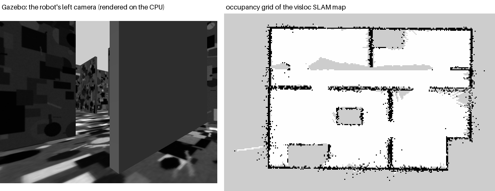
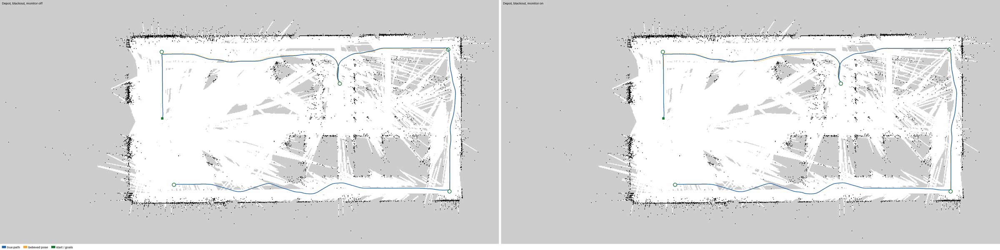
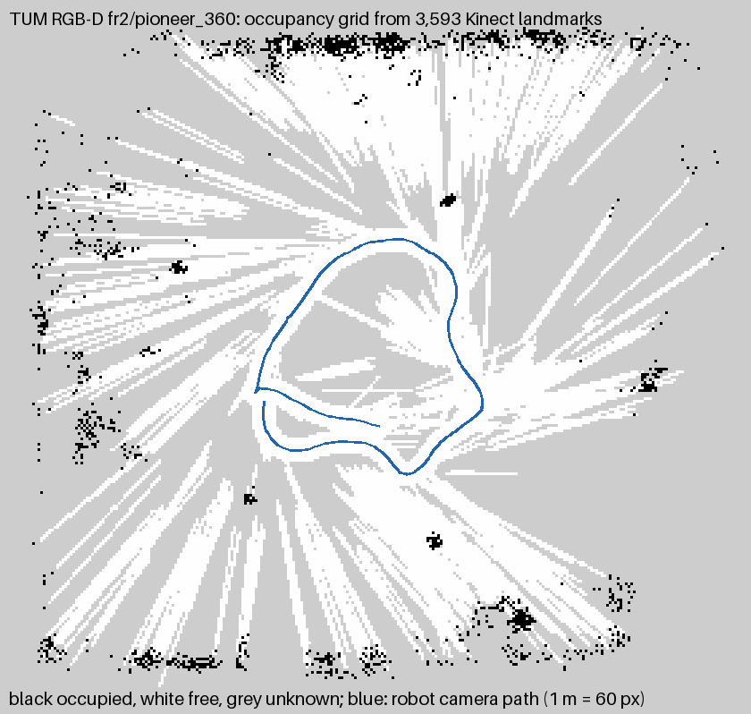

# Robot navigation with Nav2

<p align="center">
  
</p>

visloc-rs localizes a robot in a visual map. A navigation stack plans and
drives on a 2D occupancy grid. visloc-rs does not implement the navigation
stack itself: it gives [Nav2](https://docs.nav2.org) the two things Nav2
cannot get elsewhere for a camera robot.

1. **A map to plan on.** `visual_map_to_occupancy` turns a visual map (a map
   saved by the stereo-inertial SLAM, or any gravity-aligned COLMAP model)
   into the occupancy grid that Nav2's `map_server` loads (PGM + YAML).
2. **Localization in that map.** visloc publishes `map -> odom` (REP-105) from
   map-based localization, which takes the place of AMCL. The real-robot
   node is `visloc_map_localize_node`
   ([ros2/visloc-ros2](../ros2/visloc-ros2/README.md)).

The navigation results below were measured in simulation, at two levels:

- **A lightweight simulation** (`visloc_navigation::sim`): no rendering;
  the camera detects 3D texture points. It runs in real time and is
  deterministic, which makes it useful for comparing localization sources.
- **Gazebo**: rendered stereo images, an IMU and a lidar. The robot is
  driven by visloc-rs's real robot nodes (`visloc_vio_node`,
  `visloc_map_localize_node`) on a map made by visloc's own stereo-inertial
  SLAM ([below](#in-gazebo-rendered-cameras-and-the-real-nodes)).

No real robot has been driven by Nav2 on visloc localization yet. The
occupancy conversion is also shown on a real robot's map (TUM RGB-D
fr2/pioneer_360).

## Result: Nav2 on visloc localization, in simulation

<p align="center">
  
</p>

Nav2 Jazzy (planner NavFn, controller Regulated Pure Pursuit) drives the
simulated robot to five goals in turn, one in each room, then back to the
start. It runs in real time over ROS 2. The robot's `map -> odom` comes from
one of three sources:

| `map -> odom` from | goals reached | collisions | believed-pose error, RMSE / max | drive time |
| --- | ---: | ---: | --- | ---: |
| ground truth (upper bound) | **5/5** | 0 | 0 | 90 s |
| **visloc** (map-based localization + wheel odometry) | **5/5** | 0 | **3.8 cm** / 25 cm | 89 s |
| wheel odometry alone (start pose given) | 0/5 | 0 | 1.65 m / 3.07 m | 434 s |
| visloc, with a box missing from the map blocking the hallway | **5/5** | 0 | 3.5 cm / 23 cm | 99 s |

A goal counts as reached only if Nav2 reports success *and* the robot's true
pose ends within 0.3 m of it. With odometry alone, Nav2 reported two goals as
reached while the robot was 0.36 m and 0.77 m away from them, and the
other three failed or timed out. With visloc, the robot localizes 0.2 s after
start without being given an initial pose. Its believed pose stays at
centimetre level, except along the textureless hallway wall, where no fix
comes for a few seconds (the 25 cm maximum). In the last run the unmapped
box blocks the hallway between the two bedrooms. Nav2's obstacle layer sees
it on the depth scan and replans through the living room and the kitchen
(right panel), at the cost of 9 s.

What is simulated (`visloc_navigation::sim`, deterministic):

- **World.** A 10 m x 7 m apartment: five rooms joined by 1 m doorways,
  furniture, wall texture as 3D points with descriptors (15% of them
  deliberately alike, as repetitive texture), and one hallway wall left bare.
- **Robot.** Differential drive, 0.2 m radius, 0.5 m/s, with actuation noise.
- **Wheel odometry.** Wheel radii ±0.25% off and track width 2% off, plus
  noise: realistic drift.
- **Camera.** Forward, 640 x 480 pinhole, about 90 degrees across, 0.5 m up,
  5 Hz. It detects the texture points in view and not occluded, with
  0.7 px noise, noisy descriptors, 20% missed detections and 40 clutter
  keypoints per image. There is no image rendering, so feature extraction
  is not tested; matching, PnP and everything after it are.
- **Depth scan.** The horizontal slice of a depth camera, 87 degrees, 4 m,
  for Nav2's obstacle layers.
- **Map.** Built by a mapping run through every room (`nav_sim_build_map`).
  Landmarks get 2 cm of error and keyframes 1 cm, standing in for SLAM
  error. The occupancy grid is built from that map alone, not from the true
  walls.

Localization is visloc's own pipeline (`visloc_localization`): brute-force
descriptor matching with a ratio test, P3P-RANSAC and Gauss-Newton
refinement against the map's landmarks. From the second fix onward,
matching is limited to the landmarks within 8 m of the predicted camera.
Fixes go into `OdomCorrection`, the same class `visloc_map_localize_node`
uses on real robots, which gates them against the wheel odometry and keeps
`map -> odom`. A localization takes 1.2 ms. Until the first `map -> odom`,
the robot turns in place to find the map.

Note on the solver: the pipeline's default minimal solver (DLT) is degenerate
when every landmark in view is on one wall, which is common indoors, so the
simulation uses P3P as `basalt_euroc_localize_demo` does. With DLT the same
drive got stuck against a wall.

### Without ROS

`nav_sim_drive` runs the same robot, map and localization without ROS. A
waypoint follower steers on the believed pose around a patrol of every room,
twice:

```bash
cargo run --release --example nav_sim_drive -- --laps 2
```

| `map -> odom` from | waypoints reached | collisions | error RMSE / max |
| --- | ---: | ---: | --- |
| ground truth | 34/34 | 0 | 0 |
| visloc | **34/34** | 0 | **2.3 cm** / 11 cm |
| wheel odometry alone | 7/34, then stuck against a wall | yes | 0.25 m when it stopped |

`pipelines/navigation/tests/sim_robot.rs` checks part of this drive in
`cargo test`.

## Reproduce

Build the map, then convert it to the Nav2 map. `nav_sim_build_map` already
writes `occupancy.yaml`. The second command shows the conversion a real map
goes through, and gives a byte-identical grid:

```bash
cargo run --release --example nav_sim_build_map -- --out runs/nav_sim/map
```

```bash
cargo run --release --example visual_map_to_occupancy -- \
  --map-dir runs/nav_sim/map --camera-height 0.5 --out runs/nav_sim/map/occupancy
```

With ROS 2 Jazzy and Nav2 installed (`ros-jazzy-navigation2`,
`ros-jazzy-nav2-bringup`), build the node and launch everything. The node
uses pure-Rust DDS, so it needs no ROS build tooling:

```bash
cargo build --release --manifest-path ros2/visloc-ros2/Cargo.toml --bin visloc_nav_sim_node
```

```bash
ros2 launch ros2/visloc-ros2/launch/nav_sim.launch.py \
  map_dir:=runs/nav_sim/map \
  node:=ros2/visloc-ros2/target/release/visloc_nav_sim_node \
  mode:=visloc record:=runs/nav_sim/visloc.csv
```

In another shell, send the goals and score the drive:

```bash
python3 ros2/visloc-ros2/tools/nav_sim_goals.py --out runs/nav_sim/visloc.json
```

`mode:=odometry` and `mode:=ground_truth` give the other rows. For the
unmapped box, add `extra_box:=4.6,4.0,5.2,5.0,0.8`. To draw the figure:

```bash
python3 scripts/plot_nav_sim.py --map runs/nav_sim/map/occupancy.yaml \
  --run "visloc=runs/nav_sim/visloc.csv" --out runs/nav_sim/nav.png
```

RViz shows the run with the `map` fixed frame: `/map`, `/plan`,
`/local_costmap/costmap`, `/scan` and `/map_pose`.

## In Gazebo: rendered cameras and the real nodes

<p align="center">
  
</p>

The same apartment in [Gazebo](https://gazebosim.org) Harmonic, with nothing
of the lightweight simulation left but the floor plan. Gazebo renders the
cameras, so the whole camera pipeline runs: feature extraction, stereo VIO,
SLAM and map-based localization.

- **World** (`ros2/visloc-ros2/gz/make_world.py`): the apartment's walls and
  furniture with procedurally generated textures, one hallway wall bare.
- **Robot**: a differential drive, 0.2 m radius, with on `imu_link`, 0.5 m
  up, a stereo pair (640 x 480 grey, 90 degrees, 12 cm baseline, 20 Hz)
  and an IMU (200 Hz, with noise and bias), and a 2D lidar for Nav2's
  obstacle layers. There is no wheel odometry.
- **Map**: the robot is driven once around every room (`drive_route.py`)
  while `record_euroc.py` records the stereo images and the IMU.
  `basalt_euroc_online_slam_demo --save-map` builds the map from that
  recording (0.9 cm trajectory error online; 4,355 frames, 22,536
  landmarks), and `visual_map_to_occupancy` converts it (right panel).
- **Navigation** (`nav.launch.py`): `visloc_vio_node` on the stereo pair and
  the IMU gives `odom -> imu_link`. `visloc_map_localize_node` on the left
  camera, against the saved map, gives `map -> odom`. Nav2 plans on the
  converted map. This is the stack a real robot would run, except for the
  base driver.

The map is in the SLAM's own frame, which starts where mapping started. The
goals are the same five rooms, written in the world and converted to the
map with a planar transform fitted between the SLAM trajectory and Gazebo's
ground truth (`align_map.py`, 0.9 cm residual). Only the goal script and the
scoring use that transform; navigation never sees it.

<p align="center">
  
</p>

| run | goals reached | contacts | `/map_pose` error, RMSE / median / max | drive time (sim) |
| --- | ---: | ---: | --- | ---: |
| visloc VIO + map localization | **5/5** | 0 | **1.6 cm** / 1.1 cm / 4.3 cm | 116 s |
| same, with a textured box missing from the map in the hallway | **5/5** | 0 | 1.8 cm / 1.4 cm / 4.4 cm | 130 s |
| same, with a plain (textureless) box | **5/5** | 0 | 2.0 cm / 1.5 cm / 4.4 cm | 130 s |

Each goal counts as reached by the same rule as above, with the true pose
from Gazebo. The robot localizes in the map from its first image (about 400
PnP inliers), without an initial pose. The first run was repeated three
times, each with 5/5 goals and 1.6 cm RMSE. With the box, Nav2's
obstacle layer marks it from the lidar and the planner goes round through
the living room and the kitchen (right panel), about 14 s longer. Map
localization finds nothing on the box, which is not in the map, and keeps
working on the walls around it.

**Pitfall: the map frame is not on the floor.** The SLAM map's frame and the
VIO's `odom` start at the IMU, here 0.5 m above the floor, so `base_link` and
the lidar's points are at z ≈ -0.5 m in both. Nav2's obstacle layer drops
points below `min_obstacle_height`, which is set both per source and per
layer (the layer's own defaults to 0.0). With the defaults, Nav2 marked no
obstacle at all: the run without the box still passed, because the map has
every wall, and with the box the robot drove into it. `gz/nav2_params.yaml`
sets both limits to -1.5 m. A real robot with this stack needs the same, or
a floor-level `map` frame.

**VIO that has lost tracking.** When the robot drove into the box (before
that fix), the camera ended up about 10 cm from its face, too close for
stereo. The VIO had nothing to track, integrated the IMU alone, and its pose
ran off 7 m while the robot stood still. Map localization had no features
either, so nothing corrected it. `visloc_vio_node` now has a lost-tracking
monitor for that (off by default; `nav.launch.py lost_min_observations:=10
lost_max_speed:=1.0`). Too few tracked observations for 0.5 s, or an
implausible speed, resets the estimator. The node then publishes no odometry
and no `odom -> base_link` until tracking has held for 1 s, so Nav2 loses
the robot's pose and stops it. Each reset is announced on `odom_reset`, on
which `visloc_map_localize_node` drops its `map -> odom` and relocalizes
(before, it applied its old correction to the VIO's new `odom` frame after
every reset, including the resets that already followed estimator errors).

To test it, `gz/camera_blackout.py` blanks both cameras for 5 simulated
seconds as the robot drives down the hallway (from world (4.5, 4.5), on the
way to the second goal); `nav_goals.py --retries 3` sends a goal Nav2 gave
up on again once the robot has been localized for 2 s, as a supervisor
would. Two pairs of runs, the second with a chase camera rendered for the
video below (more CPU load, so the VIO dropped a few frames):

| 5 s camera blackout in the hallway | goals reached | contacts | `/map_pose` error, RMSE / max | robot during the blackout |
| --- | ---: | ---: | --- | --- |
| monitor off | 5/5 | 0 | 5.6 cm / **43 cm** | drives on blind for 1.5 m |
| monitor on (`lost_min_observations 20`, `lost_max_speed 1.0`) | 5/5 (goal 2 on the 2nd try) | 0 | 1.5 cm / 4.4 cm | stops within 7 cm |
| monitor off, with the chase camera | 5/5 | 0 | 1.9 cm / **13 cm** | drives on blind |
| monitor on (`lost_min_observations 10`), with the chase camera | 5/5 (goal 2 on the 2nd try) | 0 | 1.4 cm / 4.1 cm | stops |

<p align="center">
  
</p>

Without the monitor, the VIO carried on on the IMU alone. The robot drove
on, steering on a pose that drifted up to 43 cm off, 35 cm of it across a
hallway 0.9 m wide. It snapped back when the cameras returned. Here
the hallway was straight and empty, so the robot got through; it was luck.
With the monitor, tracking counted as lost 0.5 s into the blackout and Nav2
aborted the goal; the robot stopped about 7 cm on. The estimator was reset
every 0.5 s while the images stayed blank (9 resets). 1 s after the
cameras came back, the VIO published again, map localization had its new
`map -> odom` at once, and the second try reached the goal. The error
column counts only the poses that were published. How far the blind
robot's pose drifts differs from run to run (43 cm, then 13 cm): it is
the IMU alone, integrated for 5 s.

**A false alarm, and getting out of it.** With `lost_min_observations 20`
and the chase camera's extra load, the monitor fired before the blackout:
the VIO dropped frames and tracked 19 observations for 0.5 s at the second
goal's start. The robot stopped facing a nearly bare wall, where map
localization found 11 inliers (it needs more), so it never relocalized and
the goal timed out. Two changes: the threshold went down to 10, and
`nav_goals.py --spin-after 5` turns the robot 90 degrees with Nav2's Spin
behavior (on odometry alone) when it has had odometry but no map pose for
5 s, until the map comes into view. With both, the second pair of runs
above had no false alarm (the 9 resets all fell in the blackout) and needed
no spin. In normal driving frames went down to 5 tracked observations,
briefly. A gap longer than a few seconds still needs someone (or a behavior
tree) to resend the goal, and the robot stays where it stopped until the
cameras see again; wheel odometry would let it go on.

The second pair of runs as seen from a camera following the robot (Gazebo,
rendered for the video only; it sees a plain floor through a visibility
mask, the robot's cameras the textured one). The cyan ring is where visloc
puts the robot; the robot's own (left) camera is in the corner:
[media/gz_nav2_blackout_3d.mp4](media/gz_nav2_blackout_3d.mp4).

### A public warehouse: the Depot

The apartment's walls and floor carry random patterns made to give the
cameras features. The same stack also runs in a realistic scene: the
Depot, a 30 m x 15.6 m warehouse with PBR materials (brick walls, steel
racks, crates, a concrete floor) published by OpenRobotics on Gazebo Fuel
under CC BY 4.0. `gz/make_depot_world.py` puts the same robot in it. The
Depot's only collision geometry is its floor, so the script projects the
meshes (3 to 60 cm above the floor) into a grid of what the robot can hit;
the mapping route, the contact count and the clearance check use that grid.
Everything else is as in the apartment, with nothing tuned for the place.

- **Map.** A 115 m mapping drive around the hall and between the racks;
  visloc's SLAM puts its trajectory within 4.0 cm RMSE (9.5 cm max) of the
  ground truth, with 25,972 landmarks.
- **Occupancy grid.** `visual_map_to_occupancy --max-range 20`. The
  default 8 m ray range is too short for a 30 m hall: it left most of the
  hall unknown and marked little more than the near walls.
- **Navigation.** Five goals across the hall, a 5 s camera blackout once the
  robot crosses x = -4 m on the way to the second
  (`camera_blackout.py --cross-x -4`), the chase camera on in both runs:

| Depot, 5 s camera blackout | goals reached | contacts | `/map_pose` error, RMSE / max | robot during the blackout |
| --- | ---: | ---: | --- | --- |
| monitor off | 5/5 | 0 | 6.0 cm / **20 cm** | drives on blind for 1.5 m |
| monitor on (`lost_min_observations 10`), reset prior, `--spin-after 5` | 5/5 (goal 2 on the 2nd try) | 0 | 6.1 cm / 14 cm | stops within about 15 cm |

<p align="center">
  
</p>

The error is larger than in the apartment (1.6 cm RMSE) because most of
what the cameras see in the hall is metres away. The blackout run with the
monitor first failed: after the reset, map localization found 3 to 11
inliers on every image and never relocalized, even after three spins. Most
of its fixes in the Depot (120 of 144 before the blackout) come from
projection matching, which needs a prior pose, and after an odometry reset
there was none; map-wide matching does poorly in a large hall of repeated
bricks and racks. `visloc_map_localize_node` now keeps the body's last map
pose over a reset and uses it, moved by the new frame's odometry, as the
projection prior (`reset_prior_s`, 30 s, and within `projection_fresh_m` of
travel): the monitor has just stopped the robot, so it is still about
there. Fixes found with it pass the same quality gate and must agree like
any others. In the run above, the three fixes that set the new correction
were projection fixes, after the third spin had turned the robot toward a
part of the hall the map covers well. One run each, so this shows that the
prior can make the difference, not how often.

The two runs from the chase camera:
[media/gz_depot_blackout_3d.mp4](media/gz_depot_blackout_3d.mp4).

The visual map has no colour. For a colour view, the same mapping drive also
recorded a colour camera at cam0's pose (`make_depot_world.py --rgb-twin`,
5 Hz; no visloc node reads it). Those 2,102 images, posed by the SLAM
trajectory (not by ground truth), went into a COLMAP model, and
`gsplat_train` turned that into a 3D Gaussian splat: 7,000 steps, 311k
Gaussians, held-out PSNR 22.1 dB, about 95 minutes on the CPU (lavapipe
Vulkan). The splat looks right from about the camera's height, where the
images were taken. From a chase camera 1.9 m up it blurs: no image saw the
place from there. So this video renders it at the robot's camera pose, through
the "monitor on" run, next to what the robot's camera saw:
[media/gz_depot_3dgs_fpv.mp4](media/gz_depot_3dgs_fpv.mp4).


Gazebo renders on the CPU here (no GPU), which makes the simulation run at
about a tenth of real time. Every node runs on simulation time, so Nav2 and
the visloc nodes see a normal-speed robot; a 2-minute drive takes about
20 minutes.

### Reproduce in Gazebo

Needs ROS 2 Jazzy, Nav2 and `ros-jazzy-ros-gz` (Gazebo Harmonic). Build the
nodes and the SLAM:

```bash
cargo build --release --manifest-path ros2/visloc-ros2/Cargo.toml \
  --bin visloc_vio_node --bin visloc_map_localize_node
```

```bash
cargo build --release --example basalt_euroc_online_slam_demo --example visual_map_to_occupancy
```

Make the world, then map. In one shell, start Gazebo and the bridge; in a
second, record; in a third, drive the route, then stop the recorder with
Ctrl-C:

```bash
python3 ros2/visloc-ros2/gz/make_world.py --out runs/gz_nav/world
```

```bash
(cd runs/gz_nav/world && gz sim -s -r --headless-rendering apartment.sdf) &
ros2 run ros_gz_bridge parameter_bridge --ros-args \
  -p config_file:=ros2/visloc-ros2/gz/bridge.yaml -p use_sim_time:=true
```

```bash
python3 ros2/visloc-ros2/gz/record_euroc.py --out runs/gz_nav/mapping
```

```bash
python3 ros2/visloc-ros2/gz/drive_route.py
```

Build the map, its occupancy grid, and the world-from-map transform for the
goals:

```bash
target/release/examples/basalt_euroc_online_slam_demo \
  --euroc-dir runs/gz_nav/mapping \
  --calibration runs/gz_nav/world/calibration.json \
  --config configs/basalt/variants/official_euroc_ds/euroc_config.json \
  --out-dir runs/gz_nav/slam --save-map runs/gz_nav/map
```

```bash
target/release/examples/visual_map_to_occupancy \
  --map-dir runs/gz_nav/map --camera-height 0.5 --out runs/gz_nav/map/occupancy
```

```bash
python3 ros2/visloc-ros2/gz/align_map.py --trajectory runs/gz_nav/slam/trajectory_online.tum \
  --ground-truth runs/gz_nav/mapping/mav0/state_groundtruth_estimate0/data.csv \
  --out runs/gz_nav/map/world_from_map.json
```

Navigate: launch Gazebo, the visloc nodes and Nav2, then send the goals from
a second shell:

```bash
ros2 launch ros2/visloc-ros2/gz/nav.launch.py world:=runs/gz_nav/world/apartment.sdf \
  map:=runs/gz_nav/map nodes:=ros2/visloc-ros2/target/release
```

```bash
python3 ros2/visloc-ros2/gz/nav_goals.py --world-from-map runs/gz_nav/map/world_from_map.json \
  --out runs/gz_nav/nav.json --record runs/gz_nav/nav.csv
```

If Nav2's bringup stalls (the launch never logs `lifecycle_manager_navigation`
"Managed nodes are active"; here about one launch in three), stop everything
and launch again.

For the camera blackout, launch with `camera_suffix:=image
lost_min_observations:=10 lost_max_speed:=1.0` (or without the last two for
the run without the monitor), run the relay in another shell, and add
`--retries 3 --spin-after 5` to `nav_goals.py`:

```bash
python3 ros2/visloc-ros2/gz/camera_blackout.py --at 4.5,4.5 --duration 5 \
  --log runs/gz_nav/blackout.json
```

The figure above is `plot_nav_sim.py` with `--crop 3.5,3.6,7.5,5.4`.

For the Depot, fetch the model, make the world (`--gt-grid` needs
`pycollada`; `--rgb-twin` adds the colour camera used for the 3DGS below),
map with `drive_route.py --scene runs/gz_depot/world/scene.json`, convert
the map with `--max-range 20`, and pass the same `--scene` to
`nav_goals.py`:

```bash
curl -L -o runs/gz_depot/depot.zip https://fuel.gazebosim.org/1.0/OpenRobotics/models/Depot.zip
unzip runs/gz_depot/depot.zip -d runs/gz_depot/depot_model
```

```bash
python3 ros2/visloc-ros2/gz/make_depot_world.py --depot runs/gz_depot/depot_model \
  --out runs/gz_depot/world --gt-grid
```

For the unmapped box, make a second world with
`--extra-box 4.6,4.0,5.2,5.0,0.8` (add `--extra-box-plain` for the
textureless one), launch on it, and pass the same `--extra-box` to
`nav_goals.py`, which needs it to count contacts. To draw a run on the map:

```bash
python3 scripts/plot_nav_sim.py --map runs/gz_nav/map/occupancy.yaml \
  --world-from-map runs/gz_nav/map/world_from_map.json \
  --run "visloc=runs/gz_nav/nav.csv" --out runs/gz_nav/nav.png
```

## Real to sim: a simulator made of a 3D Gaussian splat of real photos

Gazebo needs a world modelled by hand. Here the world is the splat that
visloc-rs's own SfM and 3DGS make from photos of a real place, and Nav2
drives a robot through it on visloc localization. Everything is from public
data and runs on a CPU.

<p align="center">
  
</p>

**The place.** TUM RGB-D fr2/pioneer_360, pioneer_slam and pioneer_slam3
(CC BY 4.0): a Pioneer robot with a Kinect drives loops in a hall, at the
height a robot's camera is. One in five frames, 1,339 in all, undistorted
with the Kinect's calibration.

**SfM.** `gsplat_photos --steps 0 --cpu` with the intrinsics held fixed:
1,334 of 1,339 images registered, 61,110 points, 9 minutes on 4 cores.
Photo SfM has no scale and no up. `gs/align_sfm_tum.py` fits the one
similarity (7 numbers) that takes the SfM camera centres onto the motion
capture (metres, z up, the floor at z = 0). The ground truth sets only those
7 numbers: every pose is the SfM's. After the fit, the SfM's own camera
centres are 3.7 cm RMSE from the motion capture over the three sequences.

**3DGS.** `gsplat_train` on the metric model, 20 px cropped off the
undistortion's border: 7,000 steps, 403k Gaussians, held-out PSNR 25.0 dB,
2.3 hours on the CPU (lavapipe Vulkan).

**The simulator** (`gs/gs_sim.py`):

- **Robot.** A differential drive on `cmd_vel`. Its wheel odometry (`odom ->
  base_link`) has a 2% distance-scale error, a 3% turn-rate error and a
  0.002 rad/s yaw bias.
- **Camera.** `gsplat_render_server` renders the splat at the camera's
  pose with the Kinect's own lens distortion, 640 x 480 at 10 Hz, about
  70 ms an image.
- **Collisions and scan.** The splat has no collision geometry, so
  `gs/make_gs_scene.py` builds a 2D grid of what the robot can hit from
  the opaque, small Gaussians 6–80 cm above the floor. Cells within 0.45 m
  of the capture path are free, since the robot drove there. Cells farther
  than 1.5 m from every training camera are a fence, because the splat is
  only trustworthy near its photos. A 360° scan is ray-cast in that grid.
- **Clock.** The simulator owns `/clock`, and each step waits for its
  image, so a slow renderer slows simulated time rather than the robot.

**Localization.** The map comes from `tum_rgbd_save_map --keep-world`
along pioneer_slam's SfM poses, and `visloc_map_localize_node` localizes the
rendered camera against it (`--extrinsics tf`). Two maps were tried, each
on the same 39 m drive along pioneer_slam's path (`gz/drive_route.py`):

| Map built from | Images localized | `/map_pose` error, RMSE / median / max |
| --- | ---: | --- |
| the real Kinect images and depth | 4 of 450 | 52 / 43 / 100 cm (wheel odometry) |
| **the splat's renders and depth** (`gs/render_tum_seq.py`) | **216 of 350** | **6.7 / 1.3 / 44 cm** |

The renders look like the photos, as the figure shows. But they are softer:
150–400 ORB corners an image, with descriptors that rarely match the real
images' within the quality gate. So a map of the real images does not
localize the simulator's camera. A map of the splat's own renders does. That
is also what a robot would build if it mapped inside the simulator. A real
robot uses real images for both the map and the queries.

**Nav2.** `gs/gs_nav.launch.py` starts the simulator, map localization on
the render map, map_server on that map's occupancy grid and Nav2 (the
Gazebo setup's `nav2_params.yaml`). `nav_goals.py --scene` sends 5 goals
spread over the hall:

| Run | Goals reached | Contacts | `/map_pose` error, RMSE / median / max | Drive |
| --- | ---: | ---: | --- | --- |
| 3DGS simulator, render map | **5/5** (goal 5 on the 2nd try) | 0 | 8.7 / 1.8 / 28 cm | 106 s simulated |

Video: [media/gs_tum_nav.mp4](media/gs_tum_nav.mp4). Where Nav2's path
leaves the capture paths, the camera sees the splat's floaters. Localization
then waits for the next good view, and the wheel odometry carries the pose
until it comes.

### Reproduce the 3DGS simulator

```bash
for s in 360 slam slam3; do
  curl -L https://cvg.cit.tum.de/rgbd/dataset/freiburg2/rgbd_dataset_freiburg2_pioneer_$s.tgz | tar -xz -C runs/gs_tum/data
done
# undistort every 5th frame into runs/gs_tum/images as <sequence>_<timestamp>.png (OpenCV, the Kinect's
# fr2 calibration, the same K out), then:
cargo run --release -p visloc-gsplat-train --features gpu,euroc --example gsplat_photos -- \
  --images runs/gs_tum/images --out runs/gs_tum/sfm --steps 0 --cpu \
  --camera "PINHOLE 640 480 520.9 521.0 325.1 249.7" --no-refine-intrinsics \
  --window 20 --retrieval 30 --max-keypoints 4096 --mask-black 12
python3 ros2/visloc-ros2/gs/align_sfm_tum.py --model runs/gs_tum/sfm/sparse/0 \
  --images runs/gs_tum/sfm/images --data runs/gs_tum/data --out runs/gs_tum/metric
# crop 20 px off each side of the images (PINHOLE 600 440 520.9 521 305.1 229.7) into runs/gs_tum/train, then:
cargo run --release -p visloc-gsplat-train --features gpu --example gsplat_train -- \
  --data runs/gs_tum/train --steps 7000 --max-gaussians 400000 --out runs/gs_tum/scene.ply
CAM="FULL_OPENCV 640 480 520.9 521.0 325.1 249.7 0.2312 -0.7849 -0.0033 -0.0001 0.9172 0 0 0"
python3 ros2/visloc-ros2/gs/render_tum_seq.py --splat runs/gs_tum/scene.ply \
  --trajectory runs/gs_tum/metric/slam.tum --out runs/gs_tum/render_slam --camera "$CAM"
cargo run --release --features image-io --example tum_rgbd_save_map -- \
  --seq-dir runs/gs_tum/render_slam --trajectory runs/gs_tum/metric/slam.tum --out runs/gs_tum/map \
  --fx 520.9 --fy 521.0 --cx 325.1 --cy 249.7 --k1 0.2312 --k2 -0.7849 --p1 -0.0033 --p2 -0.0001 \
  --k3 0.9172 --match-radius-px 12 --max-depth 6 --keyframe-m 0.05 --keyframe-deg 4 --max-hamming 70 --keep-world
cargo run --release --example visual_map_to_occupancy -- --map-dir runs/gs_tum/map --floor-z 0 \
  --max-range 8 --out runs/gs_tum/map/occupancy
python3 ros2/visloc-ros2/gs/make_gs_scene.py --splat runs/gs_tum/scene.ply \
  --model runs/gs_tum/metric/sparse/0 --out runs/gs_tum/sim/scene.json --camera "$CAM" \
  --camera-height 0.55 --camera-forward 0 --start=-2.33,-2.18,1.0
# add "goals": [[x, y, yaw], ...] to scene.json, then:
ros2 launch ros2/visloc-ros2/gs/gs_nav.launch.py scene:=runs/gs_tum/sim/scene.json map:=runs/gs_tum/map
python3 ros2/visloc-ros2/gz/nav_goals.py --world-from-map identity.json \
  --scene runs/gs_tum/sim/scene.json --retries 3 --spin-after 5 --out runs/gs_tum/nav.json
```

`identity.json` is `{"x": 0, "y": 0, "yaw": 0}`: the simulator's world is
the map's frame.

### A street from a 360-degree video

A 360° camera sees every direction at once, so one walk trains the splat
for every heading the robot may face. The source is walk 0313afa5 of
[OverMaps360_50](https://huggingface.co/datasets/OverTheReality/OverMaps360_50)
(an Insta360 X5 carried on a pole through a town's streets; CC BY-NC 4.0,
gated on Hugging Face; faces and plates are blurred in the data). Its first
300 frames cover 121 m of walking, 100 s.

- **SfM.** `gsplat_photos --insv ... --max-size 640 --window 2 --cpu
  --imu-frame-period 0.333683` registered all 3,000 lens faces, with
  497,069 points, in 61 minutes. The camera's own IMU gives the model's
  scale: 1.1507 m per unit ([insta360_imu_scale.md](insta360_imu_scale.md)).
  So no ground truth is used at all.
- **Levelling.** `gs/level_sfm.py` puts z up from the cameras' mean up and
  the floor at 0 from a RANSAC plane under them. The camera rode 2.26 m above
  the ground. The street climbs by about 0.9 m over its last 40 m, so
  `make_gs_scene.py --terrain` takes the ground's height from the camera
  path.
- **3DGS.** `gsplat_train --alpha-mask` on the faces, with the dataset's
  blacked-out pixels (blurred faces, the camera's pole) left out of the
  loss: 7,000 steps, 607k Gaussians, held-out PSNR 22.0 dB, 2.9 hours on the
  CPU.
- **Robot.** Its camera is at the capture height, 2.26 m over the ground, a
  pole-mounted camera. A splat only looks right near the height of its
  photos. It renders one 640 x 640, 90° face ahead; with `--mono`, because
  640 x 640 rgb8 messages (1.2 MB) did not get through RustDDS to the
  localization node. The fence keeps the robot within 3 m of the walk.
- **Localization map.** `render_tum_seq.py` renders the 6 horizontal faces
  of every frame, colour and depth, and `tum_rgbd_save_map` builds the map
  from them: 1,799 keyframes, 40,345 landmarks. The occupancy grid comes
  from that map.

Nav2 drove to 4 goals spread along the walk, the last one at its end:

| Run | Goals reached | Contacts | `/map_pose` error, RMSE / median / max | Images localized |
| --- | ---: | ---: | --- | ---: |
| default projection window (5 s, 2 m) | 3/4 | 0 | 94 / 2.4 / 250 cm | 466 of 800 |
| `--projection_fresh_s 60 --projection_fresh_m 15 --projection_radius 40` | **4/4** | 0 | **3.6 / 1.7 / 21 cm** | 694 of 850 |

In the first run, Nav2 cut across an S-bend about 64 m along the walk, away
from where the photos were taken. The renders there broke up, and a few
localizations failed in a row. That put the robot more than 2 m from its last
fix, so map localization stopped searching around the predicted pose. The
map-wide search does not work on renders (3 to 26 inliers), and none
succeeded again. The wheel odometry then drifted 2.4 m, and the last goal
could not be planned. With a 60 s, 15 m projection window, the search around
the predicted pose picks up again where the renders are good. Of 850
localizations, 692 were by projection.

Video: [media/gs_street_360.mp4](media/gs_street_360.mp4). First, the
real 360° frames against the simulator at the same spots. Then the robot's
drive, filmed by a chase camera in the splat 3.2 m behind it and 2.75 m up,
near the capture height. The robot is a simple 3D model drawn into the
render, hidden where the splat's depth is in front of it.

The overlays show the localization itself:

- **Green rays** run from the robot's camera to the map landmarks that its
  latest localization matched (its PnP inliers, from
  `visloc_map_localize_node`'s new `dump_inliers` CSV). White dots are the
  map's other landmarks within 12 m.
- **The inset** is the camera image that was localized, with the matched
  keypoints circled.
- **The cyan ring** is where visloc puts the robot.

The video is of a third run with the same settings. It reached 4/4 goals with
no contacts, at 4.1 / 1.7 / 34 cm `/map_pose` error (RMSE / median / max).

## The occupancy grid of a visual map

A sparse visual map says where there is something (a landmark). Along every
ray from a camera to a landmark it observed, it also says where there is
nothing. `visloc_navigation::OccupancyMapper` accumulates both as log-odds
in a 2.5D grid: per 5 cm cell, and per 25 cm slice of the robot's height
band (0.1–1.5 m above the floor by default). It then projects them to 2D:

- **Occupied**: some slice holds at least two landmark hits and positive
  evidence.
- **Free**: the lowest slice was seen through and nothing is occupied, or the
  mapping robot drove there. Because obstacles stand on the floor, a column
  seen free only higher up (the inside of a sofa, seen over its back) stays
  unknown.
- **Unknown**: everything else, including textureless walls. A visual map
  cannot see a bare wall, so set Nav2's planner `allow_unknown: false` and
  give it a depth sensor. The parameters in
  `ros2/visloc-ros2/launch/nav_sim_nav2_params.yaml` do both.

Walls come out as dotted lines, with a cell for every textured point.
Inflation by the robot radius closes the gaps for planning.

### On real data: TUM RGB-D fr2/pioneer_360

<p align="center">
  
</p>

The real-data check uses [TUM RGB-D](https://cvg.cit.tum.de/data/datasets/rgbd-dataset)
fr2/pioneer_360: a Pioneer robot with a Kinect drives loops in a large
hall. The map is built with `tum_rgbd_save_map` from the sequence's
motion-capture trajectory, so this tests the conversion on real landmarks
(Kinect depth, ORB corners) but not SLAM. It has 3,593 landmarks and 262
keyframes. The floor is a clear peak of landmarks 0.52 m below the camera,
which gives `--camera-height 0.52`. The grid shows the hall's walls as
straight edges about 12.6 m apart, and the objects in it. The loop's inside
stays unknown: the forward camera never looked at it. Free space is sparse,
along the rays to the landmarks, which is the limit of a sparse visual map.
A depth sensor's obstacle layer in Nav2, or a denser map, fills it in.

```bash
cargo run --release --features image-io --example tum_rgbd_save_map -- \
  --seq-dir rgbd_dataset_freiburg2_pioneer_360 \
  --trajectory rgbd_dataset_freiburg2_pioneer_360/groundtruth.txt --out runs/pioneer_map \
  --fx 520.9 --fy 521.0 --cx 325.1 --cy 249.7 \
  --k1 0.2312 --k2 -0.7849 --p1 -0.0033 --p2 -0.0001 --k3 0.9172 \
  --match-radius-px 12 --max-depth 6 --keyframe-m 0.05 --keyframe-deg 4 --max-hamming 70
```

```bash
cargo run --release --example visual_map_to_occupancy -- \
  --map-dir runs/pioneer_map --camera-height 0.52 --out runs/pioneer_map/occupancy
```

For a map from `basalt_euroc_online_slam_demo --save-map`:

```bash
cargo run --release --example visual_map_to_occupancy -- \
  --map-dir runs/office_map --camera-height 0.55 --out runs/office_map/occupancy
```

`--camera-height` is the camera's height above the floor on the robot: the
floor is the median camera height minus it. You can give `--floor-z`
instead. The map must be gravity-aligned with `z` up, which the
stereo-inertial SLAM's maps are. Photo SfM models are not, unless you align
them first. Other options: `--resolution`, `--min-height` / `--max-height`
(the obstacle band), `--max-range`, `--min-hits`, `--free-radius` (the disc
cleared around each camera position).

## On a real robot

Replace `visloc_nav_sim_node` with the real nodes: the robot's base driver
(`odom -> base_link`), `visloc_vio_node` and `visloc_map_localize_node`
(`map -> odom`), and a depth camera or a laser for the obstacle layers.
Then run Nav2's `navigation_launch.py` with `map_server` on the converted
map, and no AMCL. `ros2/visloc-ros2/gz/nav.launch.py` is that setup in
Gazebo, without wheel odometry; on a robot, add the base driver's odometry
and keep the VIO for `odom -> base_link` or the other way round. This has
not been tried on a robot yet. The OpenLORIS
results in [openloris_map_localization.md](openloris_map_localization.md)
are the localization half of it, with no navigation.
