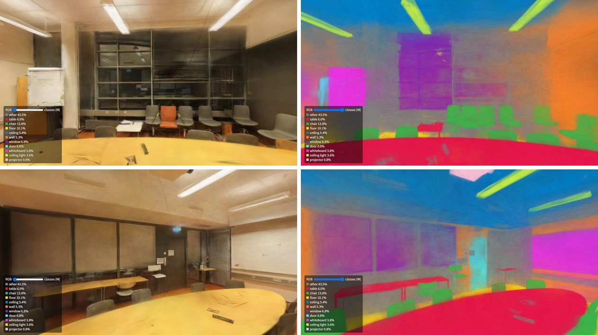

# Semantic splats: SAM 3 classes on the gaussians

A trained splat can carry a class per gaussian, voted from per-pixel labels
of its photos:

1. **Label the photos.** `scripts/sam3_labels.py` runs
   [SAM 3](https://huggingface.co/facebook/sam3) on each training image with
   a list of text prompts.
2. **Vote.** `gsplat_semantic_cuda` renders every view and adds each splat's
   blending weight to the class of the pixel it lands in. A gaussian takes
   the class with the most weight.
3. **Look.** The web viewer (`docs/euroc_splat`) blends the splat's colours
   into the classes' with a slider.

<p align="center">
  
</p>

<p align="center"><sub>FIORD's MeetingRoom_In (CC BY 4.0), 106 photos of a 200° fisheye: the splat (left) and its gaussians painted by class (right), in the web viewer.</sub></p>

```bash
# 1. SAM 3 labels: <run>/labels/<image>.png and classes.txt
python scripts/sam3_labels.py --images run/images --out run/labels \
    --prompts "table,chair,floor,ceiling,wall,window,door,whiteboard,ceiling light,projector"
# 2. The votes: semantic.ply, and the web viewer's files in run/web
gsplat_semantic_cuda --ply run/scene.ply --data run --labels run/labels \
    --out run/semantic.ply --web run/web
# 3. Serve a directory holding docs/euroc_splat and run/web, then open
#    euroc_splat/index.html?url=/web/scene.splat&semantic=/web/semantic.splat&cameras=/web/cameras.json
```

`run` is a `gsplat_photos` output trained by `gsplat_train_cuda` (any COLMAP
model with its images and a `scene.ply`).

## Labels from SAM 3

`sam3_labels.py` takes SAM 3 through Hugging Face transformers
(`Sam3Model`). It needs torch, a transformers with SAM 3, and access to the
gated `facebook/sam3` checkpoint (`hf auth login`).

- **Prompts.** SAM 3 finds every instance of each prompt. A pixel takes the
  prompt of the highest-scoring instance that covers it, and class 0,
  "other", where none does. The image's features are computed once, each
  prompt's text once.
- **No label.** Where the image's alpha masks it out, the pixel gets 255
  and casts no vote: past `--max-angle` and under a `--camera-mask`, as
  `gsplat_photos` wrote them.
- **Output.** `<out>/<image name>.png` (8-bit grey, the class index) and
  `<out>/classes.txt` (`index r g b name` per line). `--preview` also writes
  each photo with its classes over it.
- **Upright.** SAM 3 reads the scene from the image's orientation. FIORD's
  photos are upside down, and without `--rotate 180` SAM 3 labels their
  floor as ceiling and their ceiling as floor. `--rotate` turns each image
  for SAM 3 and turns the labels back.

On an 8 GB laptop GPU in bf16, ten prompts take 0.75 s per 800 px image.

## The vote

`CudaGsplat::vote_labels` renders a view and runs the compositing loop
again: at each pixel with a class, each splat's blending weight there
(`T_i a_i`, the weight its colour gets in the render) is added to that
splat's tally for the pixel's class. The tallies sum over all views on the
device; `votes` copies them back.

- **Through the lens.** The projection is the renderer's, so a fisheye's
  views vote through their lens, past 90° too.
- **The class.** `semantic::label_gaussians` gives each gaussian its class
  with the most weight. Its confidence is that class's share of the
  gaussian's weight. A gaussian no labelled pixel saw gets class 255.
- **Tested.** Against the CPU f64 oracle, with one splat white and the rest
  black, so the oracle's render is that splat's weight per pixel. The
  votes agree to 1.7e-5 over a pinhole and fisheyes
  ([gsplat_cuda.md](gsplat_cuda.md#against-the-cpu-oracle)).

`--out` gets the splat painted by class: the class colour as degree-0 SH,
the geometry and opacity unchanged. It has two extra float properties,
`class` and `class_confidence`, which readers that do not know them skip.
`--web <dir>` writes the viewer's files:

- `scene.splat` and `semantic.splat`, the same `--max` gaussians in the
  same order.
- `semantic.json`, the legend.
- `cameras.json`, the capture viewpoints.

## MeetingRoom_In

The splat is the front lens of FIORD's MeetingRoom_In, with the lens
refined and the tripod masked out
([fisheye.md](fisheye.md#fiord-a-200-insta360-through-its-factory-calibration)):
106 photos at 800 px, 88,309 gaussians.

- **SAM 3:** the ten prompts above with `--rotate 180`, 89 s for the 106
  photos. 20% of the labelled pixels are "other".
- **The vote:** 0.5 s for the 106 views. Every gaussian is seen by a
  labelled pixel. The mean confidence is 0.80.
- **Gaussians by class:** 44% are "other", twice its share of pixels. The
  floor, ceiling and walls are covered by few large gaussians: their median
  volume is 60 times that of the "other" gaussians.

`--check` holds out every 8th view, as training did, and lets only the
other 92 vote. It then renders the painted splat at the 14 held-out views
and compares each pixel's class with SAM 3's label of that photo. A pixel's
class is the class colour nearest its render.

| | Pixel accuracy | mIoU (11 classes) |
|---|---|---|
| Held-out views | 82.6% | 71.3% |

| Class | IoU | Class | IoU |
|---|---|---|---|
| table | 91.6% | window | 31.3% |
| chair | 75.9% | door | 76.8% |
| floor | 83.6% | whiteboard | 94.4% |
| ceiling | 87.9% | ceiling light | 34.3% |
| wall | 63.4% | projector | 92.5% |
| other | 52.0% | | |

Windows and ceiling lights score lowest. These numbers measure agreement
with SAM 3's labels of the held-out photos, not with a ground truth.

## The viewer

`docs/euroc_splat/index.html` (antimatter15's WebGL viewer) takes these
parameters:

- `?url=scene.splat&semantic=semantic.splat` loads both splats. A slider,
  or the M key, blends the scene's colours into the classes'.
- `&blend=1` starts on the classes.
- The legend comes from the `.json` beside the class splat.
- `&cameras=cameras.json` starts at the first capture viewpoint, and the
  number keys step through the captures.

## Not done

- **Instances.** Each class has no instance IDs; two chairs are one class.
- **The labels in training.** The classes come after training and do not
  shape the gaussians. A gaussian that straddles two objects takes one
  class.
