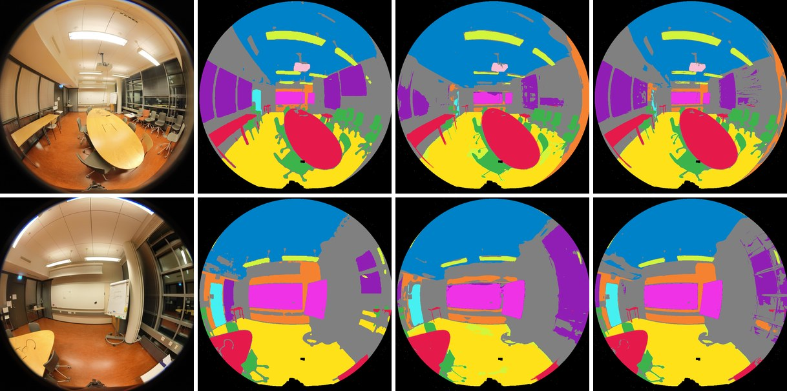

# Semantic splats: SAM 3 classes on the gaussians

A trained splat can carry a class per gaussian, and an object, voted from
per-pixel labels of its photos:

1. **Label the photos.** `scripts/sam3_labels.py` runs
   [SAM 3](https://huggingface.co/facebook/sam3) on each training image with
   a list of text prompts.
2. **Vote.** `gsplat_semantic_cuda` renders every view and adds each splat's
   blending weight to the class of the pixel it lands in. A gaussian takes
   the class with the most weight.
3. **Objects.** With `--instances`, each photo's SAM 3 instances vote the
   same way. The instances of one class that share gaussians across photos
   merge into one 3D object ([Objects](#objects)).
4. **Look.** The web viewer (`docs/euroc_splat`) blends the splat's colours
   into the classes' or the objects' with a slider.

The labels can also shape the training itself (`gsplat_train_cuda
--labels`). The held-out pixels that agree with SAM 3 rise at the same
PSNR: from 79–85% to 88.0% on MeetingRoom_In, and from 87% to 91.3% on
Building_In. Outdoors, on Bridge_Out, they rise from 93.7% to 95.2%, 0.1 dB
lower on average. Letting the labels change the splats' shapes too
(`--semantic-shape`) gives 89.8%, 92.4% and 95.7%, but grows large splats
that showed as floaters in some MeetingRoom_In runs
([Training with the labels](#training-with-the-labels)).

<p align="center">
  
</p>

<p align="center"><sub>FIORD's MeetingRoom_In (CC BY 4.0), 106 photos of a 200° fisheye: the splat (left), its gaussians painted by class (middle) and by object (right), in the web viewer.</sub></p>

```bash
# 1. SAM 3 labels: <run>/labels/<image>.png, classes.txt and instances/
python scripts/sam3_labels.py --images run/images --out run/labels --instances \
    --prompts "table,chair,floor,ceiling,wall,window,door,whiteboard,ceiling light,projector"
# 2. The votes: semantic.ply, and the web viewer's files in run/web
gsplat_semantic_cuda --ply run/scene.ply --data run --labels run/labels \
    --out run/semantic.ply --web run/web --instances
# 3. Serve a directory holding docs/euroc_splat and run/web, then open
#    euroc_splat/index.html?url=/web/scene.splat&semantic=/web/semantic.splat&instances=/web/instances.splat&cameras=/web/cameras.json
```

`run` is a `gsplat_photos` output trained by `gsplat_train_cuda` (any COLMAP
model with its images and a `scene.ply`).

## Labels from SAM 3

`sam3_labels.py` takes SAM 3 through Hugging Face transformers
(`Sam3Model`). It needs torch, a transformers with SAM 3, and access to the
gated `facebook/sam3` checkpoint (`hf auth login`).

- **Prompts.** SAM 3 finds every instance of each prompt. A pixel takes the
  prompt of the highest-scoring instance that covers it, and class 0,
  "other", where none does. The image's features are computed once, each
  prompt's text once.
- **No label.** Where the image's alpha masks it out, the pixel gets 255
  and casts no vote: past `--max-angle` and under a `--camera-mask`, as
  `gsplat_photos` wrote them.
- **Output.** `<out>/<image name>.png` (8-bit grey, the class index) and
  `<out>/classes.txt` (`index r g b name` per line). `--preview` also writes
  each photo with its classes over it.
- **Upright.** SAM 3 reads the scene from the image's orientation. FIORD's
  photos are upside down, and without `--rotate 180` SAM 3 labels their
  floor as ceiling and their ceiling as floor. `--rotate` turns each image
  for SAM 3 and turns the labels back.
- **Score threshold.** An instance counts from a score of `--threshold`
  (0.5). `--prompt-threshold window=0.4` sets another for one prompt,
  repeated for more ([Windows alone at 0.4](#windows-alone-at-04)).
- **Instances.** `--instances` also writes each pixel's instance, the one
  that gave its class: `<out>/instances/<image name>.png` (0 none, i the
  image's i-th instance, 255 no label) and `.txt` (`id class score` per
  instance, best first).

On an 8 GB laptop GPU in bf16, ten prompts take 0.75 s per 800 px image.

## The vote

`CudaGsplat::vote_labels` renders a view and runs the compositing loop
again: at each pixel with a class, each splat's blending weight there
(`T_i a_i`, the weight its colour gets in the render) is added to that
splat's tally for the pixel's class. The tallies sum over all views on the
device; `votes` copies them back.

- **Through the lens.** The projection is the renderer's, so a fisheye's
  views vote through their lens, past 90° too.
- **The class.** `semantic::label_gaussians` gives each gaussian its class
  with the most weight. Its confidence is that class's share of the
  gaussian's weight. A gaussian no labelled pixel saw gets class 255.
- **Tested.** Against the CPU f64 oracle, with one splat white and the rest
  black, so the oracle's render is that splat's weight per pixel. The
  votes agree to 1.7e-5 over a pinhole and fisheyes
  ([gsplat_cuda.md](gsplat_cuda.md#against-the-cpu-oracle)).

`--out` gets the splat painted by class: the class colour as degree-0 SH,
the geometry and opacity unchanged. It has extra float properties, which
readers that do not know them skip: `class` and `class_confidence`, and
with `--instances` `instance` (-1 for none). `--web <dir>` writes the
viewer's files:

- `scene.splat`, `semantic.splat` and with `--instances` `instances.splat`
  (each object its own colour), the same `--max` gaussians in the same
  order.
- `semantic.json` and `instances.json`, the legends.
- `cameras.json`, the capture viewpoints.

## MeetingRoom_In

The splat is the front lens of FIORD's MeetingRoom_In, with the lens
refined and the tripod masked out
([fisheye.md](fisheye.md#fiord-a-200-insta360-through-its-factory-calibration)):
106 photos at 800 px, 88,309 gaussians.

- **SAM 3:** the ten prompts above with `--rotate 180`, 89 s for the 106
  photos. 20% of the labelled pixels are "other".
- **The vote:** 0.5 s for the 106 views. Every gaussian is seen by a
  labelled pixel. The mean confidence is 0.80.
- **Gaussians by class:** 44% are "other", twice its share of pixels. The
  floor, ceiling and walls are covered by few large gaussians: their median
  volume is 60 times that of the "other" gaussians.

`--check` holds out every 8th view, as training did, and lets only the
other 92 vote. It then renders the painted splat at the 14 held-out views
and compares each pixel's class with SAM 3's label of that photo. A pixel's
class is the class colour nearest its render. Per class it prints the IoU,
the recall and the precision, each with the classes that took the rest
([Windows](#windows)). `--check-images <dir>` writes each held-out view's
classes as rendered and as labelled, as images in the class colours.

| | Pixel accuracy | mIoU (11 classes) |
|---|---|---|
| Held-out views | 82.6% | 71.3% |

| Class | IoU | Class | IoU |
|---|---|---|---|
| table | 91.6% | window | 31.3% |
| chair | 75.9% | door | 76.8% |
| floor | 83.6% | whiteboard | 94.4% |
| ceiling | 87.9% | ceiling light | 34.3% |
| wall | 63.4% | projector | 92.5% |
| other | 52.0% | | |

Windows and ceiling lights score lowest ([Windows](#windows) looks at
why). These numbers measure agreement with SAM 3's labels of the held-out
photos, not with a ground truth.

## Objects

SAM 3's instances are per photo: the third chair in one photo is not the
third in the next. `--instances` joins them into 3D objects through the
gaussians they share.

- **Members.** Each photo's instance image votes on its own
  (`vote_labels` with the photo's instances as classes, 0 for the pixels of
  none). An instance's members are the gaussians that give it at least half
  of their weight in that photo (`semantic::view_instance_members`).
- **Merging.** Two instances of one class in different photos join when
  their members overlap: each instance's weights normalised to sum 1, the
  sum over shared gaussians of the smaller weight is at least
  `--instance-overlap` (0.5). Joins chain (union-find).
- **Objects.** A gaussian takes the object its memberships give the most
  weight, counting only objects of its own class. Objects seen in fewer
  than `--min-views` photos (3) are dropped (`semantic::merge_instances`).

On MeetingRoom_In the 106 photos hold 3,728 instances, 38 per photo
(median). They merge into 65 objects in 2.6 s: 25 chairs, 6 tables, 12
windows, 9 ceiling lights, 4 walls and others. 56.5% of the gaussians
belong to one: nearly all but the "other" ones (43.5%).

`--check --instances` merges the 92 training views' instances (62 objects)
and compares them with each held-out photo's instances, in weight. An
instance and an object overlap by the weight the instance's pixels give the
object's gaussians, against the weight of the instance's pixels plus that
of all pixels on the object's gaussians (a soft pixel IoU).

| `--instance-overlap` | Objects | Chairs | Mean best IoU | Instances matched at 0.5 | Objects shown that match |
|---|---|---|---|---|---|
| 0.1 | 43 | 15 | 41.8% | 43.2% | 58.5% |
| 0.3 | 56 | 22 | 50.5% | 59.2% | 60.7% |
| **0.5** | 62 | 26 | **52.8%** | **64.4%** | 59.3% |
| 0.6 | 70 | 29 | 51.6% | 61.0% | 51.0% |
| 0.8 | 139 | 64 | 43.4% | 43.0% | 19.5% |

- **The 525 held-out instances.** Each is scored against its best object.
- **Objects shown.** These are the objects whose gaussians take 50 pixels'
  weight or more in a held-out photo; each matches if some instance there
  overlaps it by 0.5.
- **The threshold.** A lower one merges more (15 chairs at 0.1), a higher
  one splits more (64 at 0.8). Both lose matches; 0.5 matches the most.

At 0.5, by class:

| Class | Held-out instances | Mean best IoU | Matched at 0.5 |
|---|---|---|---|
| chair | 221 | 54.6% | 68.8% |
| ceiling light | 92 | 52.8% | 66.3% |
| table | 51 | 62.0% | 74.5% |
| window | 50 | 19.3% | 8.0% |
| wall | 39 | 47.4% | 53.8% |
| whiteboard | 20 | 65.0% | 85.0% |

Windows rarely match. As for the classes, this is agreement with SAM 3's
instances, not a ground truth.

## Building_In

The same steps on FIORD's Building_In, a lobby and its corridors: the front
lens refined and its tripod masked out as for MeetingRoom_In, 230 photos at
800 px, 214,131 gaussians.

- **SAM 3:** twelve prompts for the scene, `floor, ceiling, wall, pillar,
  door, window, stairs, ceiling light, floor mat, trash can, bench,
  elevator`, with `--rotate 180`: 213 s for the 230 photos.
- **The vote:** 1.6 s. 32% of the gaussians are "other" and 27% floor.
- **Objects:** 11,604 view instances merge into 174 objects in 35 s, among
  them 53 ceiling lights, 29 windows, 24 walls, 23 doors and 7 pillars.

`--check` holds out 29 views and lets the other 201 vote:

| | Pixel accuracy | mIoU (13 classes) |
|---|---|---|
| Held-out views | 87.2% | 57.8% |

| Class | IoU | Class | IoU |
|---|---|---|---|
| floor | 96.6% | window | 48.6% |
| ceiling | 91.2% | stairs | 90.2% |
| wall | 60.3% | ceiling light | 18.0% |
| pillar | 82.2% | floor mat | 38.3% |
| door | 60.6% | trash can | 66.3% |
| other | 55.0% | bench | 43.9% |
| | | elevator | 0.3% |

The objects match far less often than on MeetingRoom_In: 26.1% of the 1,502
held-out instances at IoU 0.5 (64.4% there). 591 of those instances are
ceiling lights, small and many down the corridors, and only 7.4% of them
match. By class:

| Class | Held-out instances | Matched at 0.5 |
|---|---|---|
| ceiling light | 591 | 7.4% |
| wall | 217 | 44.2% |
| door | 175 | 16.0% |
| window | 125 | 23.2% |
| floor | 103 | 28.2% |
| pillar | 80 | 76.2% |
| trash can | 78 | 34.6% |
| floor mat | 44 | 36.4% |
| ceiling | 37 | 97.3% |
| bench | 23 | 65.2% |
| stairs | 17 | 64.7% |
| elevator | 12 | 0.0% |

## Bridge_Out

Outdoors: FIORD's Bridge_Out, a snowy yard between buildings, with the
front lens refined and its tripod masked out as for the other two. It has
272 photos at 800 px and 235,765 gaussians.

- **SAM 3:** eleven prompts for the scene, `sky, snow, building, window,
  door, tree, bike rack, railing, lamp post, person, sign`, with
  `--rotate 180`: 239 s for the 272 photos.
  - Of the labelled pixels, 41% are snow, 29% sky and 21% building.
  - SAM 3 labels almost no doors or signs (0.01% of the pixels).
- **The vote:** 1.7 s.
  - 59% of the gaussians are snow and 24% building.
  - The sky takes 29% of the pixels but 1.0% of the gaussians, few and
    large.
- **Objects:** 6,930 view instances merge into 60 objects in 81 s. Among
  them are 12 trees, 11 patches of snow, 10 buildings, 10 bike racks, 6
  windows, 6 railings and 4 lamp posts.

`--check` holds out 34 views and lets the other 238 vote:

| | Pixel accuracy | mIoU (12 classes) |
|---|---|---|
| Held-out views | 93.7% | 43.0% |

| Class | IoU | Class | IoU |
|---|---|---|---|
| sky | 98.2% | tree | 41.4% |
| snow | 97.3% | bike rack | 27.2% |
| building | 87.8% | railing | 58.4% |
| window | 48.1% | lamp post | 12.9% |
| door | 0.0% | person | 0.0% |
| other | 44.9% | sign | 0.0% |

- **Sky and snow** take 70% of the pixels and agree on 97–98% of them.
  More of the pixels agree than indoors.
- **Three classes at zero** pull the mIoU down. Over the other nine it is
  57.4%.
  - **People** walking past are in a few photos each. The splat keeps
    none of them: 96% of their held-out pixels render as the snow behind
    them.
  - **Doors and signs.** SAM 3 labels them small and seldom, and no
    gaussian takes either class.
- **Thin things** agree least.
  - **Lamp posts:** IoU 12.9%. Of the pixels the splat paints as lamp
    post, SAM 3 labels 67% as building.
  - **Bike racks:** IoU 27.2%. The splat paints 45% of their pixels as
    "other" and 25% as snow.

The objects match at IoU 0.5 for 39.3% of the 922 held-out instances
(64.4% on MeetingRoom_In, 26.1% on Building_In):

| Class | Held-out instances | Matched at 0.5 |
|---|---|---|
| tree | 201 | 1.5% |
| window | 152 | 69.1% |
| snow | 116 | 61.2% |
| building | 115 | 86.1% |
| lamp post | 95 | 14.7% |
| railing | 91 | 30.8% |
| bike rack | 54 | 14.8% |
| door | 44 | 0.0% |
| sky | 34 | 100.0% |
| person | 13 | 0.0% |
| sign | 7 | 0.0% |

## The viewer

`docs/euroc_splat/index.html` (antimatter15's WebGL viewer) takes these
parameters:

- `?url=scene.splat&semantic=semantic.splat` loads both splats. A slider,
  or the M key, blends the scene's colours into the classes'.
- `&instances=instances.splat` adds the objects; O switches the overlay
  between classes and objects.
- `&blend=1` starts on the overlay.
- The legend comes from the `.json` beside each overlay: the share of the
  splats per class, or the objects per class.
- `&cameras=cameras.json` starts at the first capture viewpoint, and the
  number keys step through the captures.

## Training with the labels

The vote labels a splat after its training. A gaussian that straddles a
chair and the floor then takes one class, and the gaussians end where the
photos' colours put them. `gsplat_train_cuda --labels` uses the labels in
training instead (CUDA only):

- **Class probabilities.** Every gaussian gets a logit per class (at most
  16 classes). Their softmax, the gaussian's class probabilities, is
  blended into each pixel as the colour is.
- **The loss.** At each labelled pixel of the step's view, the
  cross-entropy `-log(P_y / sum_c P_c)` of the blend P against the label y.
  Its mean over the labelled pixels, times `--semantic-weight` (0.02), is
  added to the photometric loss.
- **The gradient** reaches the logits and, through each splat's alpha, its
  opacity and position. It also counts towards brush's refine weight, so
  the refine splits gaussians where the labels disagree with them.
  `--semantic-shape` lets it change the splats' shapes (scale and
  rotation) too, which agrees more with SAM 3 but grows large splats that
  can show as floaters ([Floaters and the shapes](#floaters-and-the-shapes)).
  `--semantic-logits-only` keeps it to the logits.
- **In the colour kernels** (CUDA ABI 14). The loss needs only each
  pixel's label-class channel P_y and its coverage, which is 1 - T since
  the probabilities sum to 1. So the colour's forward blends P_y alongside
  the colour, and its backward takes the loss's gradient, two floats per
  pixel, with the colour's. The part of the gradient that every class
  shares cancels in the softmax's backward and is left out.
- **Output.** `scene.ply` gains a `class_logit_<c>` property per class.
  `gsplat_semantic_cuda --logits` takes the classes from them. Without
  `--logits`, the trained splat is voted on as any other.

```bash
gsplat_train_cuda --data run --steps 30000 --holdout 8 --alpha-mask \
    --out run/scene.ply --labels run/labels
gsplat_semantic_cuda --ply run/scene.ply --data run --labels run/labels \
    --out run/semantic.ply --instances [--logits] [--check]
```

Blending probabilities, not logits, keeps a gaussian's class the one it
renders. A first version blended the logits themselves. It fit
MeetingRoom_In's training views well (cross-entropy 0.18), but each
gaussian's own logits then meant little: the class of a gaussian's largest
logit agreed with 57.5% of the held-out pixels, against 79.4% for the vote
on the same splat.

### MeetingRoom_In

30,000 steps with every 8th view held out, as above. `--check` scores the
14 held-out views, which the training never saw.

| Training | PSNR | Pixel accuracy | mIoU | Instances matched at 0.5 |
|---|---|---|---|---|
| Without the labels shaping the splat (4 runs) | 32.67–32.76 dB | 79.4–84.5% | 68.9–73.1% | 64.4–66.1% |
| `--semantic-weight 0.02`, the default (9 runs, logits) | 32.44–32.75 dB | 87.9–88.2% | 79.3–79.5% | 77.7% (one run) |
| `--semantic-shape`, weight 0.02 | 32.69 dB | 89.8% | 81.5% | 76.8% |
| `--semantic-shape`, weight 0.05 (2 runs) | 31.80, 32.34 dB | 90.6%, 90.9% | 83.1%, 83.3% | 78.9%, 79.2% |
| `--semantic-shape`, weight 0.2 | 31.39 dB | 91.7% | 84.6% | 80.0% |

<p align="center">
  
</p>

<p align="center"><sub>Two of the 14 held-out views, through the fisheye (<code>--check-images</code>): the photo, SAM 3's labels, the vote on a splat trained without them, and the classes of one trained with them (<code>--semantic-shape</code>, weight 0.02). Pixel accuracy 74.9% → 90.1% (top) and 80.9% → 90.8% (bottom).</sub></p>

- **Without the labels.** The four runs are:
  - the splat above;
  - a second plain run;
  - two runs that trained the logits alone (`--semantic-logits-only`, one
    with the first version), whose geometry trains as without labels.

  The spread is the training's own run-to-run variation. The floor's IoU
  alone ranges from 67.8% to 88.6% across them.
- **Logits and votes.** In every run, the classes from the trained logits
  score within 0.4 points of the vote on the same splat, in pixel accuracy
  and in mIoU.
- **Where it gains**, `--semantic-shape --semantic-weight 0.05` against the
  plain run:
  - Ceiling lights' IoU goes from 41.6% to 72.5%, windows' from 35.0% to
    53.6%, walls' from 67.2% to 81.5% and chairs' from 75.8% to 84.2%.
  - Objects: chairs match at 0.5 85.1% of the time (73.8% before), walls
    84.6% (51.3%) and windows 28.0% (8.0%).
- **The cost.**
  - **Image quality.** At 0.02 the PSNR stays within the plain runs'
    range. With the shapes it drops by about 0.15 dB, and floaters showed
    in 2 of 16 runs ([Floaters and the shapes](#floaters-and-the-shapes)).
    Higher weights trade PSNR for agreement, with more gaussians: 96,680
    at 0.05 and 129,500 at 0.2, against 88,170.
  - **Time.** The class channels first had passes of their own: 5.6 ms
    per step (1.4 ms forward, 4.2 ms backward), more than the rest of the
    step, and 30k steps took 288 s of training instead of 142 s. Inside
    the colour kernels they take about 1 ms. In one session, 30k steps
    took 192 s without the labels, a median of 216 s with them (eight runs,
    179–234 s) and 372–378 s with the separate passes (two runs).

### Building_In

The same settings, with 29 held-out views:

| Training | PSNR | Pixel accuracy | mIoU | Instances matched at 0.5 |
|---|---|---|---|---|
| Without the labels shaping the splat (2 runs) | 31.98, 32.05 dB | 87.2%, 87.3% | 57.8%, 58.2% | 26.1%, 26.2% |
| `--semantic-weight 0.02`, the default (2 runs, logits) | 32.00, 32.05 dB | 91.3%, 91.3% | 67.7%, 67.8% | 43.2%, 43.5% |
| `--semantic-shape`, weight 0.02 | 31.97 dB | 92.4% | 71.9% | 45.4% |
| `--semantic-shape`, weight 0.05 | 31.40 dB | 92.9% | 73.3% | 49.1% |

- **Without the labels.** The two runs are the splat above and one with
  `--semantic-logits-only`.
- **Large splats** (footprint above 2,000 px² in a held-out view, see
  [Floaters and the shapes](#floaters-and-the-shapes)): 45 without the
  labels, 50 and 59 at the default, 159 with `--semantic-shape`.
- **Where it gains**, `--semantic-shape` at 0.05 against the logits-only
  run:
  - The corridors' many small ceiling lights: IoU from 19.6% to 81.5%, and
    their instances matched at 0.5 from 9.0% to 49.2%.
  - Doors from 60.4% to 81.4%, walls from 62.1% to 81.4%, the elevator
    from 0.3% to 9.5%.
- **The cost.** At 0.02 the PSNR stays. 30k steps took 442 s of training
  against 227 s with the separate passes. Inside the colour kernels they
  took 335 s against 298 s, in another session (31.90 dB, 92.3% of the
  held-out pixels and an mIoU of 70.6% from the logits, with the shapes).

### Bridge_Out

The same settings outdoors ([Bridge_Out](#bridge_out)), with 34 held-out
views:

| Training | PSNR | Pixel accuracy | mIoU | Instances matched at 0.5 |
|---|---|---|---|---|
| Without the labels (2 runs, votes) | 31.17, 31.20 dB | 93.7%, 93.8% | 43.3%, 43.5% | 38.1%, 38.6% |
| `--semantic-weight 0.02`, the default (4 runs, logits) | 30.91–31.17 dB | 95.2% | 47.2–47.5% | 39.7–42.2% |
| `--semantic-shape`, weight 0.02 (2 runs, logits) | 30.98, 31.14 dB | 95.7%, 95.7% | 49.2%, 49.2% | 43.9%, 44.0% |

- **Without the labels.** These are two runs of this build. The splat
  above, from an earlier build, gave 31.32 dB and also 93.7%. Unlike
  indoors, the runs agree closely.
- **Where it gains**, the default against the runs without the labels
  (with the shapes in brackets):
  - Windows' IoU goes from 49.4–52.6% to 70.6–71.1% (75.1%).
  - "Other" goes from 45% to 55% (59%), and buildings from 87–88% to 91%.
  - Bike racks go from 27–28% to 33–35% (38–39%), and railings from
    59–60% to 62% (69–70%).
  - Sky and snow were at 97–98% already.
- **Thin things gain least.**
  - Trees go from 42–43% to 44–46%.
  - Lamp posts go from 12.5–12.6% to 13.0–13.6% from the logits. The vote
    on the same splats gives them 22.8–23.1%.
  - The vote scores 95.8% of the pixels and an mIoU of 48.5–48.7%. The
    lamp posts make most of the mIoU's difference. On MeetingRoom_In votes
    and logits stay within 0.4 points.
- **People stay out.** Trained with the labels, the splat still keeps none
  of the people walking past: their IoU stays at 0.0–0.3%.
- **The cost.**
  - **Image quality.** None of the eight runs has floaters: no held-out
    view is more than 1.7 dB below its median over the runs. The default's
    PSNR is 0.1 dB lower on average (31.06 against 31.18 dB).
  - **Gaussians.** The default has 9% fewer: 212,449–215,291 against
    235,079 and 235,864. The runs with the shapes have 213,703 and
    214,648.
  - **Large splats** (footprint above 2,000 px² in a held-out view): 92
    and 94 without the labels, 90–141 at the default, and 142 and 152 with
    the shapes. 88–94% of them are snow or sky, which also cover large
    parts of the photos.
  - **Time.** 30k steps took 213–214 s without the labels and 224–233 s
    with them.

As before, these numbers measure agreement with SAM 3's labels of photos
the training never saw, not with a ground truth.

### Floaters and the shapes

Until CUDA ABI 15 the labels also changed the splats' shapes, as
`--semantic-shape` still does. In 2 of 16 such runs at 0.02 on
MeetingRoom_In, floaters appeared in front of some held-out views between
steps 20,000 and 30,000: 27.69 and 30.63 dB, against 32.35–32.73 dB for
the other 14. None of the 10 runs without the labels had any.

- **Large splats.** Through the shape, the cross-entropy spreads a splat
  over the pixels of its class next to it. The held-out views then see
  95–156 splats with a footprint above 2,000 px² (the square root of the
  determinant of the projected covariance, times the opacity), against
  22–45 without the labels. The floaters were such splats: flat, and
  larger than the room.
- **Which gradient grows them.** In each row below the labels move only
  part of each splat. Every row is MeetingRoom_In at 0.02, scored on the
  14 held-out views; "Large splats" counts footprints above 2,000 px².

| The labels move | Runs | Large splats | PSNR | Pixel accuracy (logits) |
|---|---|---|---|---|
| Everything (`--semantic-shape`) | 8 | 95–156 | 32.35–32.73 dB, one 30.63 dB | 89.6–89.9%, the floater run 89.0% |
| Everything but the centre | 1 | 128 | 32.47 dB | 89.6% |
| Everything, the shape only shrinking | 2 | 11, 19 | 32.47, 32.57 dB | 87.6%, 87.9% |
| Opacity and centre (the default) | 8 | 31–51 | 32.46–32.75 dB | 87.9–88.2% |
| Opacity alone | 2 | 36, 37 | 32.63, 32.68 dB | 87.6%, 87.9% |
| Nothing (without the labels) | 8 | 22–45 | 32.57–32.77 dB | 79.4–84.5% (votes, the four runs above) |

- **The shape's gradient grows them**, and the shape's growing alone
  gives the last 1.8 points: kept from the shape, or let only shrink it,
  the labels leave as few large splats as no labels do, and 88% of the
  pixels agree.
- **No floaters** in the eight runs at the default, and their PSNR is
  that of the runs without the labels.
- **Outdoors**, on Bridge_Out, the shapes add fewer large splats: 142 and
  152, against 92 and 94 without the labels. Nearly all of them lie on the
  snow and in the sky. None of its eight runs had floaters
  ([Bridge_Out](#bridge_out-1)).
- **What did not help.** Making the cross-entropy linear below P_y / A =
  0.1 or 0.5, which bounds its gradient where the label's class is
  nearly absent, or leaving the labels out of the refine weight: 96–126
  large splats and 89.7–89.8% of the pixels, as with everything.

The eight runs at the default used a build that switched the conic's
share off at run time. One run of this code gave 32.44 dB, 41 large
splats and 88.0% of the pixels.

## Windows

Windows score lowest of the named classes on both scenes. `--check` shows
where their pixels go: the vote on a splat trained without the labels, and
the classes of one trained with them (`--logits`, `--semantic-shape`, weight
0.02).

| Scene, splat | Window recall | Missed as | Window precision | Taken from |
|---|---|---|---|---|
| MeetingRoom_In, plain | 48.6% | other 51.3% | 53.5% | other 39.7%, whiteboard 4.5% |
| MeetingRoom_In, trained | 72.1% | other 27.9% | 67.5% | other 31.1% |
| Building_In, plain | 61.1% | other 35.0%, door 2.7% | 70.4% | ceiling light 14.9%, other 12.5% |
| Building_In, trained | 72.3% | other 25.0%, door 1.3% | 80.1% | other 11.8%, ceiling light 6.2% |

- **With "other", not the walls.** Most window errors are pixels SAM 3
  calls "other" (no prompt's instance covers them) and the splat calls
  window, or the reverse. On Building_In ceiling lights also take 14.9% of
  what the plain splat renders as window (6.2% trained). The walls take
  under 1.5%.
- **The least consistent votes.** A window gaussian's votes agree least
  across photos: confidence 0.63 on the plain MeetingRoom_In splat (0.80
  over all gaussians), 0.69 on Building_In (0.81).
- **SAM 3 drops whole windows in some photos.** In two of MeetingRoom_In's
  14 held-out photos (frames 16 and 64) SAM 3 labels no window. Both
  splats render the glass wall at the back of the room there as window, as
  SAM 3 labels it in other photos: 20,570 and 26,174 pixels in the trained
  splat. Those two photos hold 46k of the 111k pixels the trained splat
  calls window and SAM 3 does not, and 96% of the 111k are SAM 3's "other".
  On Building_In, 8 of the 29 held-out photos have no SAM 3 window where
  the trained splat renders 1,000–3,100 window pixels.
- **A score just under the cut.** `sam3_labels.py` keeps instances scoring
  0.5 or more (`--threshold`). The best "window" instance in frames 16 and
  64 scores 0.47, against 0.64 and 0.68 in frames 32 and 56, where SAM 3
  keeps the windows.

So the 3D labels carry a window into the photos where SAM 3 dropped it, and
`--check`, scoring against SAM 3, counts that as an error. The window IoU
understates them.

### A lower threshold

SAM 3 ran again on MeetingRoom_In's 106 photos at `--threshold 0.4` and
0.3, 97 s each. Each label set was voted onto the same plain splat and
checked against its own held-out labels:

| Threshold | Window gaussians | Window confidence | Window IoU | mIoU | Pixel accuracy | Wall IoU | Ceiling light IoU |
|---|---|---|---|---|---|---|---|
| 0.5 (default) | 7.5% | 0.63 | 34.2% | 73.8% | 84.7% | 63.4% | 51.8% |
| 0.4 | 17.2% | 0.77 | 64.1% | 74.9% | 84.5% | 61.1% | 50.8% |
| 0.3 | 23.7% | 0.76 | 76.6% | 72.9% | 83.8% | 56.0% | 41.0% |

- **At 0.4 SAM 3 keeps the glass walls it dropped.**
  - Frame 16's back wall becomes window: 39,387 pixels, none at 0.5.
  - Frame 64's becomes window in part.
  - The other named classes' IoU moves by 2.3 points at most. "Other" loses
    the windows it held, 52.5% → 41.1%.
- **At 0.3 the windows grow further**, but walls drop to 56.0% and ceiling
  lights to 41.0%, and the mIoU falls below that at 0.5.
- **Comparing the rows.** Each row scores against its own labels, so the
  IoUs compare across rows only loosely. The confidence, how far the photos
  agree, needs no reference.

On this room 0.4 suits the windows.

### Windows alone at 0.4

`--prompt-threshold window=0.4` lowers the cut for the windows alone, the
other prompts staying at 0.5. On both scenes, against every prompt at 0.4
and at 0.5, each label set voted onto the scene's plain splat:

| Scene, threshold | Window gaussians | Window confidence | Window IoU | mIoU | Pixel accuracy | "Other" IoU |
|---|---|---|---|---|---|---|
| MeetingRoom_In, 0.5 | 7.5% | 0.63 | 34.2% | 73.8% | 84.7% | 52.5% |
| MeetingRoom_In, all 0.4 | 17.2% | 0.77 | 64.1% | 74.9% | 84.5% | 41.1% |
| MeetingRoom_In, window 0.4 | 16.9% | 0.78 | 63.6% | 75.5% | 84.9% | 44.3% |
| Building_In, 0.5 | 4.4% | 0.69 | 48.1% | 58.5% | 87.4% | 54.9% |
| Building_In, all 0.4 | 7.1% | 0.70 | 45.2% | 55.4% | 85.3% | 40.5% |
| Building_In, window 0.4 | 7.1% | 0.71 | 49.7% | 58.1% | 86.7% | 49.4% |

- **MeetingRoom_In.** The windows alone at 0.4 keep the glass walls, as
  every prompt at 0.4 does. The other prompts stay nearer their IoUs at
  0.5: walls 62.8% (61.1% with every prompt at 0.4, 63.4% at 0.5). The
  mIoU and the pixel accuracy are the highest of the three.
- **Building_In.**
  - Every prompt at 0.4 costs: the mIoU falls from 58.5% to 55.4%, doors
    from 62.0% to 54.3%, stairs from 92.5% to 87.2% and trash cans from
    66.6% to 56.2%.
  - The windows alone at 0.4 give 62% more window gaussians, but the
    window IoU rises only from 48.1% to 49.7%. "Other" loses 5.5 points and
    the mIoU ends 0.4 below that at 0.5.

So the default stays 0.5 for every prompt. `--prompt-threshold window=0.4`
helps where SAM 3 drops windows that score just under the cut, as on
MeetingRoom_In. The window confidence and `--check` show whether it does.
