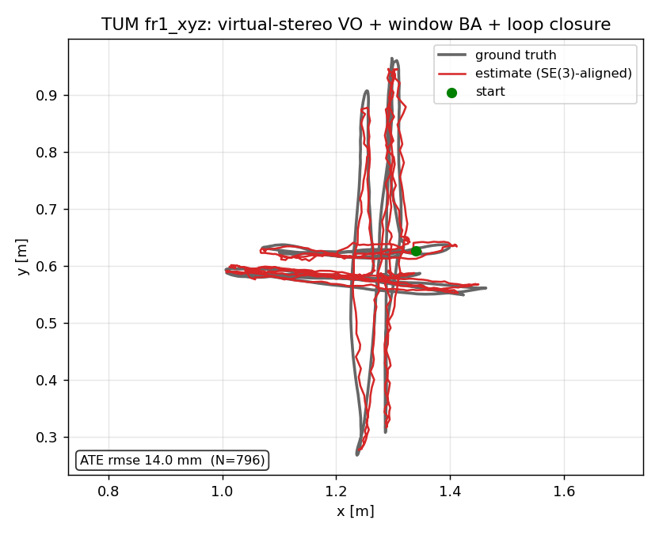
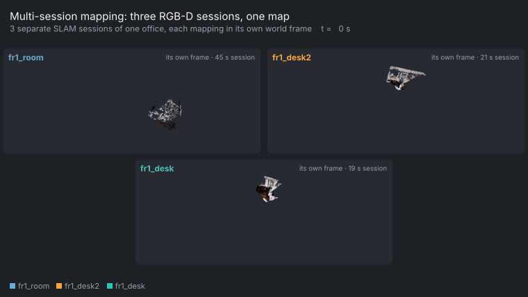

# TUM RGB-D Benchmark (indoor, handheld)

The indoor handheld counterpart to the [KITTI](kitti_loop_closure_benchmark.md)
(ground vehicle) and [EuRoC](euroc_loop_closure_benchmark.md) (aerial)
loop-closure benchmarks. [TUM RGB-D](https://cvg.cit.tum.de/data/datasets/rgbd-dataset)
is the classic indoor SLAM benchmark — a hand-held Kinect through an office, with
motion-capture ground truth — on which ORB-SLAM2, ElasticFusion, and DVO-SLAM
publish ATE.

It also exercises a different sensor than the rest of the suite. TUM RGB-D has
**no stereo pair**: each frame is a single RGB image plus a registered depth map
(16-bit PNG, `depth_m = pixel / 5000`). Rather than add a separate RGB-D
frontend, the same metric stereo VO / online-BA / loop-closure backend
(`examples/stereo_vo_external_deep_files.rs`,
`pipelines/slam/src/vo_loop_closure.rs`) is driven by **virtual stereo**.

## Virtual stereo: depth as a synthetic right image

The stereo backend only ever uses the right image to triangulate metric 3D
points; everything downstream (PnP / Kabsch relative pose, online BA, loop
closure) runs on the resulting camera-frame points. So `depth` can stand in for
the right view directly. For each depth-valid SuperPoint keypoint
`(u, v)` with depth `d`, `scripts/export_tum_rgbd_virtual_stereo.py` emits a
synthetic right keypoint at the disparity it would have at a chosen virtual
baseline `b`, carrying the same descriptor:

```
disparity = b * fx / d            u_right = u - disparity,   v_right = v
```

and a 1:1 stereo match. The Rust triangulator inverts this exactly
(`d = b * fx / disparity`), so the recovered depth — and hence the **metric
scale** — is the true TUM depth, *independent of the (arbitrary) baseline*, as
long as the same `--baseline` is passed to the binary. Temporal (frame-to-frame)
matches come from LightGlue between consecutive left frames, exactly as in the
stereo path.

The payoff: the entire stereo VO / BA / loop stack runs on RGB-D **with zero Rust
changes** — the new sensor is handled entirely in the feature exporter. Metric
scale is recovered directly from depth, with no scale drift to absorb (the SE(3)
and Sim(3) ATE numbers below agree to ~1 mm).

## Results (Freiburg1, full sequences)

SuperPoint (2048 kpts) + LightGlue, virtual-stereo depth lift, Freiburg1
intrinsics (`fx 517.3 fy 516.5 cx 318.6 cy 255.3`), baseline 0.1 m. ATE rmse via
`evo_ape` under SE(3) (rigid, the metric-frame number) and Sim(3) (scale-absorbed)
alignment, associated against the motion-capture `groundtruth.txt` by timestamp.

The full pipeline visloc ships — incremental window BA (`--online-ba`) + metric
loop closure (`--loop-closure`) + two-view loop-edge BA (`--loop-two-view-ba`) —
is the `full_tv` row.

### fr1_xyz (798 frames, translation-dominant)

| trajectory                         | ATE rmse SE(3) | ATE rmse Sim(3) | loops |
| ---------------------------------- | -------------: | --------------: | ----: |
| open VO                            |       0.0313 m |        0.0280 m |     – |
| + loop closure                     |       0.0244 m |        0.0213 m |    63 |
| + loop closure + two-view BA       |       0.0207 m |        0.0165 m |    63 |
| window BA + loop                   |       0.0205 m |        0.0200 m |    89 |
| **window BA + loop + two-view BA** |   **0.0140 m** |    **0.0129 m** |    89 |



### fr1_desk (596 frames, rotation-heavy)

| trajectory                         | ATE rmse SE(3) | ATE rmse Sim(3) | loops |
| ---------------------------------- | -------------: | --------------: | ----: |
| open VO                            |       0.1596 m |        0.1573 m |     – |
| window BA + loop                   |       0.0363 m |        0.0264 m |    52 |
| **window BA + loop + two-view BA** |   **0.0262 m** |    **0.0215 m** |    52 |

## Where a vision-only RGB-D stack stands

The best config lands at **14.0 mm (fr1_xyz)** and **26.2 mm (fr1_desk)** ATE
rmse, **~1.3–1.6× ORB-SLAM2 RGB-D** (which publishes ≈ 0.009–0.011 m on fr1_xyz
and ≈ 0.016 m on fr1_desk) — competitive for a vision-only stack that treats
depth purely as a virtual right image and reuses an outdoor-stereo-tuned VO
backend unchanged.

Two levers carry the indoor result, the same ones the
[EuRoC benchmark](euroc_loop_closure_benchmark.md) identified:

- **Loop closure is the dominant lever**, far more so than on the largely
  monotonic aerial flights. The desk scene revisits the same workspace
  repeatedly, so the open VO's accumulated drift (159.6 mm) collapses to 36.3 mm
  once 52 revisits are tied back — a **6× reduction** from loop closure alone.
- **Two-view loop BA** (`--loop-two-view-ba`) sharpens it further on both
  sequences (fr1_xyz 20.5 → 14.0 mm, fr1_desk 36.3 → 26.2 mm). Each verified
  loop edge is re-ground as a minimal two-view bundle adjustment before it enters
  the pose graph, removing the depth-anchoring bias PnP leaves in the raw edge —
  the same ~30% lever measured on EuRoC.

A note on window BA in isolation: on `fr1_xyz`, `--online-ba` *without* loop
closure slightly worsens the open VO (31.3 → 50.8 mm) because the temporal
sliding window, tuned for fast KITTI/EuRoC motion, over-constrains the slow
hand-held trajectory. Its value here is indirect: the locally-tighter map detects
more revisits (89 vs 63 loops), and once those loops plus two-view BA are applied
the combination is the best of all (14.0 mm). The frontend stage and the loop
stage are complementary, not independently additive.

## Several sessions in one map


<sub>Data: [TUM RGB-D](https://cvg.cit.tum.de/data/datasets/rgbd-dataset) fr3_long_office_household (Sturm et al., IROS 2012), CC BY 4.0. Colours are the RGB images placed by their depth.</sub>

fr3_long_office_household circles two desks in 87 s. Cut into four
sessions of about 22 s, each sees one side of the desks: a session's map
covers a quarter of the office, and only the merge makes the whole. No
image is shared between sessions; neighbouring parts see some of the same
places, opposite ones (1 and 3, 2 and 4) none. Each part is mapped on its
own, in its own frame, and `basalt_map_merge` merges the maps, as it merges
the stereo-inertial SLAM's maps of EuRoC and OpenLORIS-Scene
([basalt_map_localization.md](basalt_map_localization.md#merging-maps-of-several-flights)).
The parts come from one recording, not separate visits.

1. **Trajectory.** The virtual-stereo VO above (`full_tv`, 1,024 SuperPoint
   keypoints on the CPU, every 2nd frame) on each part alone: ATE 1.9, 3.3,
   1.5 and 1.5 cm for parts 1 to 4. Its frame is the part's first camera.
2. **Map.** `examples/tum_rgbd_save_map.rs` turns the RGB images and depth
   into a map in the layout `basalt_euroc_online_slam_demo --save-map`
   writes: keyframes every 5 cm or 5°, the Basalt mapper's ORB on each
   (Shi-Tomasi corners, 256-bit descriptors), and a landmark at each
   corner's depth, tracked over the last 10 keyframes by projection and
   descriptor. Landmarks seen once are dropped.
3. **Level.** The merge registers maps by a yaw and a translation, so each
   map's world must have z up. Freiburg 3 records no accelerometer, so each
   map is levelled by its largest horizontal plane (the floor or a desk
   top; a RANSAC over the landmarks). The four parts come out 1.7–1.8° from
   the ground truth's vertical. (On Freiburg 1 the Kinect's accelerometer
   is used instead: averaged in the world over the sequence, 1.8° off on
   fr1_room, where the plane gives 1.4°.)
4. **Merge.** `basalt_map_merge`, adding each part next to one already in
   the map: part 1, then 4, 3 and 2. The colour clouds of the GIF come from
   `scripts/rgbd_map_cloud.py --tum`.

| Added map (in order) | Its frame vs part 1's | Keyframes localized | Residual |
|---|---|---|---|
| part 4 (65–87 s) | −3.0°, 141 cm | 45 of 82 | 3.1 cm |
| part 3 (43–65 s) | 127.6°, 440 cm | 5 of 112 (4 agree) | 0.6 cm |
| part 2 (22–43 s) | −171.4°, 426 cm | 3 of 99 | 0.3 cm |

Parts 1 and 3, and 2 and 4, do not register with each other in either
direction: they share no view. Of the 24 orders, 8 register all four parts.

The merged map holds 415 keyframe images and 31,328 landmarks. Aligned to
the ground truth by part 1's keyframes alone, the keyframe centres are at
13.1 cm RMSE (34.7 cm max): part 1 1.9, part 4 3.1, part 3 11.3 and part 2
23.7 cm, against 1.9, 1.4, 1.5 and 3.3 cm for each part aligned on its own.
The error grows along the chain. Each registration is rigid, from a few
keyframes, and every map's level is off by about 1.7° in its own
direction, which a yaw and a translation cannot absorb: 2° over the 4 m
between part 1 and part 2 is 14 cm.

### Three separate recordings: fr1_room, fr1_desk2, fr1_desk



<sub>Data: TUM RGB-D fr1_room, fr1_desk2 and fr1_desk, CC BY 4.0.</sub>

Three separate recordings of one office merge the same way (Freiburg 1,
levelled by the accelerometer; VO ATE 5.33, 4.67 and 2.27 cm). fr1_room
alone covers what the other two see, so the merge adds little to the map:

| Added map (in order) | Its frame vs fr1_room's | Keyframes localized | Residual |
|---|---|---|---|
| fr1_desk2 | 71.6°, 248 cm | 20 of 209 | 8.6 cm |
| fr1_desk | 72.1°, 227 cm | 17 of 171 | 4.0 cm |

The merged map holds 751 keyframe images and 53,063 landmarks, at 7.4 cm
RMSE against the ground truth by fr1_room's alignment alone (fr1_room 5.4,
fr1_desk2 10.2, fr1_desk 7.0 cm; 5.4, 4.6 and 2.4 cm aligned on their own).
fr1_360 (turning in place, VO ATE 9.95 cm) and fr1_plant register in none
of the other maps, in any order.

```bash
D=/path/to/tum   # rgbd_dataset_freiburg1_{room,desk2,desk}
for s in room desk2 desk; do
  TUM_MAX_KEYPOINTS=1024 scripts/run_tum_rgbd_benchmark.sh \
    --seq-dir $D/rgbd_dataset_freiburg1_$s --out-dir runs/tum_$s --device cpu
  target/release/examples/tum_rgbd_save_map --seq-dir $D/rgbd_dataset_freiburg1_$s \
    --trajectory runs/tum_$s/full_tv/est.tum --out runs/fr1_${s}_map \
    --keyframe-m 0.05 --keyframe-deg 5 --match-radius-px 8 --track-keyframes 10
  python3 scripts/rgbd_map_cloud.py --map runs/fr1_${s}_map \
    --tum $D/rgbd_dataset_freiburg1_$s --out runs/fr1_${s}_cloud.npz --every 3 --max-depth 3
done
target/release/examples/basalt_map_merge --base runs/fr1_room_map \
  --add runs/fr1_desk2_map --add runs/fr1_desk_map --out runs/fr1_merged
python3 scripts/render_map_merge_gif.py --merged runs/fr1_merged \
  $(for s in room desk2 desk; do echo --map runs/fr1_${s}_map --cloud runs/fr1_${s}_cloud.npz \
    --label fr1_$s; done) \
  --max-points 60000 --point-size 2 --unit session --place office --fill 0.6 \
  --title "Multi-session mapping: three RGB-D sessions, one map" \
  --out docs/assets/map_merge_tum_rgbd_fr1.gif
```

```bash
F=/path/to/rgbd_dataset_freiburg3_long_office_household
C="--fx 535.4 --fy 539.2 --cx 320.1 --cy 247.6"
# part:start frame (every 2nd frame from there, 323 of them)
for p in 1:0 2:646 3:1292 4:1938; do n=${p%%:*}; start=${p##*:}
  python3 scripts/export_tum_rgbd_virtual_stereo.py --seq-dir $F --out-dir runs/lo$n/feat \
    --device cpu --max-keypoints 1024 --baseline 0.1 $C --min-depth 0.3 \
    --start-frame $start --frames 323 --frame-stride 2
  frames=$(ls runs/lo$n/feat/frame_*_left_features.txt | wc -l)
  target/release/examples/stereo_vo_external_deep_files --features-dir runs/lo$n/feat \
    --frames $frames --out-dir runs/lo$n/vo $C --width 640 --height 480 --baseline 0.1 \
    --min-depth 0.3 --relative-pose-mode pnp --online-ba --online-ba-window 30 \
    --online-ba-trigger-every 10 --loop-closure --loop-min-frame-gap 50 \
    --loop-min-path-length 2 --loop-min-similarity 0.2 --loop-two-view-ba
  python3 scripts/kitti_poses_to_tum.py runs/lo$n/vo/vo_poses.txt \
    runs/lo$n/feat/frame_timestamps.txt runs/lo$n/est.tum
  target/release/examples/tum_rgbd_save_map --seq-dir $F --trajectory runs/lo$n/est.tum \
    --out runs/lo${n}_map --keyframe-m 0.05 --keyframe-deg 5 --match-radius-px 8 \
    --track-keyframes 10 $C --k1 0 --k2 0 --p1 0 --p2 0 --k3 0
  python3 scripts/rgbd_map_cloud.py --map runs/lo${n}_map --tum $F \
    --tum-camera 535.4 539.2 320.1 247.6 0 0 0 0 0 --out runs/lo${n}_cloud.npz \
    --every 2 --max-depth 3
done
target/release/examples/basalt_map_merge --base runs/lo1_map --add runs/lo4_map \
  --add runs/lo3_map --add runs/lo2_map --out runs/lo_merged
python3 scripts/render_map_merge_gif.py --merged runs/lo_merged \
  --map runs/lo1_map --cloud runs/lo1_cloud.npz --label "part 1" --note "0–22 s of the recording" \
  --map runs/lo4_map --cloud runs/lo4_cloud.npz --label "part 4" --note "65–87 s" \
  --map runs/lo3_map --cloud runs/lo3_cloud.npz --label "part 3" --note "43–65 s" \
  --map runs/lo2_map --cloud runs/lo2_cloud.npz --label "part 2" --note "22–43 s" \
  --max-points 60000 --point-size 2 --unit session --place office --fill 0.6 \
  --title "Multi-session mapping: four sessions around one office, one map" \
  --out docs/assets/map_merge_tum_rgbd_fr3_parts.gif
```

## Reproduce

Download a sequence (e.g. `rgbd_dataset_freiburg1_xyz`) from the
[TUM RGB-D page](https://cvg.cit.tum.de/data/datasets/rgbd-dataset/download),
then:

```bash
scripts/run_tum_rgbd_benchmark.sh --seq-dir /path/to/rgbd_dataset_freiburg1_xyz
```

This exports virtual-stereo SuperPoint/LightGlue features
(`scripts/export_tum_rgbd_virtual_stereo.py`, requires `torch` + `lightglue` +
`pillow`), runs the three conditions above, converts each VO trajectory to TUM
(`scripts/kitti_poses_to_tum.py`), and scores with `evo_ape`
(`pip install evo`). For Freiburg2/3 pass the matching intrinsics with
`--fx/--fy/--cx/--cy`. The trajectory figure is regenerated with:

```bash
scripts/plot_tum_trajectory.py \
  --gt rgbd_dataset_freiburg1_xyz/groundtruth.txt \
  --est target/tum_rgbd_benchmark/full_tv/est.tum \
  --out docs/assets/tum_fr1_xyz_loop_closure.png \
  --title "TUM fr1_xyz: virtual-stereo VO + window BA + loop closure"
```
